# Mock Paper 1 · Predicted Paper

**B.Tech (Seventh Semester) Examination 2026-27 · CS-403T · Digital Image Processing**<br>
**Time: Three Hours · Maximum Marks: 70**<br>
**Note:** Attempt any **five** questions. All questions carry equal marks (14 each).

This paper is built from the topics that have repeated most in MJPRU papers (see [PYQ analysis](#analysis)). Write it in 3 hours first, then read the answers. Each 7-mark answer below is written at the MJPRU length: in handwriting each one fills about 2–2½ pages, so a full question fills 4–5 pages. Copy the diagrams as boxes and arrows.

## Question paper

| Q | (a) 7 marks | (b) 7 marks |
|---|---|---|
| 1 | Draw and explain the fundamental steps in digital image processing. | What is image sampling and quantization? Explain their effect on image quality. |
| 2 | What is a histogram? Explain histogram equalization and how it is useful in image enhancement. | Perform histogram equalization on a 3-bit 8×8 image with n<sub>k</sub> = 6, 14, 20, 8, 4, 4, 4, 4 for r<sub>k</sub> = 0…7. |
| 3 | Explain piecewise linear transformation functions: contrast stretching, intensity-level slicing and bit-plane slicing. | Explain smoothing spatial filters. Apply 3×3 mean, median, max and min filters to the centre pixel of the 5×5 image given below. |
| 4 | Explain filtering in the frequency domain. Differentiate between ideal, Butterworth and Gaussian low-pass filters. | Explain homomorphic filtering with a neat diagram. |
| 5 | What is image restoration? Explain the model of the image degradation/restoration process. | Explain different noise models with their probability density functions. |
| 6 | Explain the RGB and HSI colour models. Give the formulas for converting RGB to HSI. | What is colour image smoothing? Explain how smoothing is done by neighbourhood averaging. |
| 7 | Define dilation and erosion. Explain opening and closing with their properties. | Explain boundary extraction and the hit-or-miss transform. |
| 8 | How are points, lines and edges detected in an image? Give the masks. | Explain global thresholding. For the image 12 15 40 / 10 45 50 / 14 42 11, find the two groups and the final threshold. |

Image for Q3(b): rows 2 5 6 1 3 / 4 **8 3 7** 0 / 1 **9 4 2** 6 / 5 **0 7 8** 1 / 3 6 2 4 5 (centre pixel = 4).

---

## Q1 (a) Fundamental steps in digital image processing

::: ans Answer

**Introduction.** Digital image processing (DIP) is the processing of digital images by a digital computer. A digital image is a two-dimensional function f(x, y) in which the coordinates x, y and the amplitude f are finite and discrete quantities. Each element is called a pixel. DIP is not a single operation; it is a sequence of steps that starts from capturing an image and ends with understanding what it contains. These steps are called the fundamental steps of DIP.

**Definition.** <u>The fundamental steps of DIP are the set of processing stages, from image acquisition to object recognition, through which an image is converted from raw sensor data into useful information, all guided by a knowledge base about the problem domain.</u>

**Diagram.**

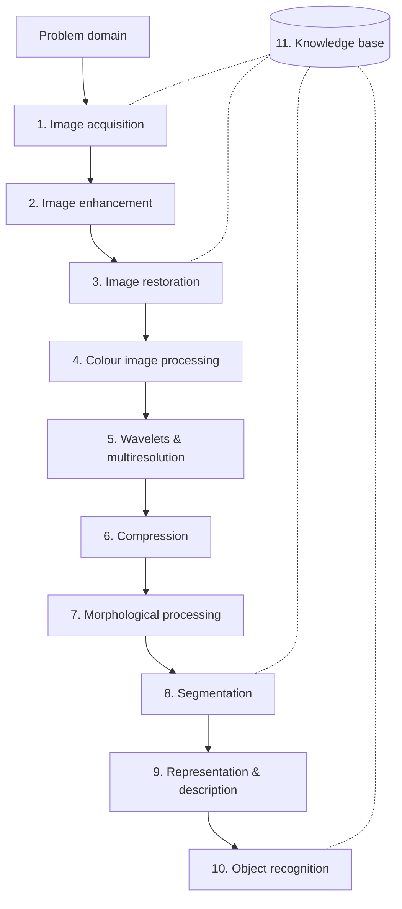
*Fig. 1: Fundamental steps in digital image processing. Outputs of steps 1–6 are images; outputs of steps 7–10 are image attributes.*

**Explanation of each step.**

1. **Image acquisition.** The first step. An image is captured by a sensor (camera, scanner, X-ray detector) and converted into digital form by a digitiser (sampling and quantization). It may include pre-processing such as scaling. Example: a CCD camera in a mobile phone.

2. **Image enhancement.** The process of manipulating an image so that the result is more suitable than the original for a specific application. It is **subjective**: what is "better" depends on the viewer. Examples: contrast stretching, histogram equalization, sharpening. It is the most appealing area of DIP.

3. **Image restoration.** Also improves the appearance of an image, but it is **objective**: it uses mathematical or probabilistic models of how the image was degraded (blur, noise) and tries to undo that degradation. Example: removing motion blur with a Wiener filter.

4. **Colour image processing.** Deals with colour models (RGB, CMY, HSI), colour transformations and processing of colour images. It has grown because of the use of digital images on the internet. Colour is also used as a feature for extracting regions.

5. **Wavelets and multiresolution processing.** Wavelets represent an image at various degrees of resolution. They are the foundation for image data compression and pyramidal representation, where images are subdivided into smaller regions.

6. **Compression.** Techniques for reducing the storage required to save an image or the bandwidth needed to transmit it. Example: JPEG (Joint Photographic Experts Group) standard. Important because images are large: a 1024×1024 colour image needs 3 MB.

7. **Morphological processing.** Tools for extracting image components that are useful in representing and describing shape, such as dilation, erosion, opening, closing and thinning. From this step onwards, outputs are attributes of the image rather than images.

8. **Segmentation.** Partitions an image into its constituent parts or objects (for example, separating characters from the background in a scanned page). It is one of the most difficult tasks: rugged segmentation brings the process close to a successful solution, while weak segmentation almost guarantees failure.

9. **Representation and description.** Follows segmentation. **Representation** decides whether the data should be represented as a boundary (for shape) or as a complete region (for texture, skeleton). **Description** (feature selection) extracts attributes that give quantitative information, such as area, perimeter or chain code.

10. **Object recognition.** The process of assigning a label (for example "vehicle", "character A") to an object based on its descriptors, using methods such as minimum-distance classifiers, neural networks or syntactic methods.

11. **Knowledge base.** Prior knowledge about the problem domain is coded into a knowledge base. It may be simple (where in the image the information of interest is located) or complex (a database of defects in materials inspection). It guides the operation of every module and controls the interaction between them, which is why it is drawn connected to all the steps.

**Example (number-plate recognition).** Acquisition (camera at a toll gate) → enhancement (contrast adjustment at night) → restoration (remove motion blur) → segmentation (isolate the plate and then each character) → representation and description (features of each character) → recognition (read "UP 25 AB 1234") with a knowledge base of plate formats.

**Points to remember.**
- Not every application needs all the steps. A simple photo editor uses only acquisition and enhancement.
- Steps 1–6 take an image in and give an image out; steps 7–10 take an image in and give attributes out.

**Conclusion.** The fundamental steps form a chain from raw data to understanding. Each step builds on the previous one, and the knowledge base ties them together, so the quality of the early steps (acquisition, enhancement, segmentation) decides the success of the final recognition.
:::

## Q1 (b) Sampling and quantization

::: ans Answer

**Introduction.** The output of most image sensors is a continuous voltage waveform whose amplitude and spatial behaviour are related to the scene. To process it in a computer, this continuous image must be converted into digital form. The conversion involves two processes: **sampling** and **quantization**.

**Definition.**
- <u>**Sampling** is the process of digitising the coordinate values (x, y) of a continuous image, i.e. selecting a finite number of points (pixels) from it.</u>
- <u>**Quantization** is the process of digitising the amplitude (intensity) values, i.e. mapping the continuous intensity at each sample to one of a finite number of discrete grey levels.</u>

**Diagram.**

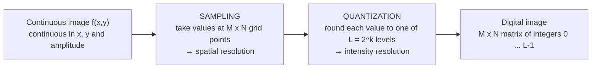
*Fig. 2: Converting a continuous image into a digital image.*

(In the exam also draw a scan line A–B across the image, the continuous intensity profile along it, the equally spaced sample points marked on the profile, and the grey-level scale on the right with the samples rounded to the nearest level.)

**Explanation.**

1. **Process along one scan line.** Take a line AB across a continuous image. Its intensity profile is a continuous curve. **Sampling:** take equally spaced samples along AB (marked as small squares). The samples still have continuous amplitudes. **Quantization:** divide the intensity range into, say, 8 discrete levels and assign each sample the nearest level. Doing this line by line for the whole image gives a 2-D digital image.

2. **Representation.** The result is a matrix of M rows and N columns:
   f(x,y) = [ f(0,0) f(0,1) … f(0,N−1); f(1,0) … ; f(M−1,0) … f(M−1,N−1) ]
   Each element is a pixel. The number of grey levels is L = 2<sup>k</sup>, and the levels are integers in [0, L−1].

3. **Storage.** The number of bits needed is **b = M × N × k**. Example: a 1024 × 1024 image with 256 levels (k = 8) needs 1024 × 1024 × 8 = 8,388,608 bits = 1 MB.

4. **Spatial resolution (effect of sampling).** It is the smallest discernible detail, measured in dots (pixels) per unit distance (dpi). Reducing the number of samples (e.g. 1024×1024 → 256×256 → 32×32) while keeping the display size the same produces a **checkerboard (pixelation) effect**: the image looks blocky and fine detail is lost. Sampling below the Nyquist rate causes **aliasing** (moiré patterns, jagged edges).

5. **Intensity resolution (effect of quantization).** It is the smallest discernible change in intensity. Reducing the number of grey levels (256 → 16 → 8 → 2) produces **false contouring**: smooth areas show ridge-like bands, because there are not enough levels to represent gradual shading. With 2 levels the image becomes binary.

6. **Choice of M, N and k.** Huang's **isopreference curves** show that images with a lot of detail (a crowd) need fewer grey levels, while images with large smooth areas (a face) need more levels to avoid false contouring. Quality depends on both together.

7. **Sampling theorem.** For a band-limited image with highest frequencies u<sub>max</sub> and v<sub>max</sub>, the image can be perfectly reconstructed if the sampling intervals satisfy Δx ≤ 1/(2u<sub>max</sub>) and Δy ≤ 1/(2v<sub>max</sub>).

**Comparison.**

| Sampling | Quantization |
|---|---|
| digitises coordinates | digitises amplitude |
| decides spatial resolution (M × N) | decides grey-level resolution (L) |
| too little → pixelation, aliasing | too little → false contouring |
| done along x and y | done on intensity values |

**Conclusion.** Sampling and quantization together convert a continuous scene into a digital image. More samples and more levels give better quality but need more storage, so they are chosen as a trade-off between quality and memory for each application (e.g. medical images use 12–16 bits; web images use 8 bits).
:::

---

## Q2 (a) Histogram and histogram equalization

::: ans Answer

**Introduction.** Image enhancement in the spatial domain works directly on pixel values. One of the simplest and most effective tools is the **histogram**, which summarises the distribution of grey levels in an image. Many enhancement techniques, the most famous being histogram equalization, are based on modifying the histogram.

**Definition of histogram.** <u>The histogram of a digital image with grey levels in [0, L−1] is the discrete function h(r<sub>k</sub>) = n<sub>k</sub>, where r<sub>k</sub> is the k-th grey level and n<sub>k</sub> is the number of pixels with that grey level.</u> The **normalised histogram** is p(r<sub>k</sub>) = n<sub>k</sub>/MN, which is an estimate of the probability of occurrence of level r<sub>k</sub>; the sum of all p(r<sub>k</sub>) is 1.

**Histogram shapes (diagram).**


*Fig. 3: Four basic image types and their histograms (draw four small bar graphs in the exam).*

**Definition of histogram equalization.** <u>Histogram equalization is a technique that transforms the grey levels of an image so that the output histogram is approximately uniform (flat), thereby spreading the grey levels over the whole available range and increasing contrast.</u>

**Derivation (continuous case).**
1. Let r be the input grey level (normalised to [0, L−1]) with PDF p<sub>r</sub>(r), and s = T(r) the output level.
2. T must satisfy: (a) T(r) is **monotonically increasing** in 0 ≤ r ≤ L−1 (the order from black to white is kept, and the inverse exists); (b) 0 ≤ T(r) ≤ L−1 (output stays in range).
3. From probability theory, p<sub>s</sub>(s) = p<sub>r</sub>(r) |dr/ds|.
4. Choose **s = T(r) = (L−1) ∫<sub>0</sub><sup>r</sup> p<sub>r</sub>(w) dw** (the cumulative distribution function scaled by L−1).
5. Then ds/dr = (L−1) p<sub>r</sub>(r), so p<sub>s</sub>(s) = p<sub>r</sub>(r) · 1/[(L−1)p<sub>r</sub>(r)] = **1/(L−1)**, a uniform PDF.

**Discrete form (used in numericals).**

**s<sub>k</sub> = T(r<sub>k</sub>) = (L−1) Σ<sub>j=0</sub><sup>k</sup> p<sub>r</sub>(r<sub>j</sub>) = ((L−1)/MN) Σ<sub>j=0</sub><sup>k</sup> n<sub>j</sub>,   k = 0, 1, …, L−1**

**Procedure (algorithm).**
1. Count n<sub>k</sub> for each grey level.
2. Compute p<sub>r</sub>(r<sub>k</sub>) = n<sub>k</sub>/MN.
3. Compute the cumulative sum (CDF) of p<sub>r</sub>.
4. Multiply by (L−1) to get s<sub>k</sub>.
5. Round s<sub>k</sub> to the nearest integer.
6. Map every pixel of level r<sub>k</sub> to s<sub>k</sub>; add the counts of levels that map to the same value to get the new histogram.

**How it is useful in image enhancement.**
1. **Automatic:** it needs no parameters, only the histogram of the image itself. The same procedure works for dark, bright and low-contrast images.
2. **Increases global contrast:** grey levels that were crowded into a narrow range are spread over the full range, so details hidden in dark or washed-out images become visible.
3. **Standardisation:** images taken under different lighting look similar after equalization, which helps comparison and further processing (e.g. face recognition, medical X-rays).
4. **Pre-processing step** for segmentation and feature extraction.
5. Used in medical imaging (chest X-rays), satellite and aerial images, and underwater photographs.

**Limitations.** The discrete histogram is only approximately flat; noise in flat areas may be amplified; it can over-enhance and give an unnatural look; when a specific shape of histogram is wanted, **histogram specification** is used instead.

**Conclusion.** The histogram describes the grey-level distribution, and histogram equalization uses its cumulative distribution as a transformation function to produce a high-contrast image automatically, which makes it one of the most widely used enhancement techniques.
:::

## Q2 (b) Histogram equalization numerical

::: ans Answer

**Given:** 3-bit image, so L = 8 and L−1 = 7. Size 8 × 8, so MN = 64. Check: 6 + 14 + 20 + 8 + 4 + 4 + 4 + 4 = 64. ✓

**Formula:** s<sub>k</sub> = (L−1) Σ<sub>j=0</sub><sup>k</sup> n<sub>j</sub>/MN = 7 × CDF(r<sub>k</sub>)

| r<sub>k</sub> | n<sub>k</sub> | p<sub>r</sub> = n<sub>k</sub>/64 | Cumulative n | CDF | 7 × CDF | s<sub>k</sub> (rounded) |
|---|---|---|---|---|---|---|
| 0 | 6 | 0.094 | 6 | 0.094 | 0.66 | 1 |
| 1 | 14 | 0.219 | 20 | 0.313 | 2.19 | 2 |
| 2 | 20 | 0.313 | 40 | 0.625 | 4.38 | 4 |
| 3 | 8 | 0.125 | 48 | 0.750 | 5.25 | 5 |
| 4 | 4 | 0.063 | 52 | 0.813 | 5.69 | 6 |
| 5 | 4 | 0.063 | 56 | 0.875 | 6.13 | 6 |
| 6 | 4 | 0.063 | 60 | 0.938 | 6.56 | 7 |
| 7 | 4 | 0.063 | 64 | 1.000 | 7.00 | 7 |

**Mapping:** 0→1, 1→2, 2→4, 3→5, 4→6, 5→6, 6→7, 7→7.

**New histogram** (add counts that map to the same level):

| s | 0 | 1 | 2 | 3 | 4 | 5 | 6 | 7 | Total |
|---|---|---|---|---|---|---|---|---|---|
| Pixels | 0 | 6 | 14 | 0 | 20 | 8 | 4 + 4 = 8 | 4 + 4 = 8 | 64 |

**Before and after histograms (draw as bar graphs).**

```
Original:  r: 0  1  2  3  4  5  6  7          Equalized:  s: 0  1  2  3  4  5  6  7
          n:  6 14 20  8  4  4  4  4                      n:  0  6 14  0 20  8  8  8
          (peak at 1-2, crowded at dark end)              (spread from 1 to 7)
```

**Observation.** In the original image 75% of the pixels were in levels 0–3 (dark, low contrast). After equalization the occupied levels spread from 1 to 7, the gaps between used levels widen (level 2 moved to 4), and the bright end is used much more, so the contrast is increased. The histogram is not perfectly flat because pixels with the same level cannot be split.
:::

---

## Q3 (a) Piecewise linear transformation functions

::: ans Answer

**Introduction.** Grey-level transformations s = T(r) map each input level r to an output level s. Basic transformations (negative, log, power-law) have a fixed form. **Piecewise linear functions** are made of several straight-line segments joined together. Their main **advantage** is that they can be made arbitrarily complex to suit an application; their **disadvantage** is that they need more input from the user. The three main types are contrast stretching, intensity-level slicing and bit-plane slicing.

**Definition.** <u>A piecewise linear transformation is a grey-level mapping s = T(r) made of two or more linear segments, each acting on a different range of input levels.</u>

### (i) Contrast stretching

Low-contrast images arise from poor illumination, a small dynamic range of the sensor, or a wrong lens aperture. **Contrast stretching expands the range of grey levels in an image so that it spans the full intensity range of the display.**


*Fig. 4: Form of the contrast-stretching function, controlled by points (r1, s1) and (r2, s2). Draw it on r–s axes from 0 to L−1.*

- The positions of (r<sub>1</sub>, s<sub>1</sub>) and (r<sub>2</sub>, s<sub>2</sub>) control the shape.
- If r<sub>1</sub> = s<sub>1</sub> and r<sub>2</sub> = s<sub>2</sub>: a straight line, **no change**.
- If r<sub>1</sub> = r<sub>2</sub>, s<sub>1</sub> = 0 and s<sub>2</sub> = L−1: a **thresholding function**, giving a binary image.
- Intermediate values give various degrees of spread. r<sub>1</sub> ≤ r<sub>2</sub> and s<sub>1</sub> ≤ s<sub>2</sub> keeps the function single-valued and increasing.
- Usual setting: (r<sub>1</sub>, s<sub>1</sub>) = (r<sub>min</sub>, 0) and (r<sub>2</sub>, s<sub>2</sub>) = (r<sub>max</sub>, L−1), giving **s = (r − r<sub>min</sub>)(L−1)/(r<sub>max</sub> − r<sub>min</sub>)**.
- **Example:** an 8-bit image uses only 60–120. Then s = (r − 60) × 255/60: 60 → 0, 90 → 127.5 ≈ 128, 120 → 255. The image now uses the full range.

### (ii) Intensity-level (grey-level) slicing

Highlights a specific range [A, B] of intensities. Used to enhance features such as masses of water in satellite images or flaws in X-ray images.
- **Approach 1 (binary):** display a high value (e.g. white) for all levels in [A, B] and a low value (black) for all others: s = L−1 if A ≤ r ≤ B, else s = 0.
- **Approach 2 (background preserved):** brighten (or darken) the levels in [A, B] and **leave all other levels unchanged**: s = L−1 if A ≤ r ≤ B, else s = r.

```
s                          s
|      ____                |      ____
|     |    |               |     |    |  /
|     |    |               |    /|    | /
|_____|    |_____ r        |___/_|    |/____ r
      A    B                    A    B
 Approach 1 (binary)        Approach 2 (rest unchanged)
```

### (iii) Bit-plane slicing

Instead of highlighting grey ranges, we highlight the contribution of specific **bits**. An 8-bit image can be seen as **eight 1-bit planes**: plane 0 (least significant bit) to plane 7 (most significant bit).

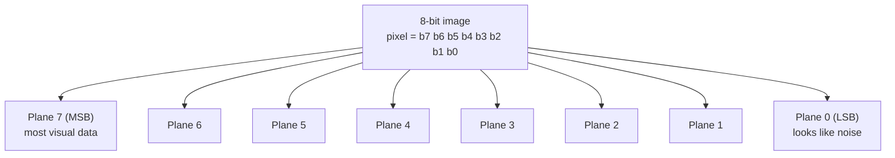

- The **higher-order planes** (especially 7, 6, 5, 4) contain the majority of the visually significant data. The lower-order planes contribute subtle detail and look like noise.
- Plane 7 is the same as thresholding the image at 128.
- **Example:** pixel value 194 = 11000010<sub>2</sub>: plane 7 = 1, plane 6 = 1, plane 1 = 1, all others 0.
- **Uses:** (1) analysing the relative importance of each bit, (2) deciding the number of bits needed to quantize an image, (3) **image compression** (an image reconstructed from planes 7–4 looks close to the original with half the data), (4) watermarking/steganography in the LSB plane.

**Conclusion.** Piecewise linear functions give fine control over enhancement: contrast stretching improves overall contrast, intensity slicing highlights a chosen range, and bit-plane slicing shows which bits carry the information.
:::

## Q3 (b) Smoothing spatial filters with numerical

::: ans Answer

**Introduction.** Spatial filtering moves a mask (kernel) over the image and computes a new value for each pixel from its neighbourhood. **Smoothing filters** are used for **blurring** (removing small details before extracting large objects, bridging small gaps) and for **noise reduction**.

**Definition.** <u>A smoothing spatial filter replaces the value of each pixel by a value computed from the pixels in its neighbourhood (the average or a ranked value), which reduces sharp transitions in intensity.</u>

**Diagram: the mechanism of spatial filtering.**


**Types.**

1. **Linear smoothing (averaging / mean / low-pass) filters.** Response = average of the pixels under the mask.
   - Box filter: (1/9) × [1 1 1; 1 1 1; 1 1 1].
   - Weighted average: (1/16) × [1 2 1; 2 4 2; 1 2 1] (centre is most important; less blurring).
   - General: g(x,y) = Σ w(s,t) f(x+s, y+t) / Σ w(s,t).
   - Effect: reduces random (Gaussian) noise and "irrelevant" detail, but **blurs edges**.

2. **Order-statistic (non-linear) filters.** Sort (rank) the pixels in the neighbourhood and pick one.
   - **Median filter:** middle value. Excellent for **impulse (salt-and-pepper) noise**, with much less blurring than a mean filter of the same size. It forces points with distinct values to be more like their neighbours.
   - **Max filter:** the largest value (100th percentile); finds the brightest points; removes **pepper** noise.
   - **Min filter:** the smallest value (0th percentile); finds the darkest points; removes **salt** noise.

**Numerical.** The centre pixel of the 5×5 image is f(2,2) = 4 (counting rows and columns from 0). Its 3×3 neighbourhood (rows 1–3, columns 1–3) is:

```
 8  3  7
 9 [4] 2
 0  7  8
```

- Values: 8, 3, 7, 9, 4, 2, 0, 7, 8
- **Sorted:** 0, 2, 3, 4, **7**, 7, 8, 8, 9 (9 values, so the 5th is the middle)
- Sum = 48

| Filter | Working | New value of centre pixel |
|---|---|---|
| Mean | 48 / 9 = 5.33 | **5** |
| Median | 5th sorted value | **7** |
| Max | largest value | **9** |
| Min | smallest value | **0** |

**Comparison of mean and median.**

| Mean filter | Median filter |
|---|---|
| linear | non-linear |
| blurs edges | preserves edges better |
| poor for salt-and-pepper (spreads the impulse) | best for salt-and-pepper |
| good for Gaussian noise | less effective for Gaussian noise |

**Conclusion.** Smoothing filters reduce noise; the mean filter is simple but blurs, while order-statistic filters (especially the median) remove impulse noise while keeping edges. In this example the centre value 4 becomes 5 (mean), 7 (median), 9 (max) and 0 (min).
:::

---

## Q4 (a) Filtering in the frequency domain; ILPF vs BLPF vs GLPF

::: ans Answer

**Introduction.** Any image can be expressed as a sum of sinusoids of different frequencies using the **2-D discrete Fourier transform (DFT)**. Low frequencies correspond to slowly changing intensity (smooth areas); high frequencies correspond to rapid changes (edges, noise). Filtering in the frequency domain modifies the Fourier transform of an image and then computes the inverse transform.

**DFT pair.**
F(u,v) = Σ<sub>x</sub> Σ<sub>y</sub> f(x,y) e<sup>−j2π(ux/M + vy/N)</sup>  and  f(x,y) = (1/MN) Σ<sub>u</sub> Σ<sub>v</sub> F(u,v) e<sup>j2π(ux/M + vy/N)</sup>

**Definition.** <u>Frequency-domain filtering is the process G(u,v) = H(u,v)·F(u,v), where F is the DFT of the input image and H is a filter transfer function; the filtered image is the inverse DFT of G.</u>

**Diagram.**

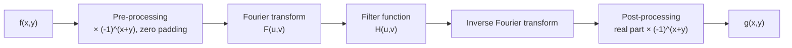
*Fig. 5: Basic steps for filtering in the frequency domain.*

**Steps.**
1. Multiply the input image by (−1)<sup>x+y</sup> to centre the transform (F(0,0) moves to (M/2, N/2)); pad to P = 2M, Q = 2N to avoid wraparound error.
2. Compute F(u,v), the DFT.
3. Multiply by a real, symmetric filter H(u,v) (zero-phase-shift filter).
4. Compute the inverse DFT.
5. Take the real part (imaginary part is only computational error).
6. Multiply by (−1)<sup>x+y</sup> and crop.

**Low-pass (smoothing) filters.** D(u,v) = distance from the centre; D<sub>0</sub> = cut-off frequency.

1. **Ideal LPF:** H(u,v) = 1 if D(u,v) ≤ D<sub>0</sub>; 0 if D(u,v) > D<sub>0</sub>. Passes all frequencies inside a circle of radius D<sub>0</sub> and cuts all others sharply. Cannot be built in hardware but can be simulated. Causes **ringing** (ripples) because its spatial equivalent is a sinc function.

2. **Butterworth LPF of order n:** H(u,v) = 1 / [1 + (D(u,v)/D<sub>0</sub>)<sup>2n</sup>]. No sharp discontinuity. At D = D<sub>0</sub>, H = 0.5. Order 1 has no ringing; order 2 has very little (a good compromise); high orders behave like the ideal filter and ring.

3. **Gaussian LPF:** H(u,v) = e<sup>−D²(u,v)/2D<sub>0</sub>²</sup>. At D = D<sub>0</sub>, H = 0.607. Its inverse Fourier transform is also Gaussian, so it **never rings**.

```
H(u,v)
 1 |‾‾‾‾‾‾|            1 |‾‾‾‾\              1 |‾‾‾\
   |      |              |     \               |    \
   |      |              |      \__            |     \___
 0 |______|______ D      0 |________\___ D    0 |_________\__ D
         D0                      D0                    D0
     Ideal                  Butterworth              Gaussian
```
*Fig. 6: Radial cross-sections of the three low-pass filters.*

**Differences.**

| Feature | Ideal LPF | Butterworth LPF | Gaussian LPF |
|---|---|---|---|
| Transfer function | 1 inside D<sub>0</sub>, 0 outside | 1/[1 + (D/D<sub>0</sub>)<sup>2n</sup>] | e<sup>−D²/2D<sub>0</sub>²</sup> |
| Transition | abrupt | smooth, controlled by n | smoothest |
| Value at D<sub>0</sub> | 1 → 0 jump | 0.5 | 0.607 |
| Ringing | severe | none for n = 1, slight for n = 2, more for large n | none |
| Parameters | D<sub>0</sub> | D<sub>0</sub>, n | D<sub>0</sub> (σ) |
| Spatial equivalent | sinc | depends on n | Gaussian |
| Practical use | theory only | general smoothing | when no artefacts are acceptable (medical) |

**Applications of LPF:** repairing broken characters in low-resolution text (OCR), "cosmetic" smoothing of faces in print, removing scan lines in satellite images.

**Conclusion.** Filtering in the frequency domain is a multiplication of the image spectrum by H(u,v). Among low-pass filters, the ideal filter rings, the Butterworth filter offers a controllable transition, and the Gaussian filter gives smooth results with no ringing.
:::

## Q4 (b) Homomorphic filtering

::: ans Answer

**Introduction.** Some images have both very dark and very bright regions because of non-uniform illumination (e.g. a room with a window, an X-ray with shadows). Simple contrast enhancement cannot fix both at once. **Homomorphic filtering** solves this using the **illumination–reflectance model** of image formation.

**Image model.** f(x,y) = i(x,y) · r(x,y), where i = illumination (slowly varying, so **low frequencies**) and r = reflectance (changes abruptly at object boundaries, so **high frequencies**).

**Definition.** <u>Homomorphic filtering is a frequency-domain technique that takes the logarithm of the image to separate illumination and reflectance, and then uses a filter that attenuates low frequencies and amplifies high frequencies, so that it simultaneously compresses the brightness range and enhances contrast.</u>

**Why the logarithm.** The Fourier transform of a product is not the product of the transforms: ℑ{f} ≠ ℑ{i}·ℑ{r}. But the log of a product is a sum, and the transform of a sum is a sum of transforms. So we work on ln f.

**Diagram.**

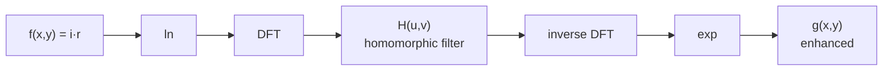
*Fig. 7: Steps of homomorphic filtering.*

**Steps.**
1. z(x,y) = ln f(x,y) = ln i(x,y) + ln r(x,y)
2. Z(u,v) = F<sub>i</sub>(u,v) + F<sub>r</sub>(u,v)
3. S(u,v) = H(u,v)F<sub>i</sub>(u,v) + H(u,v)F<sub>r</sub>(u,v)
4. s(x,y) = ℑ<sup>−1</sup>{S(u,v)} = i′(x,y) + r′(x,y)
5. g(x,y) = e<sup>s(x,y)</sup> = e<sup>i′</sup> · e<sup>r′</sup> = i<sub>0</sub>(x,y) · r<sub>0</sub>(x,y)

**The filter.** H(u,v) = (γ<sub>H</sub> − γ<sub>L</sub>) [1 − e<sup>−c·D²(u,v)/D<sub>0</sub>²</sup>] + γ<sub>L</sub>

```
H(u,v)
γH |            ________
   |          /
   |        /
γL |______/
   |_____________________ D(u,v)
```
*Fig. 8: Cross-section of the homomorphic filter (γL < 1, γH > 1).*

- **γ<sub>L</sub> < 1:** attenuates low frequencies (illumination), compressing the dynamic range.
- **γ<sub>H</sub> > 1:** amplifies high frequencies (reflectance), enhancing contrast and edges.
- **c:** controls the sharpness of the slope between γ<sub>L</sub> and γ<sub>H</sub>; D<sub>0</sub> is the cut-off.

**Effects on the image.**
1. Dark regions in shadow become visible (dynamic range compressed).
2. Bright, saturated regions are toned down.
3. Edges and fine detail become sharper (contrast enhanced).
4. Gives an image with more uniform illumination.

**Importance in medical imaging.**
- X-ray, endoscopy and microscopy images often have **uneven illumination** (bright centre, dark edges); homomorphic filtering makes the brightness uniform so that tissue detail in dark areas is visible.
- In PET and MRI it enhances fine structure while suppressing slowly varying intensity bias (bias-field correction).
- It is used as a pre-processing step before segmentation of organs, since uneven illumination makes thresholding fail.

**Conclusion.** Homomorphic filtering exploits the fact that illumination is low-frequency and reflectance is high-frequency. By working on the log of the image, it reduces illumination variation and increases reflectance contrast at the same time, which no single spatial operation can do.
:::

---

## Q5 (a) Image restoration and the degradation/restoration model

::: ans Answer

**Introduction.** Images are often degraded during acquisition and transmission: a lens may be out of focus, the camera or object may move, the atmosphere may cause turbulence, and sensors and channels add noise. **Image restoration** aims to recover the original image from the degraded one.

**Definition.** <u>Image restoration is the process of recovering an image that has been degraded, by using a priori knowledge of the degradation phenomenon; it models the degradation and applies the inverse process to estimate the original image.</u>

**Purpose of restoration.**
1. Remove or reduce **blur** (motion blur, out-of-focus blur, atmospheric turbulence).
2. Remove or reduce **noise** (sensor noise, transmission errors, periodic interference).
3. Obtain an image as close as possible to the original for accurate measurements (medicine, astronomy, forensics, satellite imaging).

**Restoration vs enhancement.**

| Image enhancement | Image restoration |
|---|---|
| subjective process | objective process |
| makes the image look better to a viewer | recovers the original image |
| no model of degradation needed | based on a model of degradation and noise |
| e.g. contrast stretching, histogram equalization | e.g. inverse filter, Wiener filter |

**Model of the degradation/restoration process (diagram).**

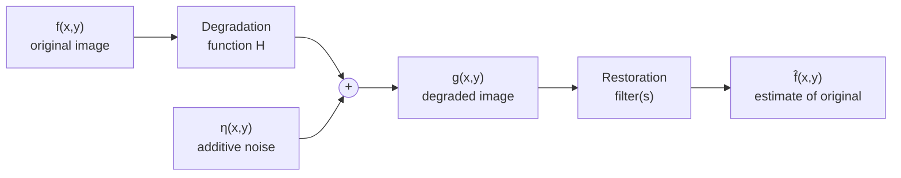
*Fig. 9: Model of the image degradation / restoration process. The left part (H and +) is DEGRADATION; the right part is RESTORATION.*

**Explanation.**

1. **Input f(x,y):** the original (ideal) image.
2. **Degradation function H:** operates on f. If H is a **linear, position-invariant** process, it is described by its **impulse response h(x,y)**, also called the **point spread function (PSF)**, and the degradation is a convolution.
3. **Additive noise η(x,y):** added to the blurred image.
4. **Degraded image:**
   - Spatial domain: **g(x,y) = h(x,y) ⋆ f(x,y) + η(x,y)**
   - Frequency domain: **G(u,v) = H(u,v) F(u,v) + N(u,v)**
   (⋆ is convolution; capital letters are Fourier transforms; convolution becomes multiplication by the convolution theorem.)
5. **Restoration:** given g, some knowledge of H and some knowledge of η, find an estimate **f̂(x,y)** that is as close as possible to f. The more we know about H and η, the closer f̂ is to f.
6. **Special case, noise only (H = 1):** g = f + η. Restoration uses spatial filters (mean, median, adaptive) or frequency filters for periodic noise.
7. **Estimating H:** (i) **by observation**: take a small sub-image with strong signal, construct an estimate of the unblurred version, and H<sub>s</sub> = G<sub>s</sub>/F̂<sub>s</sub>; (ii) **by experimentation**: with similar equipment, image a bright dot (impulse); the result is the PSF; (iii) **by modelling**: e.g. atmospheric turbulence H = e<sup>−k(u²+v²)<sup>5/6</sup></sup>, or uniform linear motion H = [T/π(ua+vb)] sin[π(ua+vb)] e<sup>−jπ(ua+vb)</sup>.

**Restoration filters (named).** Inverse filter F̂ = G/H; Wiener (minimum mean-square-error) filter; constrained least-squares filter; geometric mean filter.

**Conclusion.** The degradation model g = h ⋆ f + η expresses every degraded image as a blurred original plus noise. Restoration uses knowledge of h and η to build a filter that estimates f; this model is the foundation of all restoration techniques.
:::

## Q5 (b) Noise models

::: ans Answer

**Introduction.** The main sources of noise in digital images arise during **image acquisition** (sensor quality, light level, temperature) and **transmission** (interference in the channel, e.g. lightning in wireless transmission). To remove noise we need a model of its behaviour, which is described statistically by a **probability density function (PDF)** of the noise values.

**Definition.** <u>A noise model is a mathematical description, usually a probability density function, of the random intensity values that noise adds to an image.</u>

**Assumptions:** noise is independent of spatial coordinates and uncorrelated with the image (except periodic noise).

**Classification (diagram).**

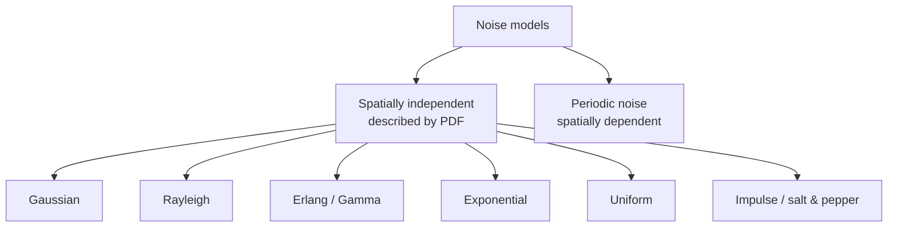

**1. Gaussian (normal) noise.**
p(z) = (1/(√(2π) σ)) e<sup>−(z − z̄)²/2σ²</sup>
- z = grey level, z̄ = mean, σ = standard deviation. About 70% of the values lie in [z̄ − σ, z̄ + σ] and 95% in [z̄ − 2σ, z̄ + 2σ].
- Source: electronic circuit noise, sensor noise due to poor illumination or high temperature. Mathematically tractable, so widely used.
- Shape: bell curve.

**2. Rayleigh noise.**
p(z) = (2/b)(z − a) e<sup>−(z−a)²/b</sup> for z ≥ a; 0 for z < a.
Mean z̄ = a + √(πb/4); variance σ² = b(4 − π)/4.
- Shape: displaced from the origin and skewed to the right. Used to approximate skewed histograms; occurs in **range imaging**.

**3. Erlang (gamma) noise.**
p(z) = a<sup>b</sup> z<sup>b−1</sup> e<sup>−az</sup> / (b − 1)! for z ≥ 0 (a > 0, b a positive integer).
Mean z̄ = b/a; variance σ² = b/a².
- Occurs in **laser imaging**.

**4. Exponential noise.**
p(z) = a e<sup>−az</sup> for z ≥ 0.
Mean z̄ = 1/a; variance σ² = 1/a². A special case of Erlang with b = 1. Laser imaging.

**5. Uniform noise.**
p(z) = 1/(b − a) for a ≤ z ≤ b; 0 otherwise.
Mean z̄ = (a + b)/2; variance σ² = (b − a)²/12.
- Rarely in practice, but the basis of random number generators used in simulation.

**6. Impulse (salt-and-pepper) noise.**
p(z) = P<sub>a</sub> for z = a; P<sub>b</sub> for z = b; 0 otherwise.
- If b > a, level b appears as **white dots (salt)** and a as **black dots (pepper)**. If only one of P<sub>a</sub>, P<sub>b</sub> is non-zero it is unipolar.
- Source: faulty switching, quick transients, dead sensor pixels, bit errors in transmission.

**7. Periodic noise.**
- Arises from **electrical or electromechanical interference** during acquisition; spatially dependent.
- In the frequency domain it appears as **pairs of bright spikes (impulses)**, so it is reduced by band-reject or notch filters.

**PDF sketches (draw in the exam).**

```
Gaussian: bell          Rayleigh: skewed hump     Erlang: skewed hump
Exponential: decaying   Uniform: flat box a..b    Impulse: two spikes at a and b
```

**Noise in the frequency domain.** Gaussian, uniform and other white noise have a **flat (constant) Fourier spectrum**, spread over all frequencies, so it cannot be removed by a simple frequency cut. Periodic noise is concentrated at specific frequencies (spikes).

**Estimating noise parameters.** Take a small, uniform (flat) patch of the image; compute its histogram; its shape identifies the noise type; estimate z̄ = Σ z<sub>i</sub> p(z<sub>i</sub>) and σ² = Σ (z<sub>i</sub> − z̄)² p(z<sub>i</sub>), from which a and b are obtained.

**Which filter for which noise.**

| Noise | Best filter |
|---|---|
| Gaussian, uniform | arithmetic / geometric mean, Wiener |
| Salt-and-pepper | median, adaptive median |
| Salt only | min filter, contraharmonic with Q < 0 |
| Pepper only | max filter, contraharmonic with Q > 0 |
| Periodic | band-reject, notch filter |

**Conclusion.** Noise models describe noise by its PDF. Recognising the model from the histogram of a flat region tells us which restoration filter to use.
:::

---

## Q6 (a) RGB and HSI colour models; RGB to HSI

::: ans Answer

**Introduction.** A **colour model** (colour space) is a specification of a coordinate system and a subspace within it where each colour is represented by a single point. Hardware-oriented models (RGB for monitors, CMY for printers) and perception-oriented models (HSI) are both used in image processing.

**Definition.** <u>The RGB model represents each colour by its red, green and blue primary components in a Cartesian unit cube; the HSI model represents each colour by its hue, saturation and intensity, decoupling intensity from colour information.</u>

### RGB model

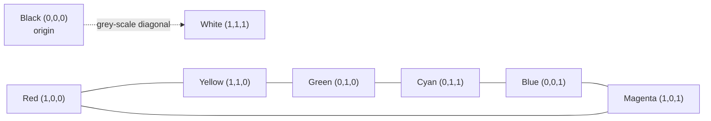
*Fig. 10: RGB colour cube (draw a cube with these 8 corners and the dotted diagonal).*

1. Based on a Cartesian coordinate system; the subspace is a **unit cube**.
2. Red, green and blue are at three corners; cyan, magenta and yellow at three others.
3. **Black at the origin, white at (1,1,1).** The **grey scale lies on the main diagonal** (equal R, G, B).
4. An RGB image consists of **three component images**, one per primary, combined on the screen.
5. **Pixel depth:** 8 bits per component → 24-bit full-colour image → 2<sup>24</sup> = 16,777,216 colours.
6. **Safe colours:** 216 colours (6 levels per component) that look the same on all systems.
7. Additive model; used in monitors, TV, cameras and scanners.

### HSI model
RGB is ideal for hardware but **not for describing colour as humans do**. People do not describe a car's colour by the percentage of each primary; they say hue, saturation and brightness.

1. **Hue (H):** the attribute that describes the **pure colour** (red, yellow, green). It is an **angle** measured around the vertical axis from red (0°); green is at 120°, blue at 240°.
2. **Saturation (S):** the **purity** of the colour, i.e. the degree to which it is diluted by white light. It is the distance from the vertical axis; 0 = grey, 1 = pure colour.
3. **Intensity (I):** the achromatic brightness, along the vertical axis from black (bottom) to white (top).
4. Geometrically: stand the RGB cube on its black vertex with white directly above; the grey diagonal becomes the vertical **intensity axis**; planes perpendicular to it show colours in a triangle/hexagon/circle with hue as the angle and saturation as the radius.

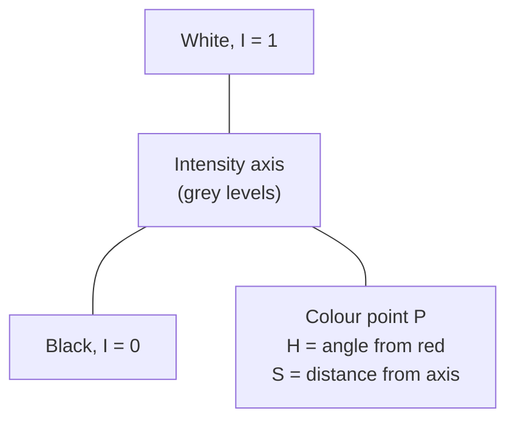

**Advantages of HSI:** intensity is decoupled from colour, so brightness can be processed (e.g. histogram equalization of I) without changing colours; H and S match human perception; good for colour segmentation.

### Converting RGB to HSI (R, G, B normalised to [0,1])

**Hue:**  H = θ if B ≤ G;  H = 360° − θ if B > G

θ = cos<sup>−1</sup> { ½[(R − G) + (R − B)] / [(R − G)² + (R − B)(G − B)]<sup>½</sup> }

**Saturation:**  S = 1 − [3/(R + G + B)] · min(R, G, B)

**Intensity:**  I = (R + G + B)/3

**Example:** (R, G, B) = (1, 0, 0), pure red. Numerator = ½(1 + 1) = 1; denominator = √(1 + 0) = 1; θ = cos<sup>−1</sup>(1) = 0°; B ≤ G so **H = 0°**; **S = 1 − 3·0/1 = 1** (fully saturated); **I = 1/3**.

**HSI to RGB (for completeness):** in the RG sector (0° ≤ H < 120°): B = I(1 − S), R = I[1 + S cos H/cos(60° − H)], G = 3I − (R + B); GB sector: subtract 120° from H and rotate the roles (R = I(1 − S), …); BR sector: subtract 240° (G = I(1 − S), …).

**Conclusion.** RGB is a hardware-oriented cube model, while HSI describes colour the way humans perceive it and separates intensity from chromaticity; the conversion formulas let us move between them so that each operation can be done in the more suitable model.
:::

## Q6 (b) Colour image smoothing

::: ans Answer

**Introduction.** Smoothing of grey-scale images is done by spatial averaging over a neighbourhood (Unit 1). A colour image has three components per pixel, so smoothing must be extended from scalar values to **colour vectors**.

**Definition.** <u>Colour image smoothing is the process of reducing noise and fine detail in a colour image by replacing each colour pixel with the average of the colour pixels in its neighbourhood.</u>

**Colour pixel as a vector.** In RGB, each pixel is c(x,y) = [c<sub>R</sub>(x,y), c<sub>G</sub>(x,y), c<sub>B</sub>(x,y)]ᵀ = [R(x,y), G(x,y), B(x,y)]ᵀ.

**Neighbourhood averaging.** Let S<sub>xy</sub> be the set of coordinates of a neighbourhood centred at (x,y), containing K pixels. The average colour vector is

**c̄(x,y) = (1/K) Σ<sub>(s,t)∈S<sub>xy</sub></sub> c(s,t)**

By the properties of vector addition this equals

**c̄(x,y) = [ (1/K) Σ R(s,t),  (1/K) Σ G(s,t),  (1/K) Σ B(s,t) ]ᵀ**

**Key result:** smoothing by neighbourhood averaging can be carried out **on a per-colour-plane basis**: smooth each component image independently using the conventional grey-scale averaging mask, then recombine.

**Diagram.**

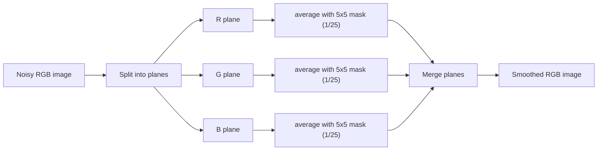
*Fig. 11: Colour image smoothing by per-plane neighbourhood averaging.*

**Procedure.**
1. Separate the colour image into its R, G and B component images.
2. Choose a mask, e.g. a 5×5 box filter with all coefficients 1/25 (or a weighted mask).
3. Convolve each component image with the mask: for every pixel, compute the average of the K neighbouring values.
4. Combine the three smoothed planes into the output colour image.

**Small example (3×3 neighbourhood, one pixel).** If the nine R values are 100, 110, 120, 100, 200 (noisy), 110, 100, 120, 110, the smoothed R value is 1070/9 ≈ 119. G and B are averaged the same way. The noisy spike of 200 is reduced to about 119.

**Smoothing in HSI.** Alternatively, convert to HSI and smooth **only the intensity component**, keeping H and S unchanged. The result is similar but **not identical** to RGB smoothing: averaging pixels of two different colours in RGB creates a mixture (a new colour), whereas smoothing only I keeps the original hues. The difference grows with mask size.

**Effects and uses.**
1. Reduces Gaussian and random noise in each channel.
2. Blurs edges and fine detail (as in grey-scale smoothing); larger masks blur more.
3. Used as pre-processing before colour segmentation, and to remove sensor noise in digital camera images.
4. For impulse noise in colour images, **vector median** filters are preferred.

**Conclusion.** Colour smoothing by neighbourhood averaging is the vector extension of grey-scale averaging; because averaging is linear, it is equivalent to smoothing each of the R, G and B planes separately and recombining them.
:::

---

## Q7 (a) Dilation, erosion, opening and closing

::: ans Answer

**Introduction.** Mathematical morphology is a tool for extracting image components that are useful in the representation and description of region shape, such as boundaries, skeletons and the convex hull. Its language is **set theory**: a binary image is a set of foreground pixel coordinates. Every morphological operation probes the image with a small set called the **structuring element (SE)**. The two fundamental operations are **dilation** and **erosion**; opening and closing are built from them.

**Basic definitions.** Reflection B̂ = {w | w = −b, for b ∈ B}. Translation (B)<sub>z</sub> = {c | c = b + z, for b ∈ B}.

### Dilation
**A ⊕ B = { z | (B̂)<sub>z</sub> ∩ A ≠ ∅ }**

<u>The dilation of A by B is the set of all displacements z such that the reflected SE B̂ and A overlap by at least one element.</u>
- Grows or thickens objects; the thickening is controlled by the shape of the SE.
- Bridges gaps; e.g. repairs broken characters in low-resolution text.

### Erosion
**A ⊖ B = { z | (B)<sub>z</sub> ⊆ A }**

<u>The erosion of A by B is the set of all points z such that B, translated by z, is contained in A.</u>
- Shrinks or thins objects.
- Removes image components smaller than the SE (e.g. thin wires, noise specks).

**Duality:** (A ⊖ B)ᶜ = Aᶜ ⊕ B̂.

**Example.** A = a 3×3 square, B = a 3×3 square SE with its origin at the centre. A ⊕ B = a 5×5 square (grows by one pixel on every side). A ⊖ B = only the single centre pixel (the only place where B fits inside A).

### Opening
**A ∘ B = (A ⊖ B) ⊕ B**  (erosion followed by dilation)

- Generally **smooths the contour** of an object, **breaks narrow isthmuses** and **eliminates thin protrusions**.
- Geometric interpretation: A ∘ B is the union of all translates of B that **fit inside A**; imagine rolling a ball (B) **inside** the boundary of A; the opening is the region the ball can reach.
- **Properties:** (i) A ∘ B is a subset of A; (ii) if C ⊆ D then C ∘ B ⊆ D ∘ B; (iii) (A ∘ B) ∘ B = A ∘ B (**idempotent**: repeating has no further effect).

### Closing
**A • B = (A ⊕ B) ⊖ B**  (dilation followed by erosion)

- Also smooths contours but, unlike opening, **fuses narrow breaks and long thin gulfs**, **eliminates small holes**, and **fills gaps** in the contour.
- Geometric interpretation: roll the ball B on the **outside** of the boundary of A.
- **Properties:** (i) A is a subset of A • B; (ii) if C ⊆ D then C • B ⊆ D • B; (iii) (A • B) • B = A • B (**idempotent**).

**Duality:** (A • B)ᶜ = (Aᶜ ∘ B̂).

**Diagram.**

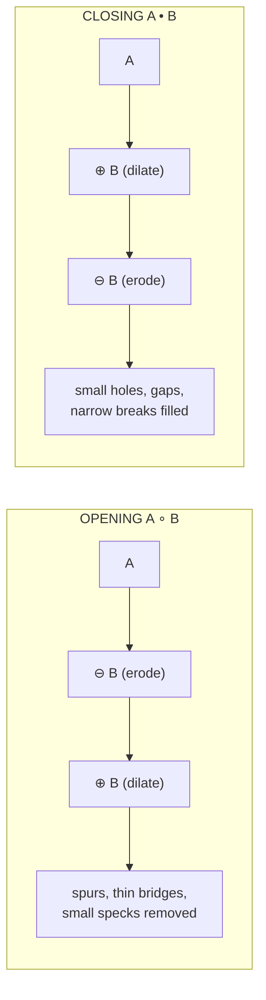
*Fig. 12: Opening and closing as compositions of erosion and dilation.*

**Comparison.**

| Opening | Closing |
|---|---|
| erosion then dilation | dilation then erosion |
| removes small objects and thin protrusions | fills small holes and gaps |
| breaks narrow connections | joins narrow breaks |
| result ⊆ A | A ⊆ result |
| ball rolled inside the boundary | ball rolled outside the boundary |

**Application (morphological filter).** For a noisy fingerprint image: **opening** removes the noise specks in the background; **closing** of the result then fills the small gaps created in the ridges. (A ∘ B) • B gives a clean fingerprint.

**Conclusion.** Dilation and erosion are the basic morphological operations; their combinations, opening and closing, smooth object shapes in complementary ways and form the basis of morphological filtering.
:::

## Q7 (b) Boundary extraction and hit-or-miss transform

::: ans Answer

**Introduction.** Using dilation and erosion we can build algorithms that extract useful shape information. Two of the most important are boundary extraction and the hit-or-miss transform, which is the basic tool for shape detection.

### Boundary extraction
**Definition.** <u>The boundary of a set A, β(A), is obtained by first eroding A by a suitable structuring element B and then taking the set difference between A and its erosion:</u>

**β(A) = A − (A ⊖ B)**

**Explanation.**
1. Erosion by a 3×3 SE removes the outermost layer of pixels from the object.
2. Subtracting the eroded set from the original leaves only that outer layer, i.e. the boundary.
3. With a 3×3 SE the boundary is **one pixel thick**; a 5×5 SE gives a two-to-three-pixel-thick boundary.

**Example.**
```
     A                A ⊖ B             β(A) = A − (A ⊖ B)
0 0 0 0 0 0       0 0 0 0 0 0           0 0 0 0 0 0
0 1 1 1 1 0       0 0 0 0 0 0           0 1 1 1 1 0
0 1 1 1 1 0       0 0 1 1 0 0           0 1 0 0 1 0
0 1 1 1 1 0       0 0 1 1 0 0           0 1 0 0 1 0
0 1 1 1 1 0       0 0 0 0 0 0           0 1 1 1 1 0
0 0 0 0 0 0       0 0 0 0 0 0           0 0 0 0 0 0
```


### Hit-or-miss transform
**Definition.** <u>The hit-or-miss transform is a morphological operation that finds the locations where a given pattern of foreground pixels and a given pattern of background pixels occur together; it is the basic tool for shape detection.</u>

**A ⊛ B = (A ⊖ B<sub>1</sub>) ∩ (Aᶜ ⊖ B<sub>2</sub>)**,  B = (B<sub>1</sub>, B<sub>2</sub>)

**Explanation.**
1. **B<sub>1</sub>** is the shape we are looking for (set of foreground pixels, X). It must "hit" (fit in) the object.
2. **B<sub>2</sub>** describes the background around the shape, usually B<sub>2</sub> = (W − X), where W is a small window enclosing X. It must "fit" in the background (the complement Aᶜ), i.e. "miss" the object.
3. A ⊖ B<sub>1</sub> gives all locations where the shape fits inside A.
4. Aᶜ ⊖ B<sub>2</sub> gives all locations where the surrounding background fits inside the background of A.
5. Their **intersection** gives the locations where **both** happen, i.e. where the exact shape X occurs (with the required background around it). This is why it finds a shape of a given size and not larger objects that merely contain it.

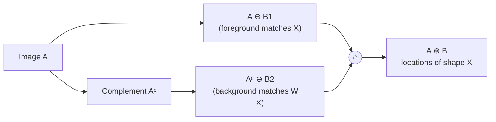
*Fig. 13: Hit-or-miss transform.*

**Uses (finding local patterns of pixels).**
- Detecting isolated points (foreground pixel with all-background neighbours).
- Finding end points and junctions of lines (used in pruning).
- Detecting corners and specific small shapes (e.g. a particular character or a 3×3 L-shape).
- It is the basis of **thinning** (A ⊗ B = A − (A ⊛ B)) and **thickening** (A ⊙ B = A ∪ (A ⊛ B)).

**Conclusion.** Boundary extraction uses erosion and subtraction to give the outline of an object, while the hit-or-miss transform uses a pair of structuring elements to locate exact pixel patterns, making it the foundation of thinning, thickening and pruning.
:::

---

## Q8 (a) Detection of points, lines and edges

::: ans Answer

**Introduction.** Segmentation algorithms are based on two properties of intensity: **discontinuity** and **similarity**. Discontinuity-based methods detect abrupt local changes: **points**, **lines** and **edges**. They are implemented with spatial masks.

**Definition.** <u>Detection of discontinuities is the process of locating isolated points, thin lines and edges in an image by computing the response of derivative-based masks and comparing it with a threshold.</u>

**General mask response.** For a 3×3 mask with coefficients w<sub>1</sub>…w<sub>9</sub> over pixels z<sub>1</sub>…z<sub>9</sub>: **R = w<sub>1</sub>z<sub>1</sub> + w<sub>2</sub>z<sub>2</sub> + … + w<sub>9</sub>z<sub>9</sub> = Σ w<sub>k</sub>z<sub>k</sub>**. In all detection masks the coefficients sum to zero, so the response is zero in areas of constant intensity.

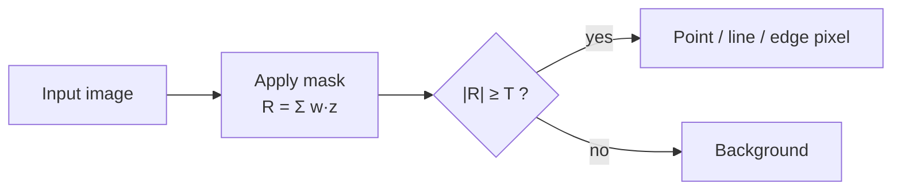

### 1. Point detection
Mask (Laplacian):
```
-1 -1 -1
-1  8 -1
-1 -1 -1
```
A point is detected at the mask centre if **|R| ≥ T** (non-negative threshold). Idea: an isolated point differs strongly from its background. Used for detecting porosity in X-ray images of turbine blades.

### 2. Line detection
Four 3×3 masks, each responding most strongly to a one-pixel-thick line in its direction:
```
 Horizontal       +45°           Vertical          −45°
-1 -1 -1        2 -1 -1        -1  2 -1        -1 -1  2
 2  2  2       -1  2 -1        -1  2 -1        -1  2 -1
-1 -1 -1       -1 -1  2        -1  2 -1         2 -1 -1
```
- Apply all four masks at a point, giving R<sub>1</sub>, R<sub>2</sub>, R<sub>3</sub>, R<sub>4</sub>. If **|R<sub>i</sub>| > |R<sub>j</sub>| for all j ≠ i**, the point most likely lies on a line in direction i.
- To find all lines in one direction, use that mask alone and threshold its absolute response.
- Example: on a horizontal line of 10s in a background of 0s, the horizontal mask gives R = 2(10+10+10) = 60; the vertical mask gives R = 2·10 − 10 − 10 = 0.

### 3. Edge detection
An **edge** is a set of connected pixels lying on the boundary between two regions of different intensity.

**Edge models:** step edge (ideal, one pixel), ramp edge (real, blurred), roof edge (a line).

**Derivatives:**
- **First derivative** (gradient) is non-zero along the entire ramp, so its **magnitude** detects the presence of an edge.
- **Second derivative** (Laplacian) gives a positive and a negative spike (double edge); its **zero crossing** locates the centre of the edge and its sign tells which side is darker.

**Gradient.** ∇f = [G<sub>x</sub>, G<sub>y</sub>]ᵀ = [∂f/∂x, ∂f/∂y]ᵀ; magnitude M = √(G<sub>x</sub>² + G<sub>y</sub>²) ≈ |G<sub>x</sub>| + |G<sub>y</sub>|; direction α = tan<sup>−1</sup>(G<sub>y</sub>/G<sub>x</sub>).

**Gradient masks:**
```
Roberts:  -1  0      0 -1
           0  1      1  0

Prewitt:  -1 -1 -1     -1  0  1
           0  0  0     -1  0  1
           1  1  1     -1  0  1

Sobel:    -1 -2 -1     -1  0  1
           0  0  0     -2  0  2
           1  2  1     -1  0  1
```
- **Roberts:** 2×2, simple, very sensitive to noise.
- **Prewitt:** 3×3, includes averaging.
- **Sobel:** weight 2 at the centre gives better noise suppression (smoothing); the most widely used.

**Advanced detectors.**
- **Laplacian of Gaussian (Marr-Hildreth):** smooth with a Gaussian, apply the Laplacian, find zero crossings.
- **Canny:** Gaussian smoothing → gradient → non-maximum suppression → double threshold with hysteresis. Gives thin, well-located, continuous edges.

**Edge linking.** Detected edges are broken by noise; local processing (similar magnitude and direction) or the **Hough transform** joins them into boundaries.

**Conclusion.** Points, lines and edges are detected with zero-sum masks: the Laplacian mask for points, four directional masks for lines, and gradient (Roberts, Prewitt, Sobel) or second-derivative operators for edges, followed by thresholding and linking.
:::

## Q8 (b) Global thresholding with numerical

::: ans Answer

**Introduction.** Thresholding is the simplest and most widely used segmentation technique, because it is intuitive and fast. It is based on the **similarity** of grey levels: object pixels have intensities different from background pixels.

**Definition.** <u>Global thresholding segments an image using a single threshold T for the whole image: g(x,y) = 1 if f(x,y) > T (object) and g(x,y) = 0 if f(x,y) ≤ T (background).</u>

**Diagram (histogram).**

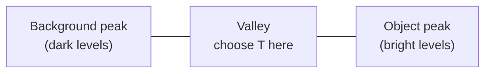
*Fig. 14: A bimodal histogram; the threshold is placed in the valley between the two peaks.*

**Basic iterative global thresholding algorithm.**
1. Select an initial estimate for T (usually the average intensity of the image).
2. Segment the image using T: group **G<sub>1</sub>** = pixels with value > T; group **G<sub>2</sub>** = pixels with value ≤ T.
3. Compute the average intensities m<sub>1</sub> and m<sub>2</sub> of G<sub>1</sub> and G<sub>2</sub>.
4. Compute the new threshold **T = ½(m<sub>1</sub> + m<sub>2</sub>)**.
5. Repeat steps 2–4 until the difference between successive T values is smaller than a predefined ΔT.

**Factors affecting thresholding:** the separation between peaks, the noise content, the relative sizes of object and background, **uniformity of illumination** and uniformity of reflectance. Uneven illumination destroys the valley, and then local (adaptive) thresholding is needed.

**Numerical.** Image:
```
12  15  40
10  45  50
14  42  11
```
**Iteration 1.** Initial T = mean = (12+15+40+10+45+50+14+42+11)/9 = 239/9 = **26.56**.
- G<sub>1</sub> (> 26.56) = {40, 45, 50, 42}; m<sub>1</sub> = 177/4 = **44.25**
- G<sub>2</sub> (≤ 26.56) = {12, 15, 10, 14, 11}; m<sub>2</sub> = 62/5 = **12.4**
- New T = (44.25 + 12.4)/2 = **28.325**

**Iteration 2.** T = 28.325. The groups are unchanged (no pixel lies between 26.56 and 28.325), so m<sub>1</sub> = 44.25, m<sub>2</sub> = 12.4 and T = 28.325 again. ΔT = 0, so the algorithm stops.

**Result.** **Final T ≈ 28.33.** Object group G<sub>1</sub> = {40, 42, 45, 50}; background group G<sub>2</sub> = {10, 11, 12, 14, 15}.

Segmented (binary) image:
```
0  0  1
0  1  1
0  1  0
```

**Advantages:** simple, fast, works well for bimodal histograms. **Limitations:** fails under uneven illumination or heavy noise; a single T cannot handle several objects (then multilevel thresholding is used).

**Conclusion.** Global thresholding separates objects from background with one value of T, found iteratively as the mid-point of the two group means; here it converges to T ≈ 28.33 in two iterations.
:::
