# Mock Paper 2

**B.Tech (Seventh Semester) Examination 2026-27 · CS-403T · Digital Image Processing**<br>
**Time: Three Hours · Maximum Marks: 70**<br>
**Note:** Attempt any **five** questions. All questions carry equal marks (14 each).

This paper covers the high-frequency topics again from different angles, plus the parts of the syllabus Mock 1 left out. Two numericals are **real past questions** (2018 histogram equalization and 2017 grey-scale morphology), because MJPRU reuses numericals.

## Question paper

| Q | (a) 7 marks | (b) 7 marks |
|---|---|---|
| 1 | Describe the elements of visual perception. How does image formation take place in the eye? | Explain brightness adaptation and discrimination. Show with examples that perceived brightness is not a simple function of intensity. |
| 2 | Explain the components of a general-purpose image processing system with a block diagram. | Explain enhancement using arithmetic and logic operations: image subtraction and image averaging. |
| 3 | Explain basic grey-level transformations: image negative, log and power-law (gamma) transformations. | Illustrate the steps of histogram equalization of the 5×5 image: 4 4 4 4 4 / 3 4 5 4 3 / 3 5 5 5 3 / 3 4 5 4 3 / 4 4 4 4 4 (3-bit image). |
| 4 | Explain sharpening spatial filters using the Laplacian. What is unsharp masking and high-boost filtering? | Explain the correspondence between filtering in the spatial and frequency domains. Explain Gaussian high-pass filters. |
| 5 | Explain restoration in the presence of noise only: mean filters and order-statistic filters. | How can periodic noise be removed using frequency-domain filtering? Explain band-reject, band-pass and notch filters. |
| 6 | What is the chromaticity diagram? Explain colour fundamentals and how the diagram is useful. | Explain the procedure for converting HSI to RGB. Explain colour segmentation. |
| 7 | For A = 7 8 2 4 / 6 4 3 3 / 7 3 6 6 / 4 4 2 3 and B = 1 1 1 / 1 2 1 / 1 1 1, show the result of grey-scale dilation and erosion. | Explain region filling, extraction of connected components and convex hull. |
| 8 | Explain the method of image segmentation using multilevel and local thresholding. What is the role of illumination? | Explain region-based segmentation: region growing and region splitting and merging. |

---

## Q1 (a) Elements of visual perception and image formation

::: ans Answer

**Introduction.** Although DIP is built on mathematics, the final judge of most processed images is a human observer. So it is important to understand how the human eye perceives images: its structure, how an image is formed in it, and its limits. These are called the elements of visual perception.

**Definition.** <u>Visual perception is the process by which the human eye receives light from a scene, forms an image on the retina, converts it into nerve signals, and the brain interprets it as brightness, colour and shape.</u>

**Structure of the human eye (diagram).**

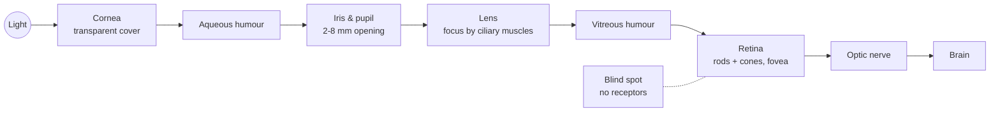
*Fig. 1: Simplified cross-section of the human eye as a chain of parts (draw the circular eye with these labels in the exam).*

**Explanation of the elements.**

1. **Shape.** The eye is nearly a sphere with an average diameter of about 20 mm. It is enclosed by three membranes.
2. **Cornea and sclera (outer cover).** The cornea is a tough, transparent tissue covering the front; the sclera is the opaque membrane covering the rest of the eyeball.
3. **Choroid.** Lies below the sclera; contains blood vessels that nourish the eye and is heavily pigmented to reduce stray light. At its front it divides into the **ciliary body** and the **iris diaphragm**. The iris contracts or expands to control the amount of light entering; the central opening (pupil) varies from about 2 to 8 mm.
4. **Lens.** Made of concentric layers of fibrous cells, suspended by fibres attached to the ciliary body. It contains 60–70% water and absorbs about 8% of visible light (more at shorter wavelengths). It focuses light on the retina.
5. **Retina.** The innermost membrane, lining the back wall. When the eye is focused, light from an object is imaged on the retina. It has two classes of receptors:
   - **Cones:** 6–7 million, located mainly in the central **fovea**, highly sensitive to **colour**. Each cone is connected to its own nerve end, so cones resolve fine detail. Cone vision is called **photopic** or bright-light vision.
   - **Rods:** 75–150 million, distributed over the retina. Several rods share one nerve end, which reduces detail but gives an overall picture. Rods are not colour-sensitive but are sensitive to low light. Rod vision is **scotopic** or dim-light vision. (Objects that look colourful in daylight look colourless in moonlight because only rods are stimulated.)
6. **Fovea.** A circular indentation about 1.5 mm in diameter in the retina, with the highest density of cones (about 150,000 per mm²), giving the sharpest vision.
7. **Blind spot.** The point where the optic nerve leaves the eye; it has no receptors.

**Image formation in the eye.**
1. In an ordinary camera the lens has a **fixed focal length**, and focusing is done by varying the distance between lens and film. In the eye the opposite holds: the distance between the lens and the retina is **fixed** (about 17 mm), and the **focal length is varied** by changing the shape of the lens.
2. The **ciliary muscles** flatten the lens for distant objects and make it thicker for near objects. The focal length ranges from about 17 mm (relaxed) to 14 mm (maximum power).
3. Light is focused on the retina, where an **inverted image** is formed; the receptors convert light energy into electrical impulses, which the brain decodes.

**Example (size of the retinal image).** An observer looks at a tree 15 m high from a distance of 100 m. If h is the height of the retinal image, by similar triangles:

15/100 = h/17  ⇒  **h = 2.55 mm**

```
   tree 15 m |\
             |  \           lens
             |    \__________|__________
             |          100 m |  17 mm  | h = 2.55 mm (inverted, on retina)
```

**Conclusion.** The eye works like a camera with a variable-focus lens and a sensor (retina) that has two kinds of receptors: cones for detail and colour in bright light, and rods for dim light. Knowing this helps in designing displays and enhancement techniques that suit human vision.
:::

## Q1 (b) Brightness adaptation, discrimination, and perceived brightness

::: ans Answer

**Introduction.** Digital images are displayed as a discrete set of intensities, so the eye's ability to discriminate between different intensity levels is an important consideration when presenting image-processing results.

**Definition.**
- <u>**Brightness adaptation** is the ability of the visual system to change its overall sensitivity according to the average illumination of the scene.</u>
- <u>**Brightness discrimination** is the ability of the eye to detect a difference between two intensity levels.</u>

**Brightness adaptation.**
1. The range of light intensity to which the visual system can adapt is enormous, of the order of **10<sup>10</sup>**, from the scotopic threshold to the glare limit.
2. **Subjective brightness** (brightness as perceived) is a **logarithmic function** of the light intensity entering the eye.
3. The eye cannot operate over this whole range simultaneously. It accomplishes the large variation by changing its overall sensitivity: **brightness adaptation**.
4. At any given condition, the current sensitivity level is called the **brightness adaptation level B<sub>a</sub>**. The range the eye can discriminate at this level is small, centred on B<sub>a</sub>. Below a level B<sub>b</sub>, all stimuli are perceived as indistinguishable blacks.

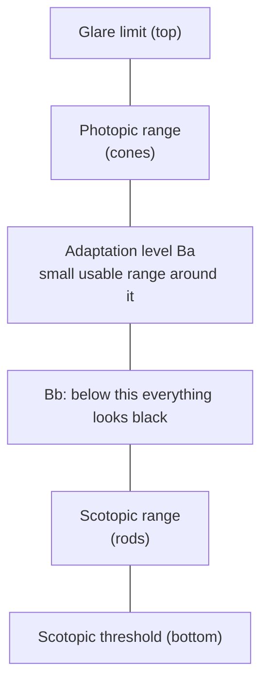
*Fig. 2: Range of subjective brightness against log of intensity (draw a curve rising with log intensity, with the short Ba–Bb segment marked).*

**Brightness discrimination (Weber ratio).**
1. Experiment: an observer looks at a flat, uniformly illuminated area of intensity I. A short flash of increment ΔI is added in the centre (a circle).
2. If ΔI is not bright enough, the observer says "no"; as it increases, the answer becomes "yes". The value **ΔI<sub>c</sub>** that is noticed 50% of the time is the **just-noticeable difference**.
3. **Weber ratio = ΔI<sub>c</sub>/I.** A **small** Weber ratio means a small percentage change can be detected, i.e. **good** brightness discrimination. A large ratio means poor discrimination.
4. A plot of log(ΔI<sub>c</sub>/I) against log I shows that discrimination is **poor at low illumination** (rods) and **improves at high illumination** (cones). The curve has two branches for rods and cones.
5. Result: the eye can discriminate only about **one to two dozen** different intensities at any one adaptation level, although it can see many more as the eye roams over a scene and adapts.

**Perceived brightness is not a simple function of intensity.**

1. **Mach bands.** A pattern of vertical stripes, each of **constant** intensity, increasing step by step. The eye perceives **scalloped** bands near the boundaries: a darker band on the darker side and a brighter band on the brighter side, although the actual intensity is flat (undershoot and overshoot). Named after Ernst Mach (1865).

```
Actual intensity:    ___|‾‾‾|___   (flat steps)
Perceived:           __\_/‾\_/‾‾   (dips and peaks at each edge)
```

2. **Simultaneous contrast.** A grey square of the **same intensity** placed on a black background looks brighter, and on a white background looks darker. Perceived brightness depends on the **surroundings**, not only on the intensity of the region itself.

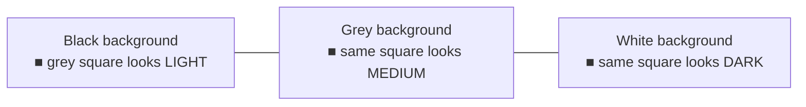

3. **Optical illusions.** The eye fills in non-existing information or wrongly perceives geometric properties: e.g. the outline of a square seen where none is drawn (Kanizsa), two equal lines looking unequal because of arrowheads (Müller-Lyer), parallel lines looking tilted.

**Importance in DIP.** Since the eye's response is logarithmic and depends on surroundings, enhancement techniques (log transform, histogram equalization, contrast stretching) are designed around these properties, and false contouring becomes visible when too few grey levels are used.

**Conclusion.** The eye adapts to a huge range of intensities but discriminates only a small range at a time, and perceived brightness depends on adaptation level and surroundings (Mach bands, simultaneous contrast), not just on the physical intensity.
:::

---

## Q2 (a) Components of an image processing system

::: ans Answer

**Introduction.** In the 1980s image-processing systems were large peripheral devices attached to host computers. Today, the trend is towards general-purpose computers with specialised hardware and software. A general-purpose image-processing system has a set of components, each performing a specific role.

**Definition.** <u>An image processing system is the combination of hardware (sensors, digitiser, computer, storage, display) and software that together acquire, process, store, display and transmit digital images.</u>

**Block diagram.**

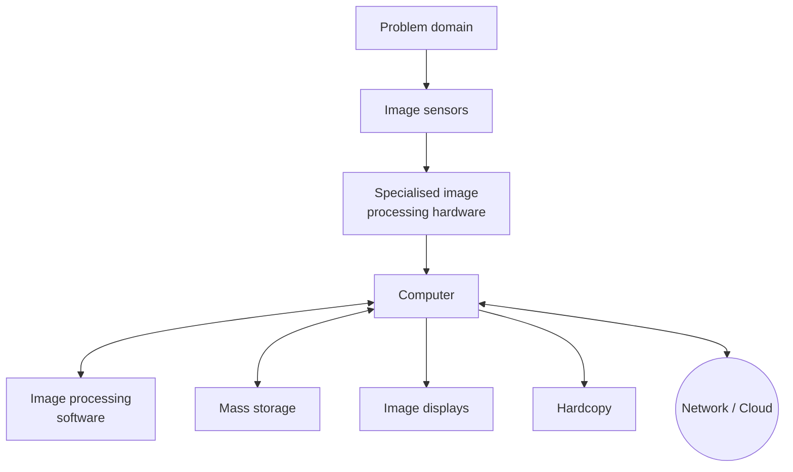
*Fig. 3: Components of a general-purpose image processing system.*

**Explanation of components.**

1. **Image sensors.** Two elements are needed to acquire digital images: (a) a **physical device** sensitive to the energy radiated by the object (e.g. a CCD/CMOS array in a camera, an X-ray detector), and (b) a **digitiser** that converts the output of the sensing device into digital form. Example: in a video camera, the sensors produce an electrical output proportional to light intensity, and the digitiser converts it to digital data.

2. **Specialised image-processing hardware.** Usually consists of the digitiser plus hardware that performs primitive operations, such as an **ALU** that does arithmetic and logic operations in parallel on entire images (e.g. averaging images as fast as they are digitised to reduce noise). It is called **front-end subsystem** hardware; its key feature is **speed** (real-time, e.g. 30 frames/s video), which a typical computer cannot achieve.

3. **Computer.** A general-purpose computer, from a PC to a supercomputer. In dedicated applications, specially designed computers are used for a required level of performance.

4. **Software.** Specialised modules that perform specific tasks (e.g. MATLAB Image Processing Toolbox, OpenCV, Photoshop). A well-designed package allows the user to write code that uses the modules, and integrates them with general-purpose languages.

5. **Mass storage.** Essential, because images are large: a 1024×1024 image with 8 bits per pixel needs **1 MB** uncompressed. Three categories:
   - **Short-term storage** during processing: computer memory or **frame buffers** (store one or more images, allow fast zoom, scroll, pan).
   - **On-line storage** for relatively fast recall: magnetic disks, SSDs.
   - **Archival storage**: massive storage with infrequent access: magnetic tapes, optical discs, cloud.
   Storage is measured in bytes, KB, MB, GB, TB.

6. **Image displays.** Mainly colour TV monitors / LCD screens, driven by the outputs of image and graphics display cards. Stereo displays (head-mounted goggles) are used in some applications.

7. **Hardcopy devices.** For recording images: laser printers, film cameras, heat-sensitive devices, inkjet units, and digital media such as optical discs. Film gives the highest resolution; paper is used for written material.

8. **Networking.** Almost a default function today, because of the large amounts of data in image-processing applications. The key consideration is **bandwidth**. Communication with remote sites over the internet is not always efficient, which is why **image compression** is important.

**Example (medical X-ray system).** Sensor = X-ray detector plate with digitiser; hardware = image-acquisition card; computer + software = DICOM viewer that enhances the image; storage = hospital PACS server (archive); display = diagnostic monitor; hardcopy = film printer; network = sending images to a remote radiologist.

**Conclusion.** An image processing system is a chain of components from sensing to output. Speed (specialised hardware), storage (mass storage) and bandwidth (network) are the main practical concerns, and the software ties everything together.
:::

## Q2 (b) Arithmetic and logic operations: subtraction and averaging

::: ans Answer

**Introduction.** Arithmetic and logic operations between images are pixel-by-pixel operations between two or more images. They are simple but very useful for enhancement, especially image subtraction and image averaging.

**Definition.** <u>Arithmetic/logic operations in DIP are operations performed on corresponding pixels of two or more images of the same size to produce a new image, e.g. s(x,y) = f(x,y) + g(x,y), d(x,y) = f(x,y) − g(x,y), p = f × g, v = f ÷ g.</u>

**Logic operations.** AND, OR and NOT (complement) on binary images, used mainly for **masking**: selecting a **region of interest (ROI)**. ANDing an image with a mask that is 1 in the ROI and 0 elsewhere keeps only the ROI. NOT gives the negative of a binary image.

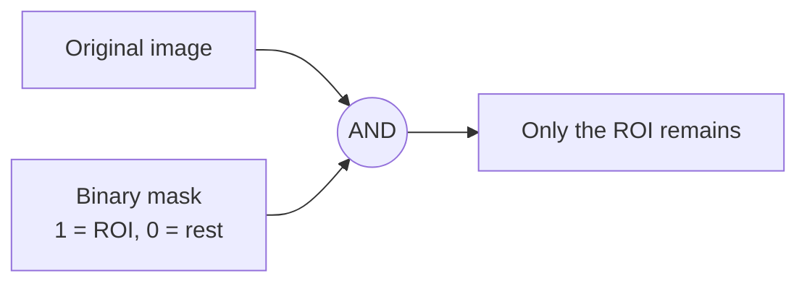

### Image subtraction
**g(x,y) = f(x,y) − h(x,y)**

The difference image shows only the **differences** between f and h; regions that are the same in both become zero (black).

**Application: digital subtraction angiography (medical).**
1. A **mask image h(x,y)** of a patient's body region is taken by an X-ray camera before injecting a contrast medium.
2. An iodine dye is injected into the bloodstream, and a series of **live images f(x,y)** is taken.
3. Subtracting the mask from each live image removes everything that did not change (bones, tissue), leaving only the **blood vessels** carrying the dye. Doctors can watch the dye propagate through the arteries.

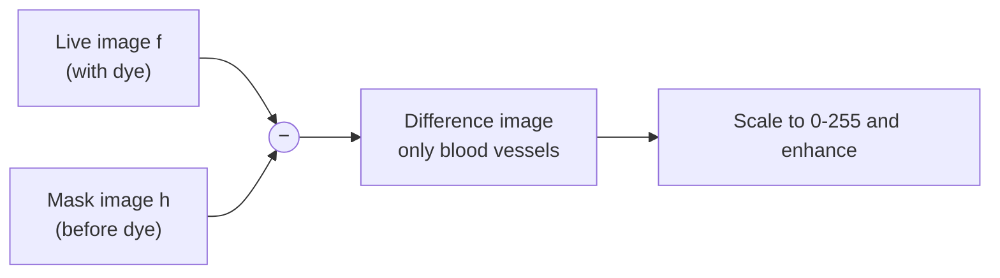

**Other uses:** change detection in satellite images, motion detection in surveillance (subtract consecutive frames), quality inspection (compare with a reference).

**Scaling the result.** Differences range from −255 to +255. Two methods: (1) add 255 and divide by 2; (2) better: f<sub>m</sub> = f − min(f), then f<sub>s</sub> = (L−1) × f<sub>m</sub>/max(f<sub>m</sub>), which uses the full range [0, L−1].

### Image averaging (noise reduction)
Suppose a noisy image g(x,y) = f(x,y) + η(x,y), where the noise η is **uncorrelated** and has **zero mean**. If we take K noisy images of the same scene and average them:

**ḡ(x,y) = (1/K) Σ<sub>i=1</sub><sup>K</sup> g<sub>i</sub>(x,y)**

Then: **E{ḡ(x,y)} = f(x,y)** and **σ²<sub>ḡ</sub> = (1/K) σ²<sub>η</sub>**, i.e. σ<sub>ḡ</sub> = σ<sub>η</sub>/√K.

As K increases, the variance (noise) at each pixel decreases and ḡ approaches the original f.

**Application:** astronomy, where images of faint galaxies are taken under very low light and the sensor noise is high; averaging 8, 16, 64 or 128 images progressively removes the noise. Also used in electron microscopy and low-light video.

**Condition:** the images must be **registered** (aligned) exactly; otherwise averaging blurs the image.

**Small numerical (element-wise operations).** For A = [1 2; 5 5] and B = [1 3; 8 7]:
- A + B = [2 5; 13 12]
- A − B = [0 −1; −3 −2] → negative values are clipped to 0 or rescaled
- A × B (pixel-wise) = [1 6; 40 35]
- A ÷ B = [1 0.67; 0.63 0.71]

**Conclusion.** Logic operations select regions of interest, image subtraction reveals changes (as in angiography), and image averaging reduces random noise by a factor of K in variance, making arithmetic operations simple yet powerful enhancement tools.
:::

---

## Q3 (a) Basic grey-level transformations

::: ans Answer

**Introduction.** Grey-level transformations are among the simplest enhancement techniques. The value of each output pixel depends only on the value of the corresponding input pixel: **s = T(r)**, where r and s are the grey levels before and after processing. Since digital images have a finite set of levels, T is usually stored as a **look-up table**.

**Definition.** <u>A grey-level (intensity) transformation is a point operation s = T(r) that maps each input grey level r to an output grey level s, using a neighbourhood of size 1×1.</u>

**Diagram: the basic transformation curves.**

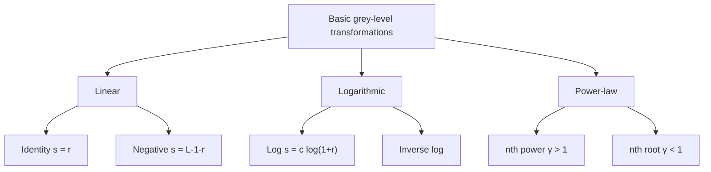
*Fig. 4: Families of basic transformations. In the exam draw them on one graph: x-axis input r (0 to L−1), y-axis output s; identity = diagonal, negative = reverse diagonal, log and nth root curve above the diagonal, inverse log and nth power curve below.*

### 1. Image negative
**s = L − 1 − r**

- Reverses the intensity levels: black becomes white and vice versa, producing the equivalent of a photographic negative.
- **Use:** enhancing white or grey detail embedded in **dark regions**, especially when black areas dominate. Example: a digital **mammogram** showing a small lesion; the negative makes the tissue easier to analyse.
- Example (L = 256): r = 0 → 255; r = 100 → 155; r = 255 → 0.

### 2. Log transformation
**s = c · log(1 + r)**, c a constant, r ≥ 0

- Maps a **narrow range of low** input levels into a **wider range** of output levels, and compresses the high values. It **expands dark pixels and compresses bright ones**.
- The **inverse log** does the opposite.
- **Use:** displaying the **Fourier spectrum**, whose values range from 0 to about 10<sup>6</sup>. Directly scaled, only the bright centre is visible; after s = c log(1 + |F|), with c chosen so the result fits 0–255, the full detail of the spectrum becomes visible.
- Example: with c = 255/log(256) ≈ 105.9, r = 10 → s = 105.9 × log(11) ≈ 110. A dark value of 10 becomes mid-grey.

### 3. Power-law (gamma) transformation
**s = c · r<sup>γ</sup>**, c and γ positive constants (sometimes s = c(r + ε)<sup>γ</sup>)

- **γ < 1:** maps a narrow range of dark input values to a wider range of output values (brightens, like log), with the opposite for bright inputs.
- **γ > 1:** the opposite: darkens, expands bright values.
- **γ = 1 and c = 1:** identity.
- A **family** of curves is obtained by varying γ, which makes it more versatile than log.
- **Gamma correction:** CRT/LCD monitors have an intensity-to-voltage response that is a power function (γ ≈ 1.8 to 2.5), which makes images look darker than intended. Pre-processing the image with s = r<sup>1/γ</sup> corrects it. Also important for reproducing images accurately on the web.
- **Uses:** contrast manipulation: MRI images of the spine (γ = 0.6, 0.4, 0.3 brighten), aerial images that look washed out (γ = 3, 4, 5 darken and add contrast).
- Example (r normalised to [0,1], c = 1): r = 0.25, γ = 0.5 → s = 0.5 (brighter); γ = 2 → s = 0.0625 (darker).

**Comparison.**

| Transformation | Formula | Effect | Typical use |
|---|---|---|---|
| Negative | s = L−1−r | reverses levels | mammograms, dark images |
| Log | s = c log(1+r) | expands dark, compresses bright | Fourier spectrum display |
| Power-law | s = c r<sup>γ</sup> | γ<1 brightens, γ>1 darkens | gamma correction, MRI, aerial photos |

**Conclusion.** Negative, log and power-law transformations are simple point operations implemented as look-up tables; they change the distribution of grey levels to bring out detail in dark or bright areas and to correct display responses.
:::

## Q3 (b) Histogram equalization of the 5×5 image (2018 PYQ)

::: ans Answer

**Given image (3-bit, so L = 8, L − 1 = 7; MN = 25):**
```
4 4 4 4 4
3 4 5 4 3
3 5 5 5 3
3 4 5 4 3
4 4 4 4 4
```

**Step 1. Count the pixels at each level.**
- Level 3: row 2 has 2, row 3 has 2, row 4 has 2 → **6**
- Level 4: row 1 has 5, row 2 has 2, row 4 has 2, row 5 has 5 → **14**
- Level 5: row 2 has 1, row 3 has 3, row 4 has 1 → **5**
- Total = 6 + 14 + 5 = 25 ✓

**Step 2. Formula.** s<sub>k</sub> = (L−1) Σ<sub>j=0</sub><sup>k</sup> n<sub>j</sub>/MN = 7 × CDF

| r<sub>k</sub> | n<sub>k</sub> | p<sub>r</sub> = n<sub>k</sub>/25 | Cumulative n | CDF | 7 × CDF | s<sub>k</sub> |
|---|---|---|---|---|---|---|
| 0 | 0 | 0 | 0 | 0 | 0 | 0 |
| 1 | 0 | 0 | 0 | 0 | 0 | 0 |
| 2 | 0 | 0 | 0 | 0 | 0 | 0 |
| 3 | 6 | 0.24 | 6 | 0.24 | 1.68 | **2** |
| 4 | 14 | 0.56 | 20 | 0.80 | 5.60 | **6** |
| 5 | 5 | 0.20 | 25 | 1.00 | 7.00 | **7** |
| 6 | 0 | 0 | 25 | 1.00 | 7.00 | 7 |
| 7 | 0 | 0 | 25 | 1.00 | 7.00 | 7 |

**Step 3. Mapping:** 3 → 2, 4 → 6, 5 → 7.

**Step 4. Equalized image:**
```
6 6 6 6 6
2 6 7 6 2
2 7 7 7 2
2 6 7 6 2
6 6 6 6 6
```

**Step 5. Histograms.**

| Level | 0 | 1 | 2 | 3 | 4 | 5 | 6 | 7 |
|---|---|---|---|---|---|---|---|---|
| Before | 0 | 0 | 0 | 6 | 14 | 5 | 0 | 0 |
| After | 0 | 0 | 6 | 0 | 0 | 0 | 14 | 5 |

```
Before:            After:
  14 |    █          14 |            █
     |    █             |            █
   6 | █  █             |   █        █
   5 | █  █  █        5 |   █        █  █
     +---------         +-----------------
       3  4  5            2  3  4  5  6  7
```

**Observation.** Originally the grey levels occupied only 3–5 (a range of 2). After equalization they spread from 2 to 7 (a range of 5): the dark border pixels (3) became darker (2), and the centre pixels became bright (6, 7). The contrast between the frame, the cross and the centre has increased greatly, which is the purpose of equalization.
:::

---

## Q4 (a) Laplacian sharpening, unsharp masking and high-boost filtering

::: ans Answer

**Introduction.** The principal objective of **sharpening** is to highlight transitions in intensity: fine detail and edges. Smoothing is done by averaging, which is analogous to integration; sharpening is therefore done by **spatial differentiation**. The strength of a derivative's response is proportional to the degree of intensity discontinuity, so derivatives enhance edges and noise and de-emphasise slowly varying areas.

**Definition.** <u>A sharpening spatial filter is a mask based on first or second derivatives that enhances edges and fine detail; the Laplacian is the simplest isotropic second-derivative sharpening filter.</u>

**First and second derivatives (1-D).**
- ∂f/∂x = f(x+1) − f(x): zero in flat areas, non-zero at the onset of a step and **along ramps** (thick edges).
- ∂²f/∂x² = f(x+1) + f(x−1) − 2f(x): zero in flat areas and along ramps of constant slope, non-zero at the onset and end of ramps; produces a **double edge** one pixel thick, with a **zero crossing**. It has a stronger response to fine detail (thin lines, isolated points). So the second derivative is better for sharpening.

**The Laplacian.**

∇²f = ∂²f/∂x² + ∂²f/∂y²

∇²f(x,y) = f(x+1,y) + f(x−1,y) + f(x,y+1) + f(x,y−1) − 4f(x,y)

It is **isotropic** (rotation invariant): its response is independent of the direction of the discontinuity.

**Masks.**
```
 (a)            (b) with diagonals    (c) = −(a)       (d) = −(b)
 0  1  0          1  1  1             0 -1  0         -1 -1 -1
 1 -4  1          1 -8  1            -1  4 -1         -1  8 -1
 0  1  0          1  1  1             0 -1  0         -1 -1 -1
```

**Sharpening with the Laplacian.** The Laplacian alone gives an image with greyish edge lines on a dark background. To recover the background while keeping the sharpening, add the Laplacian to the original:

**g(x,y) = f(x,y) + c[∇²f(x,y)]**, with **c = −1** if the centre coefficient is negative (masks a, b) and **c = +1** if positive (masks c, d).

Combining into one mask gives the **composite Laplacian mask**:
```
 0 -1  0           -1 -1 -1
-1  5 -1           -1  9 -1
 0 -1  0           -1 -1 -1
```


*Fig. 5: Laplacian sharpening.*

**Numerical example.** A pixel of value 50 surrounded by four 4-neighbours of 10:
∇²f = 10 + 10 + 10 + 10 − 4 × 50 = 40 − 200 = −160.
g = f − ∇²f = 50 − (−160) = **210**. The bright detail becomes brighter relative to its neighbours (sharpened). Values above 255 are clipped.

### Unsharp masking and high-boost filtering
Used in the printing and publishing industry for many years.

**Steps:**
1. Blur the original image: f̄(x,y).
2. Subtract the blurred image from the original to get the **mask**: g<sub>mask</sub>(x,y) = f(x,y) − f̄(x,y).
3. Add a weighted portion of the mask to the original: **g(x,y) = f(x,y) + k · g<sub>mask</sub>(x,y)**.

- **k = 1:** unsharp masking.
- **k > 1:** **high-boost filtering** (emphasises the detail more strongly and keeps the background).
- k < 1 de-emphasises the mask.

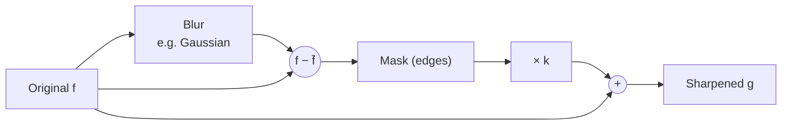
*Fig. 6: Unsharp masking (k = 1) and high-boost filtering (k > 1).*

**Applications.** Medical images (sharpening X-rays to show fine bone structure), printing, satellite images, photographs (the "sharpen" tool in Photoshop is unsharp masking).

**Conclusion.** Sharpening uses derivatives to enhance edges. The Laplacian, added to or subtracted from the original, gives a sharpened image with the background preserved, and unsharp masking/high-boost filtering achieve sharpening by adding back the difference between the image and its blurred version.
:::

## Q4 (b) Correspondence between spatial and frequency filtering; Gaussian HPF

::: ans Answer

**Introduction.** Filtering can be done in two domains: in the **spatial domain** by convolving the image with a mask, and in the **frequency domain** by multiplying its Fourier transform by a filter function. The **convolution theorem** shows that these two approaches are equivalent; this link is the basis of all filtering theory.

**Definition.** <u>The correspondence between spatial and frequency filtering states that convolving an image with a spatial filter h(x,y) is equivalent to multiplying its Fourier transform F(u,v) by H(u,v), the Fourier transform of h(x,y); h and H form a Fourier transform pair.</u>

**Convolution theorem.**
- **f(x,y) ⋆ h(x,y) ⇔ F(u,v) H(u,v)**
- **f(x,y) h(x,y) ⇔ F(u,v) ⋆ H(u,v)**

(⋆ = convolution, ⇔ = Fourier transform pair.) Convolution in one domain = multiplication in the other.

**Correlation theorem.** f(x,y) ☆ h(x,y) ⇔ F*(u,v) H(u,v), where F* is the complex conjugate. Correlation is used for template matching.

**Impulse response.** If f is a unit impulse δ(x,y) (whose transform is 1), then the output is h(x,y). So **a spatial filter mask is the impulse response of the corresponding frequency filter**, and h(x,y) = ℑ<sup>−1</sup>{H(u,v)}.

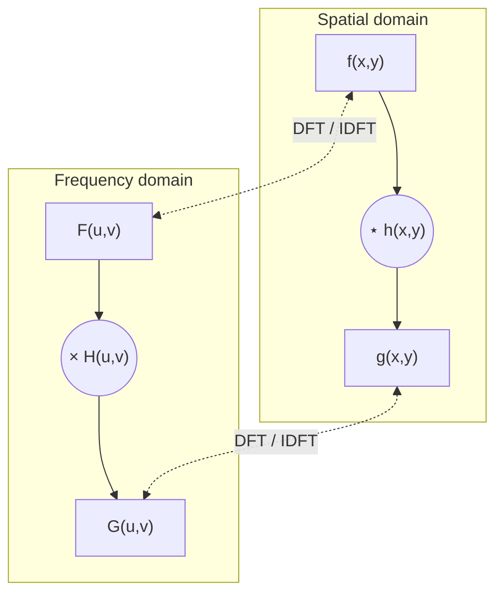
*Fig. 7: The same result is obtained by convolution in the spatial domain or by multiplication in the frequency domain.*

**Gaussian example of the correspondence.**
- Frequency-domain Gaussian low-pass: **H(u) = A e<sup>−u²/2σ²</sup>**
- Corresponding spatial filter: **h(x) = √(2π) σ A e<sup>−2π²σ²x²</sup>**
- Both are Gaussian and **real**, so the filter is easy to analyse and has no ringing.
- They behave **reciprocally**: when H(u) is **narrow** (strong low-pass), h(x) is **wide** (large blurring mask), and vice versa. In the limit, a very wide H gives an impulse-like h (no filtering).
- A **high-pass** filter can be constructed as a difference of Gaussians: H(u) = Ae<sup>−u²/2σ₁²</sup> − Be<sup>−u²/2σ₂²</sup> (A ≥ B, σ₁ > σ₂), whose spatial form has a positive centre and negative side lobes, just like the Laplacian sharpening masks.

**Practical consequences.**
1. Spatial masks such as the averaging mask and Laplacian mask are approximations of frequency-domain low-pass and high-pass filters.
2. We can design a filter in the frequency domain (where it is intuitive) and implement a small mask of it in the spatial domain (where it is fast).
3. For small masks the spatial method is faster; for large filters the FFT method is faster.
4. Padding is required in the frequency domain to avoid wraparound error, because DFT convolution is circular.

### Gaussian high-pass filter (GHPF)

**H(u,v) = 1 − e<sup>−D²(u,v)/2D<sub>0</sub>²</sup>**

where D(u,v) is the distance from the centre of the frequency rectangle and D<sub>0</sub> is the cut-off.

```
H(u,v)
1 |            ______
  |         /
  |       /
0 |_____/____________ D(u,v)
         D0
```
*Fig. 8: Radial cross-section of a GHPF.*

- Obtained as H<sub>HP</sub> = 1 − H<sub>LP</sub>.
- Attenuates low frequencies (smooth areas, the average) and passes high frequencies (edges, detail).
- **Smoother** than ideal and Butterworth HPFs; **no ringing**; even small objects and thin bars are cleanly enhanced.
- The output has a dark background (DC removed); adding a constant (**high-frequency emphasis**, H = k<sub>1</sub> + k<sub>2</sub>H<sub>HP</sub>) keeps the tones.
- Comparison: ideal HPF (sharp cut, severe ringing, distorted thin edges), Butterworth HPF of order 2 (sharper, little ringing), Gaussian HPF (smoothest).

**Conclusion.** The convolution theorem makes spatial and frequency filtering two views of the same operation: a spatial mask is the inverse transform of a frequency filter. The Gaussian high-pass filter illustrates this, sharpening an image smoothly without ringing.
:::

---

## Q5 (a) Restoration in the presence of noise only: mean and order-statistic filters

::: ans Answer

**Introduction.** When the only degradation present is additive noise, the degradation model becomes **g(x,y) = f(x,y) + η(x,y)** and G(u,v) = F(u,v) + N(u,v). Because the noise terms are unknown, subtracting them is not possible; **spatial filtering** is the method of choice when only additive random noise is present.

**Definition.** <u>Restoration in the presence of noise only means estimating f(x,y) from g(x,y) = f(x,y) + η(x,y) by spatial filters that compute each output pixel from the noisy pixels in a neighbourhood S<sub>xy</sub> of size m × n.</u>

**Classification (diagram).**

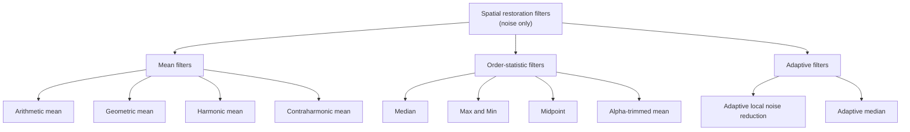
*Fig. 9: Spatial filters for restoration.*

### Mean filters

1. **Arithmetic mean filter.**
   **f̂(x,y) = (1/mn) Σ<sub>(s,t)∈S<sub>xy</sub></sub> g(s,t)**
   Smooths local variations; noise is reduced as a result of blurring. Good for Gaussian and uniform noise.

2. **Geometric mean filter.**
   **f̂(x,y) = [ Π<sub>(s,t)∈S<sub>xy</sub></sub> g(s,t) ]<sup>1/mn</sup>**
   Achieves smoothing comparable to the arithmetic mean but **loses less image detail**.

3. **Harmonic mean filter.**
   **f̂(x,y) = mn / Σ<sub>(s,t)∈S<sub>xy</sub></sub> [1/g(s,t)]**
   Works well for **salt noise** and Gaussian noise; **fails for pepper** noise (a 0 makes 1/g infinite).

4. **Contraharmonic mean filter of order Q.**
   **f̂(x,y) = Σ g(s,t)<sup>Q+1</sup> / Σ g(s,t)<sup>Q</sup>**
   - **Q > 0** eliminates **pepper** noise; **Q < 0** eliminates **salt** noise. It cannot do both at once.
   - Q = 0 → arithmetic mean; Q = −1 → harmonic mean.
   - Choosing the wrong sign of Q can be disastrous.

### Order-statistic filters
Their response is based on **ordering (ranking)** the pixels in the neighbourhood.

1. **Median filter.** f̂(x,y) = median{g(s,t)}. Excellent noise-reduction capability with **considerably less blurring** than linear filters of similar size; particularly effective for **bipolar and unipolar impulse (salt-and-pepper)** noise. Repeated passes remove more noise but gradually blur.
2. **Max filter.** f̂ = max{g(s,t)} (100th percentile). Finds the brightest points; reduces **pepper** noise.
3. **Min filter.** f̂ = min{g(s,t)} (0th percentile). Finds the darkest points; reduces **salt** noise.
4. **Midpoint filter.** f̂ = ½[max + min]. Combines order statistics and averaging; works best for randomly distributed noise such as **Gaussian or uniform** noise.
5. **Alpha-trimmed mean filter.** Delete the d/2 lowest and d/2 highest values in S<sub>xy</sub>; average the remaining mn − d values g<sub>r</sub>:
   **f̂(x,y) = [1/(mn − d)] Σ g<sub>r</sub>(s,t)**
   d = 0 → arithmetic mean; d = mn − 1 → median. Useful for **combinations of noise**, e.g. salt-and-pepper plus Gaussian.

**Numerical illustration.** Window values: 10, 12, 11, 255, 13, 12, 0, 11, 12 (salt 255, pepper 0).
- Arithmetic mean = 336/9 = 37.3 (badly affected by the impulses).
- Sorted: 0, 10, 11, 11, **12**, 12, 12, 13, 255 → median = **12** (impulses ignored).
- Alpha-trimmed (d = 2, drop 0 and 255) = 81/7 = 11.6.

**Which filter for which noise.**

| Noise | Best filter |
|---|---|
| Gaussian / uniform | arithmetic, geometric mean, midpoint |
| Salt only | harmonic, contraharmonic (Q < 0), min |
| Pepper only | contraharmonic (Q > 0), max |
| Salt and pepper | median, adaptive median |
| Mixed | alpha-trimmed mean |

**Adaptive filters (brief).** Their behaviour changes with local statistics. The **adaptive local noise-reduction filter** f̂ = g − (σ²<sub>η</sub>/σ²<sub>L</sub>)[g − m<sub>L</sub>] preserves edges (high local variance) while smoothing flat regions; the **adaptive median filter** enlarges the window until the median is not an impulse, handling dense impulse noise while preserving detail.

**Conclusion.** For noise-only degradation, mean filters smooth Gaussian-type noise, order-statistic filters (especially the median) remove impulse noise without much blurring, and adaptive filters adjust to local statistics for better detail preservation.
:::

## Q5 (b) Periodic noise reduction by frequency-domain filtering

::: ans Answer

**Introduction.** **Periodic noise** arises typically from **electrical or electromechanical interference** during image acquisition (e.g. a power line near the scanner). It appears as a regular pattern of stripes or a sinusoidal ripple over the image. It is the only spatially dependent noise model, and it can be removed far more effectively in the frequency domain than in the spatial domain.

**Definition.** <u>Periodic noise reduction by frequency-domain filtering is the process of locating the concentrated bursts of energy (spikes) that periodic noise produces in the Fourier transform and suppressing them with selective filters (band-reject, band-pass or notch), followed by the inverse transform.</u>

**Why the frequency domain.** A sinusoidal noise pattern of frequency (u<sub>0</sub>, v<sub>0</sub>) has a Fourier transform consisting of a **conjugate pair of impulses (bright spikes)** at (u<sub>0</sub>, v<sub>0</sub>) and (−u<sub>0</sub>, −v<sub>0</sub>). In the spectrum these spikes are easy to see and isolated, so they can be removed without affecting the rest of the image much. Spatial filters, in contrast, would blur the whole image.

**Procedure (diagram).**


*Fig. 10: Periodic noise removal.*

### 1. Band-reject filters
Remove (attenuate) a **band of frequencies about the origin**: useful when the noise components lie on a ring (approximately known distance from the origin). D<sub>0</sub> = radius of the band centre, W = width of the band.

- **Ideal:** H(u,v) = 0 if D<sub>0</sub> − W/2 ≤ D ≤ D<sub>0</sub> + W/2; 1 otherwise.
- **Butterworth (order n):** H(u,v) = 1 / [1 + (DW / (D² − D<sub>0</sub>²))<sup>2n</sup>]
- **Gaussian:** H(u,v) = 1 − e<sup>−½[(D² − D<sub>0</sub>²)/(DW)]²</sup>

```
H
1 |‾‾‾‾‾\        /‾‾‾‾‾
  |      \      /
0 |       \____/
  |______________________ D
           D0
```
*Fig. 11: Cross-section of a band-reject filter.*

**Application:** an image corrupted by sinusoidal noise whose spikes lie on a circle; a Butterworth band-reject filter of order 4 with D<sub>0</sub> at that radius removes it almost completely.

### 2. Band-pass filters
**H<sub>BP</sub>(u,v) = 1 − H<sub>BR</sub>(u,v)**: passes only the band and rejects everything else.
- Performing a band-pass filtering on an image would remove too much detail, so it is not used for restoration directly.
- **Use:** to **isolate the noise pattern** itself: applying the band-pass filter and inverse-transforming shows the noise alone. This helps in analysing it and simplifies further processing (e.g. optimum notch filtering).

### 3. Notch filters
Reject (or pass) frequencies in **predefined neighbourhoods about a centre frequency**. Because of the symmetry of the Fourier transform, notch filters must appear in **symmetric pairs about the origin**.
- **Ideal notch reject (pair):** H = 0 if D<sub>1</sub> ≤ D<sub>0</sub> or D<sub>2</sub> ≤ D<sub>0</sub>; 1 otherwise, with D<sub>1</sub>, D<sub>2</sub> the distances from (u<sub>0</sub>, v<sub>0</sub>) and (−u<sub>0</sub>, −v<sub>0</sub>).
- Butterworth and Gaussian notch filters are similar but smooth.
- **Notch pass:** H<sub>NP</sub> = 1 − H<sub>NR</sub>.
- **Use:** removing noise that appears as **individual spikes** not on a ring, e.g. horizontal scan lines in satellite images (energy along the vertical axis), or moiré patterns in newspaper images.

### 4. Optimum notch filtering
When there are several interference components:
1. Isolate the principal noise contributions with a notch-pass filter: N(u,v) = H<sub>NP</sub>(u,v) G(u,v); η(x,y) = ℑ<sup>−1</sup>{N}.
2. Subtract a **weighted** version of the noise: f̂(x,y) = g(x,y) − w(x,y) η(x,y), with w chosen to minimise the local variance of f̂.
Used, for example, for images from the Mars Mariner spacecraft.

**Conclusion.** Periodic noise shows up as symmetric spikes in the spectrum. Band-reject filters remove noise lying on a ring, band-pass filters isolate the noise pattern for study, and notch filters remove individual spike pairs, giving very effective restoration with little damage to the image.
:::

---

## Q6 (a) Colour fundamentals and the chromaticity diagram

::: ans Answer

**Introduction.** The use of colour in image processing is motivated by two factors: (1) colour is a powerful **descriptor** that often simplifies object identification and extraction from a scene; (2) humans can discern **thousands** of colour shades and intensities, compared with only about two dozen shades of grey. Colour image processing is divided into **full-colour** processing (images from colour sensors) and **pseudo-colour** processing (assigning colours to grey intensities).

**Definition.** <u>The chromaticity diagram is a two-dimensional plot (CIE) of the trichromatic coefficients x (red) and y (green), which shows every visible colour as a point specified by its chromaticity (hue and saturation), independent of intensity.</u>

**Colour fundamentals.**
1. In 1666 Newton found that sunlight passed through a prism gives a continuous **spectrum** from violet to red: violet, blue, green, yellow, orange and red, with no sharp boundaries. Visible light is about 400–700 nm.
2. The colour of an object is determined by the nature of the light **reflected** from it. A green object reflects light with wavelengths mainly in 500–570 nm and absorbs the rest.
3. **Achromatic light** (no colour) is described only by intensity (grey level). **Chromatic light** is described by three quantities: **radiance** (total energy, W), **luminance** (energy perceived by an observer, lumens), and **brightness** (subjective, practically impossible to measure).
4. **Cones** are the sensors for colour: about 65% are sensitive to red, 33% to green and 2% to blue. So colours are seen as variable combinations of the **primary colours red (R), green (G) and blue (B)** (CIE: 700 nm, 546.1 nm, 435.8 nm).
5. **Secondary colours of light:** magenta (red + blue), cyan (green + blue), yellow (red + green). Mixing the three primaries, or a secondary with its opposite primary, in the right intensities gives **white light**.
6. **Primary colours of pigments** are the secondary colours of light (cyan, magenta, yellow): a pigment primary absorbs one primary of light and reflects the other two.
7. **Characteristics to distinguish colours:**
   - **Brightness:** the achromatic notion of intensity.
   - **Hue:** the dominant wavelength in a mixture; the colour as perceived (red, orange, yellow).
   - **Saturation:** relative purity, the amount of white light mixed with a hue. Pure spectrum colours are fully saturated; pink (red + white) and lavender (violet + white) are less saturated.
   - Hue and saturation together are called **chromaticity**, so a colour is characterised by its brightness and chromaticity.
8. **Tristimulus values:** the amounts of red, green and blue needed to form a colour, X, Y, Z. **Trichromatic coefficients:** x = X/(X+Y+Z), y = Y/(X+Y+Z), z = Z/(X+Y+Z), and **x + y + z = 1**.

**Chromaticity diagram (diagram).**

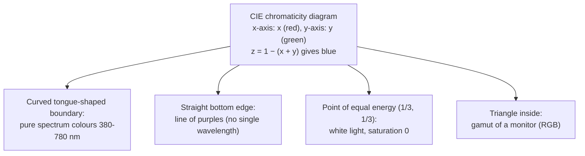
*Fig. 12: Features of the chromaticity diagram. In the exam draw a horseshoe shape on x–y axes (0 to 0.8), mark wavelengths around the boundary (blue at bottom-left, green at top, red at right), the white point in the middle, and a triangle inside.*

**How the chromaticity diagram is useful.**
1. **Specifying colour:** any colour is a point (x, y); z is obtained from z = 1 − (x + y). Example: a green point with x = 0.25, y = 0.62 has z = 0.13 (25% red, 62% green, 13% blue).
2. **Pure colours:** points on the boundary are pure, fully saturated colours of the spectrum.
3. **Saturation:** as a point moves from the boundary toward the **point of equal energy** (white), more white light is added and the colour becomes less saturated; at the white point saturation is zero.
4. **Colour mixing:** a straight line joining any two points defines all colours obtainable by additively mixing those two colours. A line from the white point through a colour to the boundary gives its **dominant wavelength (hue)**.
5. **Colour gamut:** the triangle formed by three colours (e.g. a monitor's R, G, B phosphors) contains all colours that can be produced by mixing them. Because the diagram is not a triangle, **no three fixed primaries can produce all visible colours**. Printer gamuts are irregular and smaller than monitor gamuts.
6. **Device comparison and calibration:** used to compare and match the colours of monitors, printers and cameras.

**Conclusion.** Colour is characterised by brightness, hue and saturation. The chromaticity diagram represents hue and saturation of every visible colour in a plane, and is useful for specifying colours, understanding saturation and mixing, and showing the gamut of colour devices.
:::

## Q6 (b) HSI to RGB conversion and colour segmentation

::: ans Answer

**Introduction.** Images are usually stored and displayed in RGB, but many operations are easier in HSI, because HSI separates intensity from colour. After processing in HSI, the result must be converted back to RGB for display. Colour segmentation is one of the main uses of these models.

**Definition.** <u>HSI-to-RGB conversion computes the red, green and blue components of a pixel from its hue H, saturation S and intensity I, using formulas that depend on which 120° sector of the hue circle H lies in.</u>

**Diagram: hue sectors.**

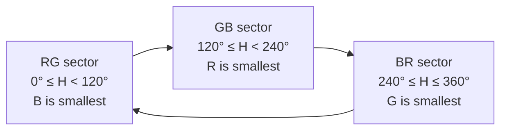
*Fig. 13: The three sectors of the hue circle (red at 0°, green at 120°, blue at 240°). Draw as a circle divided in three.*

**Procedure (H in degrees, S and I in [0,1]):**

**(i) RG sector (0° ≤ H < 120°):**
- B = I(1 − S)
- R = I [1 + S cos H / cos(60° − H)]
- G = 3I − (R + B)

**(ii) GB sector (120° ≤ H < 240°):** first set H = H − 120°, then
- R = I(1 − S)
- G = I [1 + S cos H / cos(60° − H)]
- B = 3I − (R + G)

**(iii) BR sector (240° ≤ H ≤ 360°):** first set H = H − 240°, then
- G = I(1 − S)
- B = I [1 + S cos H / cos(60° − H)]
- R = 3I − (G + B)

**Example.** H = 0°, S = 1, I = 1/3 (RG sector):
B = (1/3)(1 − 1) = 0; R = (1/3)[1 + 1·cos 0°/cos 60°] = (1/3)(1 + 2) = 1; G = 3(1/3) − (1 + 0) = 0. So (R, G, B) = (1, 0, 0), **pure red**, which matches the RGB → HSI example.

**For reference, RGB → HSI:** H = θ (if B ≤ G) or 360° − θ (if B > G), θ = cos<sup>−1</sup>{½[(R−G) + (R−B)] / [(R−G)² + (R−B)(G−B)]<sup>½</sup>}; S = 1 − 3 min(R,G,B)/(R+G+B); I = (R+G+B)/3.

### Colour segmentation
**Segmentation** partitions an image into regions. In colour images, regions can be separated by **colour** much more easily than by grey level.

**(a) Segmentation in HSI space.**
1. Colour is described by **hue**, so segment the hue image.
2. **Saturation** is used as a **masking image** to isolate regions of interest in the hue image (pixels with low saturation have unreliable hue). Threshold S (e.g. at 10% of its max) to make a binary mask.
3. Multiply the mask by the hue image and threshold the product to select the desired colour range.
4. Intensity is seldom used because it carries no colour information.

**(b) Segmentation in RGB space (gives better results).**
1. Choose a set of sample points representative of the colours of interest; compute their **average colour a** (the prototype).
2. Classify each RGB pixel z as belonging to the colour of interest if its distance from a is within a threshold D<sub>0</sub>:
   - **Euclidean distance:** D(z,a) = ‖z − a‖ = [(z<sub>R</sub>−a<sub>R</sub>)² + (z<sub>G</sub>−a<sub>G</sub>)² + (z<sub>B</sub>−a<sub>B</sub>)²]<sup>½</sup> ≤ D<sub>0</sub> (a **sphere** of radius D<sub>0</sub>).
   - **Mahalanobis distance:** D = [(z − a)ᵀ C<sup>−1</sup> (z − a)]<sup>½</sup> using the covariance matrix C (an **ellipsoid**).
   - **Bounding box** (fastest): centre the box on a, with sides proportional to the standard deviation of each colour component (e.g. 1.25σ). This avoids square roots.
3. Pixels inside → 1 (object); outside → 0.

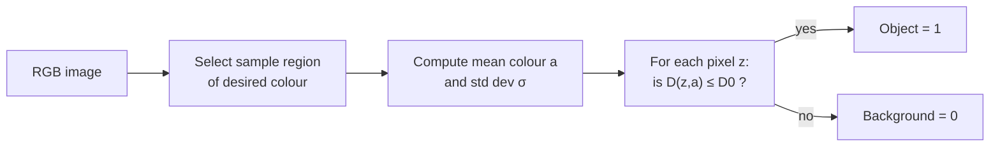
*Fig. 14: Colour segmentation in RGB space.*

**Applications:** detecting skin in face detection, separating fruits by ripeness, extracting vegetation in satellite images, detecting reddish regions (tumours, signs).

**Conclusion.** HSI-to-RGB conversion uses one of three sets of formulas depending on the hue sector, so that HSI processing results can be displayed. Colour segmentation can be done in HSI by thresholding hue with a saturation mask, or more accurately in RGB by measuring the distance of each pixel from a prototype colour.
:::

---

## Q7 (a) Grey-scale dilation and erosion numerical (2017 PYQ)

::: ans Answer

**Introduction.** Morphology extends from binary to **grey-scale images**. For a grey-scale image f(x,y) and a structuring element b(x,y), dilation and erosion become **max** and **min** operations.

**Definitions.**
- <u>**Grey-scale dilation:** (f ⊕ b)(x,y) = max{ f(x − s, y − t) + b(s,t) | (s,t) ∈ D<sub>b</sub> }</u>
- <u>**Grey-scale erosion:** (f ⊖ b)(x,y) = min{ f(x + s, y + t) − b(s,t) | (s,t) ∈ D<sub>b</sub> }</u>

(D<sub>b</sub> = domain of b. With a **flat** SE (all zeros), dilation is simply the local **maximum** and erosion the local **minimum**.)

**Effects.** Dilation makes the image **brighter** overall and reduces or removes dark details; erosion makes it **darker** and reduces bright details.

**Given.**
```
A =  7 8 2 4        B =  1 1 1
     6 4 3 3             1 2 1
     7 3 6 6             1 1 1
     4 4 2 3
```
B is symmetric, so its reflection equals B and the dilation formula becomes "add B to the neighbourhood, take the maximum". Pixels outside the image are ignored (only positions where B overlaps A are used).

**Diagram (procedure).**
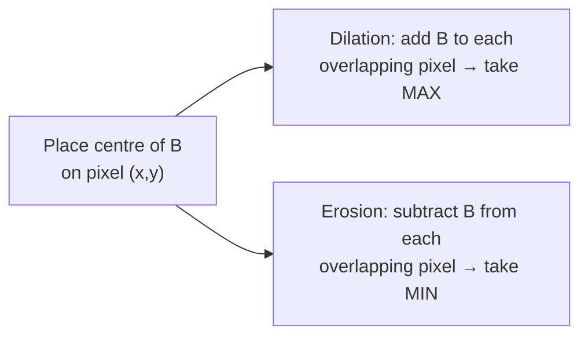

### Dilation (f + b, maximum)
Worked pixels:
- **(0,0) = 7:** neighbours 7, 8, 6, 4 with weights 2 (centre), 1, 1, 1 → 7+2 = 9, 8+1 = 9, 6+1 = 7, 4+1 = 5 → max = **9**
- **(0,1) = 8:** neighbours 7, 8, 2, 6, 4, 3 → 7+1, 8+2 = 10, 2+1, 6+1, 4+1, 3+1 → max = **10**
- **(1,1) = 4:** 3×3 window 7 8 2 / 6 4 3 / 7 3 6 → centre 4+2 = 6, others +1: max(8, 9, 3, 7, 4, 8, 4, 7) = **9**
- **(2,2) = 6:** window 4 3 3 / 3 6 6 / 4 2 3 → centre 6+2 = 8, others + 1: max = **8**

Doing the same for all 16 pixels:
```
A ⊕ B =   9 10  9  6
          9  9  9  7
          9  8  8  8
          8  8  7  7
```

### Erosion (f − b, minimum)
Worked pixels:
- **(0,0) = 7:** 7−2 = 5, 8−1 = 7, 6−1 = 5, 4−1 = 3 → min = **3**
- **(0,2) = 2:** neighbours 8, 2, 4, 4, 3, 3 → 8−1, 2−2 = 0, 4−1, 4−1, 3−1, 3−1 → min = **0**
- **(1,1) = 4:** window 7 8 2 / 6 4 3 / 7 3 6 → 4−2 = 2, others −1: 6, 7, 1, 5, 2, 6, 2, 5 → min = **1**
- **(3,2) = 2:** neighbours 3, 6, 6, 4, 2, 3 → 2−2 = 0 → min = **0**

All 16 pixels:
```
A ⊖ B =   3  1  0  1
          2  1  1  1
          2  1  1  1
          2  1  0  1
```

**Observation.** Dilation increased all values (range 6–10): bright regions grew and the dark pixels 2 and 3 were removed. Erosion decreased all values (range 0–3): dark regions grew and bright peaks 7 and 8 were removed. This is exactly the max/min behaviour of grey-scale morphology. (If the question intends a **flat** 3×3 SE, use max and min of the window without adding/subtracting: dilation = 8 8 8 4 / 8 8 8 6 / 7 7 6 6 / 7 7 6 6, erosion = 4 2 2 2 / 3 2 2 2 / 3 2 2 2 / 3 2 2 2.)

**Applications.** Grey-scale opening (erosion then dilation) removes small bright details; closing removes small dark details; the morphological gradient (dilation − erosion) highlights edges; top-hat transformation corrects uneven illumination.
:::

## Q7 (b) Region filling, connected components and convex hull

::: ans Answer

**Introduction.** When dealing with binary images, one of the principal uses of morphology is to extract components that are useful in representing and describing shape. Using dilation, erosion, intersection and the hit-or-miss transform, we can build simple morphological algorithms. Three important ones are region filling, extraction of connected components and the convex hull.

**Definition.** <u>Morphological algorithms are iterative procedures built from basic morphological operations and set operations that extract shape components such as filled regions, connected components and convex hulls from binary images.</u>

### 1. Region (hole) filling
A **hole** is a background region surrounded by a connected border of foreground pixels. Given the boundary A and a starting point p inside it:

**X<sub>k</sub> = (X<sub>k−1</sub> ⊕ B) ∩ Aᶜ,  k = 1, 2, 3, …**

- X<sub>0</sub> = an array of 0s except a 1 at the starting point p.
- B = the 3×3 **cross-shaped** (4-connected) structuring element.
- Stop when **X<sub>k</sub> = X<sub>k−1</sub>**. The union **X<sub>k</sub> ∪ A** is the filled region with its boundary.
- The intersection with Aᶜ at each step limits the dilation to inside the region; without it, the dilation would fill the entire image. This is called **conditional dilation**.

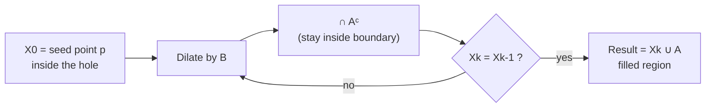
*Fig. 15: Region filling.*

**Application:** filling holes in segmented objects (e.g. reflections inside balls in an image, or the hollow centres of cells), so that measurements such as area are correct.

### 2. Extraction of connected components
Let A be a set containing one or more connected components, and p a known point in one of them:

**X<sub>k</sub> = (X<sub>k−1</sub> ⊕ B) ∩ A,  k = 1, 2, 3, …**

- X<sub>0</sub> = point p; B = 3×3 square SE (for 8-connectivity).
- Stop when X<sub>k</sub> = X<sub>k−1</sub>; then **Y = X<sub>k</sub>** is the connected component containing p.
- Difference from region filling: intersection with **A** (the object) instead of Aᶜ.
- Repeat with a new seed in the remaining pixels to extract and **label** every component.


**Application:** automated inspection; e.g. detecting foreign objects (bone fragments) in packaged chicken breast X-ray images: threshold the image, erode to remove small objects, then extract the connected components and count the pixels in each to find large fragments. Also used for counting objects (cells, coins).

### 3. Convex hull
A set A is **convex** if the straight line segment joining any two points of A lies entirely within A. The **convex hull H** of an arbitrary set S is the **smallest convex set containing S**. The set difference H − S is the **convex deficiency** D, useful for object description.

**Algorithm.** Let B<sup>i</sup>, i = 1, 2, 3, 4, be four structuring elements (each one detects a concave corner from one direction; they are rotations of each other by 90°).

**X<sub>k</sub><sup>i</sup> = (X<sub>k−1</sub> ⊛ B<sup>i</sup>) ∪ A,  i = 1, 2, 3, 4,  k = 1, 2, …,  with X<sub>0</sub><sup>i</sup> = A**

- ⊛ = hit-or-miss transform. Iterate each B<sup>i</sup> until convergence (X<sub>k</sub><sup>i</sup> = X<sub>k−1</sub><sup>i</sup>); call the result D<sup>i</sup>.
- **C(A) = D<sup>1</sup> ∪ D<sup>2</sup> ∪ D<sup>3</sup> ∪ D<sup>4</sup>**.
- To prevent the hull from growing beyond the minimum dimensions needed, limit the growth to the bounding box of A.

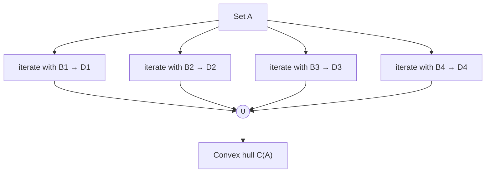
*Fig. 16: Convex hull computation.*

**Applications:** shape description (convexity = area/hull area), detecting defects (convex deficiency shows dents), hand-gesture recognition (finger gaps), and object recognition.

**Conclusion.** Region filling grows a seed inside a boundary with conditional dilation on Aᶜ, connected-component extraction grows a seed inside the object with conditional dilation on A, and the convex hull is built by iterated hit-or-miss transforms with four rotated structuring elements.
:::

---

## Q8 (a) Multilevel and local thresholding; role of illumination

::: ans Answer

**Introduction.** Thresholding is central to segmentation because of its intuitive properties, simplicity and speed. A single global threshold works only when the histogram has two well-separated peaks and illumination is uniform. When there are **several objects** or **uneven illumination**, we need **multilevel** and **local (variable)** thresholding.

**Definition.**
- <u>**Multilevel thresholding** segments an image into more than two classes using two or more thresholds T<sub>1</sub> < T<sub>2</sub> < … chosen at the valleys of a multimodal histogram.</u>
- <u>**Local (adaptive) thresholding** uses a threshold that changes over the image, computed at each pixel from the properties of its neighbourhood.</u>

**Thresholding in general.** T = T[x, y, p(x,y), f(x,y)], where p(x,y) is a local property (e.g. the local mean). If T depends only on f, it is **global**; if it also depends on p(x,y), it is **local**; if it depends on x and y as well, it is **dynamic/adaptive**.

### Role of illumination
Image formation: **f(x,y) = i(x,y) · r(x,y)**.
1. If the illumination i is **uniform**, the histogram reflects only the reflectance of the object and background, and it is **bimodal** with a clear valley; one global T separates them.
2. If the illumination is **non-uniform** (e.g. a light source on one side gives a ramp of brightness), multiplying the reflectance by the illumination spreads each peak. The two modes **merge**; the valley disappears and **no single global threshold** can separate object from background: parts of the brightly lit background are classed as object and parts of the dark object as background.
3. **Remedies:**
   - Correct the illumination: if i(x,y) can be imaged (photograph a uniform white surface under the same lighting), divide: f/i = r, then threshold the reflectance.
   - **Homomorphic filtering** to suppress illumination (low frequencies).
   - **Morphological top-hat** transformation to remove the slowly varying background.
   - **Local/adaptive thresholding** (below).

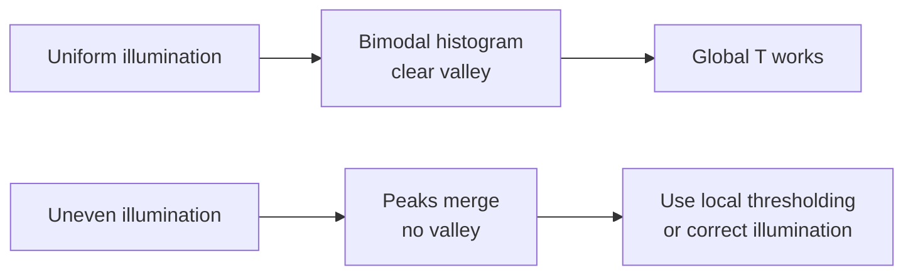
*Fig. 17: Effect of illumination on thresholding.*

### Multilevel thresholding
For an image with, e.g., **two objects on a background** (three modes):

**g(x,y) = a if f(x,y) > T<sub>2</sub>;  b if T<sub>1</sub> < f(x,y) ≤ T<sub>2</sub>;  c if f(x,y) ≤ T<sub>1</sub>**

**Method:**
1. Compute and smooth the histogram.
2. Identify the peaks (modes) and the **valleys** between them; set T<sub>1</sub>, T<sub>2</sub> at the valley minima.
3. Or extend **Otsu's method** to K classes: choose T<sub>1</sub>, T<sub>2</sub> to **maximise the between-class variance** σ²<sub>B</sub> = P<sub>1</sub>(m<sub>1</sub> − m<sub>G</sub>)² + P<sub>2</sub>(m<sub>2</sub> − m<sub>G</sub>)² + P<sub>3</sub>(m<sub>3</sub> − m<sub>G</sub>)², where P<sub>k</sub> and m<sub>k</sub> are the probability and mean of class k and m<sub>G</sub> the global mean.
4. Label every pixel with a, b or c.

```
count
  |  /\        /\         /\
  | /  \      /  \       /  \
  |/    \____/    \_____/    \___ intensity
          T1          T2
   background  object 1   object 2
```
*Fig. 18: Trimodal histogram with two thresholds.*

**Example.** A medical image with background (≈ 30), soft tissue (≈ 120) and bone (≈ 220): T<sub>1</sub> ≈ 75, T<sub>2</sub> ≈ 170 separate the three classes.

**Limitations:** with more than two thresholds the results become unreliable; noise and overlapping modes make valleys shallow.

### Local (variable) thresholding
1. **Image partitioning:** divide the image into non-overlapping rectangles small enough that illumination is approximately uniform in each; threshold each sub-image with its own (e.g. Otsu) threshold.
2. **Local properties:** compute the mean m<sub>xy</sub> and standard deviation σ<sub>xy</sub> in a neighbourhood S<sub>xy</sub> of each pixel:
   **T<sub>xy</sub> = aσ<sub>xy</sub> + b m<sub>xy</sub>** (or T<sub>xy</sub> = a σ<sub>xy</sub> + b m<sub>G</sub>)
   g(x,y) = 1 if f(x,y) > T<sub>xy</sub>, 0 otherwise.
3. **Moving averages:** compute the moving average m along scan lines in a zig-zag pattern (useful for document images with text); threshold at T<sub>xy</sub> = b·m<sub>xy</sub>.

**Applications:** scanned documents with shading, images of cells under uneven microscope lighting, licence plates in shadows.

**Conclusion.** Uniform illumination gives a bimodal histogram where global thresholding works. For multiple objects, multilevel thresholding places several thresholds at the valleys or maximises Otsu's between-class variance; for uneven illumination, local thresholding computes a separate threshold for each region or pixel.
:::

## Q8 (b) Region growing and region splitting and merging

::: ans Answer

**Introduction.** Segmentation can be based on finding boundaries (edge-based) or on finding **regions directly** (region-based). Region-based methods use the **similarity** of pixels: pixels with similar properties are grouped into one region. The two main techniques are **region growing** and **region splitting and merging**.

**Definition.** <u>Region-based segmentation partitions an image R into sub-regions R<sub>1</sub>, R<sub>2</sub>, …, R<sub>n</sub> such that (a) ∪R<sub>i</sub> = R; (b) each R<sub>i</sub> is connected; (c) R<sub>i</sub> ∩ R<sub>j</sub> = ∅ for i ≠ j; (d) Q(R<sub>i</sub>) = TRUE for every i; (e) Q(R<sub>i</sub> ∪ R<sub>j</sub>) = FALSE for any adjacent R<sub>i</sub>, R<sub>j</sub>, where Q is a logical uniformity predicate.</u>

### 1. Region growing
A procedure that groups pixels or sub-regions into larger regions based on **predefined criteria for growth**.

**Algorithm.**
1. Select a set of **seed points** (e.g. pixels with the brightest values, or the peaks of the histogram, or chosen using prior knowledge).
2. Define a **similarity (predicate)** criterion, e.g. |f(x,y) − f(seed)| ≤ T, or a range of grey level, colour or texture.
3. Grow regions by appending to each seed those **neighbouring pixels** (4- or 8-connected) that satisfy the criterion.
4. Repeat for the newly added pixels until no more pixels can be added (**stopping rule**).

```mermaid
flowchart LR
  S[Select seed points] --> C[Check 8-neighbours]
  C --> Q{"similar to seed?<br/>|f − f_seed| ≤ T"}
  Q -->|yes| A[Add to region] --> C
  Q -->|no| N[Reject]
  C --> E[No more pixels → stop]
```
*Fig. 19: Region growing.*

**Example.** Image row: 10 11 12 50 52 11; seed = 11 (2nd pixel), T = 3: 10, 12 join; 50 is rejected; the region is {10, 11, 12}.

**Problems:** selection of seeds; selection of the similarity criterion; formulating a stopping rule; results depend on the order of processing.

### 2. Region splitting and merging
Instead of seeds, start with the **whole image** and **subdivide** it into a set of disjoint quadrants, then **merge** and/or **split** them to satisfy the segmentation conditions.

**Quadtree representation.** R is the entire image. If Q(R) = FALSE, divide R into four quadrants R<sub>1</sub>, R<sub>2</sub>, R<sub>3</sub>, R<sub>4</sub>; if Q is FALSE for any quadrant, subdivide it into four sub-quadrants; and so on. This gives a **quadtree** where each node has exactly four descendants.

```mermaid
flowchart TB
  R["R (whole image)"] --> R1[R1]
  R --> R2[R2]
  R --> R3[R3]
  R --> R4["R4 (not uniform)"]
  R4 --> R41[R41]
  R4 --> R42[R42]
  R4 --> R43[R43]
  R4 --> R44[R44]
```
*Fig. 20: Quadtree of a partitioned image. Also draw the image square divided into quadrants, with R4 divided again.*

**Algorithm.**
1. **Split** into four disjoint quadrants any region R<sub>i</sub> for which **Q(R<sub>i</sub>) = FALSE**.
2. When no further splitting is possible, **merge** any adjacent regions R<sub>j</sub> and R<sub>k</sub> for which **Q(R<sub>j</sub> ∪ R<sub>k</sub>) = TRUE**.
3. **Stop** when no further merging is possible.

(A variation merges any adjacent regions that each satisfy Q individually, even if their union does not.)

**Predicate examples.**
- Q(R) = TRUE if at least 80% of the pixels in R satisfy |z<sub>j</sub> − m<sub>R</sub>| ≤ 2σ<sub>R</sub>.
- Q(R) = TRUE if σ<sub>R</sub> > a AND 0 < m<sub>R</sub> < b (e.g. to segment a textured region such as a nebula).
- Q(R) = TRUE if max(R) − min(R) ≤ ε.

**Comparison.**

| Region growing | Splitting and merging |
|---|---|
| bottom-up, starts from seeds | top-down, starts from the whole image |
| needs seed selection | no seeds needed |
| grows pixel by pixel | works on quadrants (quadtree) |
| boundaries follow pixels | boundaries can be blocky |
| sensitive to seed and order | systematic, less order-dependent |

**Advantages of region-based methods:** regions are connected and closed by construction, more robust to noise than edge methods, use spatial information. **Disadvantages:** computationally expensive; over- or under-segmentation if the predicate is poorly chosen.

**Conclusion.** Region growing builds regions from seeds by adding similar neighbours, while region splitting and merging starts from the whole image, splits non-uniform quadrants using a quadtree, and merges adjacent similar regions until the uniformity predicate is satisfied everywhere.
:::
