# Mock Paper 3

**B.Tech (Seventh Semester) Examination 2026-27 · CS-403T · Digital Image Processing**<br>
**Time: Three Hours · Maximum Marks: 70**<br>
**Note:** Attempt any **five** questions. All questions carry equal marks (14 each).

This paper completes the syllabus: registration, stereo imaging, Wiener filtering, Fourier transform properties, thinning and skeletons, representation and description, and recognition. It also has the 2017 arithmetic-operations numerical and the histogram-specification numerical.

## Question paper

| Q | (a) 7 marks | (b) 7 marks |
|---|---|---|
| 1 | What is digital image processing? Explain its applications, especially in medicine. | What is an image model? Explain the simple image model f(x,y) = i(x,y)·r(x,y) and image sensing and acquisition. |
| 2 | Explain histogram specification (matching). Match the 8×8 image with n<sub>k</sub> = 8, 10, 10, 2, 12, 16, 4, 2 to the specified histogram 0, 0, 0, 8, 8, 8, 32, 8. | Explain local enhancement. For A = 1 2 3 4 / 5 5 6 6 / 6 7 6 6 / 6 7 2 3 and B = 1 3 5 7 / 8 7 0 1 / 3 5 6 7 / 1 3 5 7, find A+B, A−B, A×B and A/B. |
| 3 | Explain the basics of spatial filtering. Differentiate between correlation and convolution. | Explain gradient operators (Roberts, Prewitt, Sobel) for edge detection. Find the Sobel gradient at the centre of 10 10 10 / 10 10 80 / 80 80 80. |
| 4 | Explain the 2-D discrete Fourier transform and its properties. | Explain sharpening in the frequency domain: ideal, Butterworth and Gaussian high-pass filters, and high-frequency emphasis. |
| 5 | Compare the inverse filter with the Wiener filter. How does Wiener filtering minimise the mean-square error? | Explain adaptive filters: adaptive local noise-reduction filter and adaptive median filter. Where are they used? |
| 6 | Explain colour transformations and colour image sharpening. | Explain the CMY/CMYK colour model and pseudo-colour image processing. |
| 7 | Explain thinning, thickening and skeletons. Explain their importance in medical imaging. | Explain logic operations involving binary images. Apply binary dilation and erosion with a 3×3 square SE to the given image. |
| 8 | What is image registration? Explain geometric transformation, mapping, and stereo imaging (correspondence and depth). | Write short notes on any **two**: (i) edge linking and the Hough transform (ii) corner detection (iii) chain codes and boundary description (iv) object recognition methods. |

Image for Q7(b) (6×6): 0 0 0 0 0 0 / 0 1 1 1 0 0 / 0 1 1 1 0 0 / 0 1 1 1 1 0 / 0 0 0 0 0 0 / 0 0 0 0 0 0

---

## Q1 (a) Digital image processing and its applications

::: ans Answer

**Introduction.** Vision is the most advanced of our senses, so images play the most important role in human perception. Unlike humans, who see only the visible band, imaging machines cover almost the entire electromagnetic (EM) spectrum, from gamma rays to radio waves. Digital image processing therefore has an extremely wide range of applications.

**Definition.** <u>An image is a two-dimensional function f(x,y) where x, y are spatial coordinates and the amplitude f is the intensity (grey level) at that point. When x, y and f are finite and discrete, the image is a digital image, and digital image processing is the processing of digital images by means of a digital computer.</u>

**Levels of processing.**
1. **Low-level:** primitive operations; input and output are images (noise reduction, contrast enhancement, sharpening).
2. **Mid-level:** segmentation, description of objects, classification; input images, output attributes (edges, contours, identity).
3. **High-level:** "making sense" of recognised objects (image analysis, computer vision).

**Classification of applications by the source of energy (diagram).**

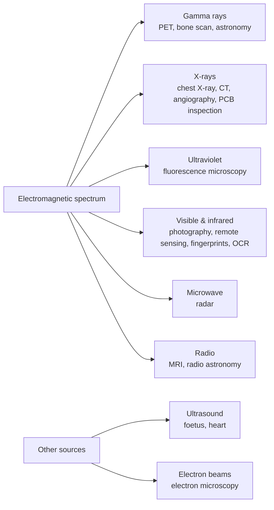
*Fig. 1: Applications classified by energy source.*

**General applications.**
1. **Gamma-ray imaging:** nuclear medicine: a radioactive isotope is injected and its emission imaged; bone scans to locate infection or tumours; **PET** (positron emission tomography) for tumours in the brain and lungs; astronomical observation.
2. **X-ray imaging:** the oldest source; chest X-rays, **angiography** (contrast-enhanced images of blood vessels), **computed tomography (CT)** slices, and industrial inspection of circuit boards for missing components or broken traces.
3. **Ultraviolet:** lithography, industrial inspection, fluorescence microscopy, biological imaging.
4. **Visible and infrared:** light microscopy, astronomy, **remote sensing** (LANDSAT multispectral images for land use, crops, weather), law enforcement (fingerprints, number plates, counterfeit currency), industrial visual inspection (missing pills, bottle fill levels), face recognition.
5. **Microwave:** imaging radar can collect data over any region at any time, regardless of weather or lighting (penetrates clouds).
6. **Radio:** **MRI** in medicine; radio astronomy.
7. **Other modalities:** ultrasound in medicine and geology (seismic imaging), electron microscopy (magnification up to 10,000×), computer-generated (synthetic) images for modelling.

**Applications in medicine (as asked in 2019).**
1. **Image acquisition and reconstruction:** CT, MRI and PET images are reconstructed from projections using image-processing algorithms (tomography).
2. **Enhancement:** histogram equalization and contrast stretching of X-rays; sharpening (Laplacian, unsharp masking) to make bone fractures and lung nodules visible; image negatives of mammograms.
3. **Noise removal:** median filtering of speckle/impulse noise in ultrasound images; averaging of low-dose images.
4. **Digital subtraction angiography:** subtracting the pre-dye mask from the live image to show only blood vessels.
5. **Segmentation:** separating tumours, organs, cells and blood vessels for measurement (area, volume).
6. **Morphology:** thinning and skeletons of blood vessels and nerves; counting cells; detecting bone fragments.
7. **Registration and fusion:** aligning CT (bone detail) with MRI (soft tissue) or PET (function) for diagnosis and treatment planning.
8. **Computer-aided diagnosis:** classification of tissue as normal/abnormal (breast cancer screening, diabetic retinopathy).
9. **Compression and telemedicine:** DICOM images compressed and transmitted to remote specialists.

**Conclusion.** DIP spans the whole EM spectrum and almost every field, from astronomy to industry. In medicine it is indispensable: it forms images (CT, MRI), enhances and restores them, segments and measures structures, and supports diagnosis.
:::

## Q1 (b) Image model and image sensing and acquisition

::: ans Answer

**Introduction.** Most images are generated by the combination of an **illumination source** and the **reflection or absorption** of energy from that source by the elements of the scene. To process images we need (1) a model of how the intensity values arise and (2) sensors that convert the incoming energy into digital data.

**Definition.** <u>A simple image model expresses the intensity of a monochrome image f(x,y) as the product of the illumination i(x,y) falling on the scene and the reflectance r(x,y) of the objects in it: f(x,y) = i(x,y)·r(x,y).</u>

### Simple image model
1. f(x,y) is positive and finite: **0 < f(x,y) < ∞**, because it is proportional to energy radiated by a physical source.
2. **f(x,y) = i(x,y) · r(x,y)**, where
   - **0 < i(x,y) < ∞**: illumination, the amount of source illumination incident on the scene; determined by the source.
   - **0 < r(x,y) < 1**: reflectance, the amount of illumination reflected by the objects; 0 means total absorption, 1 means total reflectance. It is determined by the characteristics of the objects.
3. For images formed by **transmission** (e.g. X-rays), a **transmissivity** function replaces reflectance.

**Typical values.**

| Illumination i | Value (lm/m²) | Reflectance r | Value |
|---|---|---|---|
| Clear sunny day | ~90,000 | Black velvet | 0.01 |
| Cloudy day | ~10,000 | Stainless steel | 0.65 |
| Full moon night | ~0.1 | Flat white wall paint | 0.80 |
| Office lighting | ~1,000 | Silver-plated metal | 0.90 |
|  |  | Snow | 0.93 |

4. **Grey level.** The intensity ℓ of a monochrome image at any point lies in **L<sub>min</sub> ≤ ℓ ≤ L<sub>max</sub>**, where L<sub>min</sub> = i<sub>min</sub>r<sub>min</sub> and L<sub>max</sub> = i<sub>max</sub>r<sub>max</sub>. The interval [L<sub>min</sub>, L<sub>max</sub>] is the **grey scale**; in practice it is shifted to **[0, L−1]**, where 0 = black and L−1 = white.
5. **Frequency interpretation:** illumination varies slowly (low frequencies); reflectance varies sharply at object boundaries (high frequencies). This is the basis of **homomorphic filtering**.

### Image sensing and acquisition
**Principle:** incoming energy is transformed into a voltage by the combination of input electrical power and a sensor material responsive to the particular type of energy. The output voltage waveform is digitised (sampled and quantized).

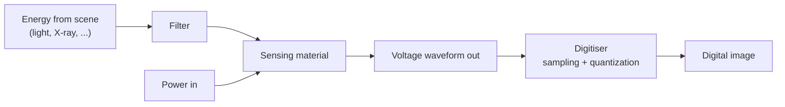
*Fig. 2: A single imaging sensor.*

**Three arrangements of sensors:**
1. **Single sensor:** e.g. a photodiode (output voltage proportional to light). To get a 2-D image, there must be relative displacement in x and y between sensor and scene: e.g. the film is mounted on a rotating drum and the sensor moves linearly. Slow but inexpensive and high-resolution (microdensitometers).
2. **Sensor strips:** an in-line arrangement of sensors gives one line of the image; motion perpendicular to the strip gives the other dimension. Used in **flatbed scanners** and airborne imaging. **Ring-shaped strips** are used in medical and industrial **CT**: a rotating X-ray source with sensors opposite; the output is processed by reconstruction algorithms to form cross-sectional images.
3. **Sensor arrays (2-D):** individual sensors arranged in a 2-D array, e.g. **CCD** or **CMOS** arrays (4000 × 4000 elements or more) in digital cameras. No motion is needed: the complete image is formed at once, by focusing the energy onto the array with a lens. Each sensor's response is proportional to the integral of the light energy on it.

**Image acquisition using an array (steps):** illumination source → light reflected from the scene element → imaging system (lens) collects it → image plane (sensor array) → output digitised → digital image.

**Conclusion.** The intensity of an image is the product of illumination and reflectance, giving grey levels in [0, L−1]. Images are acquired by single sensors with motion, sensor strips (scanners, CT) or 2-D arrays (cameras), whose analogue output is sampled and quantized into a digital image.
:::

---

## Q2 (a) Histogram specification (matching) with numerical

::: ans Answer

**Introduction.** Histogram equalization automatically produces an output with an approximately **uniform** histogram. This is not always the best approach. For some images (e.g. an image with a large dark area that dominates the histogram) equalization gives a washed-out result. Sometimes we want the output histogram to have a **specified shape**. The method that produces this is **histogram matching** or **histogram specification**.

**Definition.** <u>Histogram specification is the process of transforming the grey levels of an image so that its histogram matches a specified (desired) histogram p<sub>z</sub>(z), using the equalization transformations of both the input and the specified histograms.</u>

**Principle.** Let r be the input level with PDF p<sub>r</sub>, and z the output level with desired PDF p<sub>z</sub>.
1. Equalize the input: **s = T(r) = (L−1) ∫<sub>0</sub><sup>r</sup> p<sub>r</sub>(w) dw**
2. Equalize the specified histogram: **G(z) = (L−1) ∫<sub>0</sub><sup>z</sup> p<sub>z</sub>(t) dt = s**
3. Therefore **z = G<sup>−1</sup>(s) = G<sup>−1</sup>[T(r)]**. Both s and G(z) are uniform, so they can be equated.

**Diagram.**
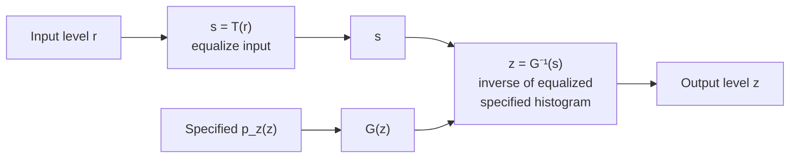
*Fig. 3: Histogram specification.*

**Discrete procedure.**
1. Compute the histogram p<sub>r</sub>(r) of the input and find s<sub>k</sub> = (L−1) Σ p<sub>r</sub>(r<sub>j</sub>), rounded.
2. Compute G(z<sub>q</sub>) = (L−1) Σ<sub>i=0</sub><sup>q</sup> p<sub>z</sub>(z<sub>i</sub>) for all q, rounded.
3. For each s<sub>k</sub>, find the z<sub>q</sub> for which G(z<sub>q</sub>) is **closest** to s<sub>k</sub> (if several, take the smallest). This gives the mapping s<sub>k</sub> → z<sub>q</sub>.
4. Map every pixel r<sub>k</sub> → s<sub>k</sub> → z<sub>q</sub>.

**Numerical.** L = 8, MN = 64.

**Step 1. Equalize the input** (n<sub>k</sub> = 8, 10, 10, 2, 12, 16, 4, 2):

| r<sub>k</sub> | 0 | 1 | 2 | 3 | 4 | 5 | 6 | 7 |
|---|---|---|---|---|---|---|---|---|
| n<sub>k</sub> | 8 | 10 | 10 | 2 | 12 | 16 | 4 | 2 |
| cumulative | 8 | 18 | 28 | 30 | 42 | 58 | 62 | 64 |
| 7 × cum/64 | 0.88 | 1.97 | 3.06 | 3.28 | 4.59 | 6.34 | 6.78 | 7.00 |
| s<sub>k</sub> | 1 | 2 | 3 | 3 | 5 | 6 | 7 | 7 |

**Step 2. Equalize the specified histogram** (counts 0, 0, 0, 8, 8, 8, 32, 8):

| z<sub>q</sub> | 0 | 1 | 2 | 3 | 4 | 5 | 6 | 7 |
|---|---|---|---|---|---|---|---|---|
| specified count | 0 | 0 | 0 | 8 | 8 | 8 | 32 | 8 |
| cumulative | 0 | 0 | 0 | 8 | 16 | 24 | 56 | 64 |
| 7 × cum/64 | 0 | 0 | 0 | 0.88 | 1.75 | 2.63 | 6.13 | 7.00 |
| G(z<sub>q</sub>) | 0 | 0 | 0 | 1 | 2 | 3 | 6 | 7 |

**Step 3. Map s<sub>k</sub> → z<sub>q</sub>** (closest G value):
- s = 1 → G(3) = 1 → **z = 3**
- s = 2 → G(4) = 2 → **z = 4**
- s = 3 → G(5) = 3 → **z = 5**
- s = 5 → closest G is 6 (z = 6; G(5) = 3 is 2 away) → **z = 6**
- s = 6 → G(6) = 6 → **z = 6**
- s = 7 → G(7) = 7 → **z = 7**

**Step 4. Final mapping r → z:** 0→3, 1→4, 2→5, 3→5, 4→6, 5→6, 6→7, 7→7.

**Resulting histogram:**

| z | 0 | 1 | 2 | 3 | 4 | 5 | 6 | 7 |
|---|---|---|---|---|---|---|---|---|
| pixels | 0 | 0 | 0 | 8 | 10 | 12 | 28 | 6 |

Compared with the specified 0, 0, 0, 8, 8, 8, 32, 8, the result is a close approximation (exact matching is impossible because pixels at one level cannot be split).

**Equalization vs specification.**

| Equalization | Specification |
|---|---|
| target is a uniform histogram | target is any specified histogram |
| fully automatic | needs the desired histogram |
| one transformation T | two transformations T and G<sup>−1</sup> |
| may over-enhance | gives controlled enhancement |

**Conclusion.** Histogram specification gives control over the shape of the output histogram by mapping r → s through the input's equalization and s → z through the inverse of the specified histogram's equalization; here the image was pushed into the bright range 3–7 as specified.
:::

## Q2 (b) Local enhancement and arithmetic operations numerical (2017 PYQ)

::: ans Answer

**Introduction.** Histogram equalization and specification are **global** methods: the transformation is based on the grey-level distribution of the whole image. They may fail to enhance details in **small areas**, because the number of pixels there has little influence on the global transformation. **Local enhancement** solves this.

**Definition.** <u>Local enhancement is the process of computing a transformation for each pixel from the grey-level distribution (or statistics) of a neighbourhood centred on that pixel, so that details in small regions are enhanced.</u>

### Local histogram processing
1. Define a square or rectangular **neighbourhood** and move its centre from pixel to pixel.
2. At each location, compute the **histogram of the pixels in the neighbourhood**.
3. Obtain the histogram-equalization (or specification) transformation function from it.
4. Use it to map the grey level of the **centre pixel only**.
5. Move to the next pixel; update the histogram incrementally (only one row/column changes).


*Fig. 4: Local histogram equalization.*

**Example:** an image with small dark squares containing hidden symbols; global equalization barely changes them, but 3×3 local equalization reveals the symbols.

### Using histogram statistics
Local mean m<sub>S<sub>xy</sub></sub> (average brightness) and local standard deviation σ<sub>S<sub>xy</sub></sub> (contrast) of the neighbourhood are compared with the global mean m<sub>G</sub> and global standard deviation σ<sub>G</sub>:

g(x,y) = **E · f(x,y)** if m<sub>S<sub>xy</sub></sub> ≤ k<sub>0</sub>m<sub>G</sub> AND k<sub>1</sub>σ<sub>G</sub> ≤ σ<sub>S<sub>xy</sub></sub> ≤ k<sub>2</sub>σ<sub>G</sub>; otherwise g(x,y) = f(x,y).

This enhances only **dark** areas (low local mean) with **low but non-zero contrast**, leaving everything else unchanged. Example: an SEM image of a tungsten filament, where the dark area on the right hides detail; E = 4, k<sub>0</sub> = 0.4, k<sub>1</sub> = 0.02, k<sub>2</sub> = 0.4 reveal it.

### Arithmetic operations numerical
Arithmetic operations between images are done **pixel by pixel** (element by element).
```
A = 1 2 3 4        B = 1 3 5 7
    5 5 6 6            8 7 0 1
    6 7 6 6            3 5 6 7
    6 7 2 3            1 3 5 7
```
**A + B:**
```
 2  5  8 11
13 12  6  7
 9 12 12 13
 7 10  7 10
```
**A − B:**
```
 0 -1 -2 -3
-3 -2  6  5
 3  2  0 -1
 5  4 -3 -4
```
Negative values cannot be displayed; either clip them to 0, or scale: f<sub>m</sub> = f − min = f + 4, then multiply by (L−1)/max(f<sub>m</sub>) = (L−1)/10.

**A × B** (pixel-wise multiplication, as used in image processing):
```
 1  6 15 28
40 35  0  6
18 35 36 42
 6 21 10 21
```
(If the examiner means matrix multiplication, A·B = 30 44 43 58 / 69 98 91 124 / 86 115 96 133 / 71 86 57 84. Write the pixel-wise result and mention this.)

**A / B** (pixel-wise, rounded to 2 decimals):
```
1.00  0.67  0.60  0.57
0.62  0.71   *    6.00
2.00  1.40  1.00  0.86
6.00  2.33  0.40  0.43
```
\* B(1,2) = 0, so division is undefined; in practice a small constant is added to B or the result is set to the maximum value. Results are rescaled to [0, L−1] for display.

**Uses:** addition = averaging for noise reduction; subtraction = change detection and angiography; multiplication = masking (ROI) and shading correction; division = shading correction (f/shading pattern).

**Conclusion.** Local enhancement adapts the transformation to each neighbourhood and reveals detail that global methods miss, while arithmetic operations combine images pixel by pixel for averaging, masking and change detection.
:::

---

## Q3 (a) Basics of spatial filtering; correlation vs convolution

::: ans Answer

**Introduction.** "Filtering" comes from the frequency domain, where it means passing or rejecting certain frequency components. The same effect can be achieved directly on the image plane using **spatial filters** (also called masks, kernels, templates or windows). Spatial filtering is one of the principal tools of DIP.

**Definition.** <u>Spatial filtering is the process of moving a filter mask from point to point over an image and, at each point (x,y), computing the response of the filter from the pixels of the neighbourhood under the mask using a predefined operation.</u>

**Mechanics.** A spatial filter consists of (1) a **neighbourhood** (typically a small rectangle, 3×3) and (2) a **predefined operation** on the pixels in it. The result is assigned to the pixel at the centre of the neighbourhood. If the operation is linear, the filter is a **linear spatial filter**; otherwise non-linear (e.g. median).

**Response of a 3×3 linear filter:**

g(x,y) = w(−1,−1)f(x−1,y−1) + w(−1,0)f(x−1,y) + … + w(0,0)f(x,y) + … + w(1,1)f(x+1,y+1)

**In general (mask m × n, m = 2a+1, n = 2b+1):**

**g(x,y) = Σ<sub>s=−a</sub><sup>a</sup> Σ<sub>t=−b</sub><sup>b</sup> w(s,t) f(x+s, y+t)**

**Diagram.**

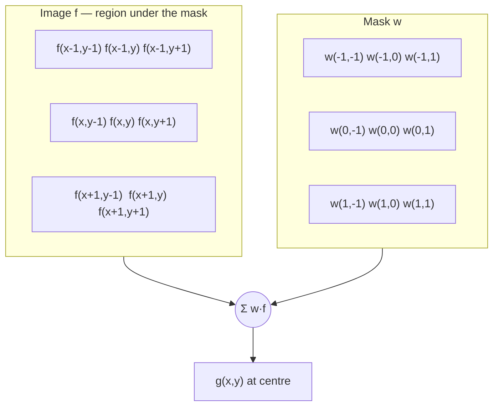
*Fig. 5: Mechanics of linear spatial filtering with a 3×3 mask.*

**Steps.**
1. Place the centre of the mask at (x, y).
2. Multiply each mask coefficient by the pixel beneath it.
3. Sum the products; the sum is g(x,y).
4. Move the mask to the next pixel and repeat for every pixel.

**Border handling.** When the mask centre is near the border, part of the mask lies outside the image. Options: (1) limit processing so that the mask stays inside (output smaller); (2) **zero padding**; (3) **replicate** border rows/columns; (4) mirror the image. Padding with zeros darkens the borders of a smoothed image.

**Vector representation.** R = w<sub>1</sub>z<sub>1</sub> + w<sub>2</sub>z<sub>2</sub> + … + w<sub>9</sub>z<sub>9</sub> = **wᵀz**.

### Correlation and convolution
- **Correlation:** move the mask over the image and compute the sum of products at each location:
  **w(x,y) ☆ f(x,y) = Σ Σ w(s,t) f(x+s, y+t)**
- **Convolution:** the same, but the mask is first **rotated by 180°**:
  **w(x,y) ⋆ f(x,y) = Σ Σ w(s,t) f(x−s, y−t)**

**1-D example.** f = 0 0 0 1 0 0 0 (a discrete unit impulse), w = 1 2 3.
- Correlation result: 0 0 **3 2 1** 0 0 → a copy of w **rotated by 180°**.
- Convolution result: 0 0 **1 2 3** 0 0 → an exact copy of w.

That is why convolution with an impulse reproduces the filter (the basis of the impulse response), and why the mask must be flipped for convolution.

**Differences.**

| Correlation | Convolution |
|---|---|
| mask used as it is | mask rotated by 180° first |
| g = Σ w(s,t) f(x+s, y+t) | g = Σ w(s,t) f(x−s, y−t) |
| response to an impulse = rotated mask | response to an impulse = mask itself |
| not commutative | commutative, associative |
| used for template matching | used for linear filtering theory (convolution theorem) |
| frequency domain: F*H | frequency domain: FH |

For **symmetric masks** (averaging, Gaussian, Laplacian), correlation and convolution give the same result.

**Generating masks.** E.g. averaging: all coefficients 1/9; Gaussian: sample h(x,y) = e<sup>−(x²+y²)/2σ²</sup> on a 3×3 grid and normalise.

**Conclusion.** Spatial filtering slides a mask over the image and computes a weighted sum (linear) or a ranked value (non-linear) at each position; correlation uses the mask directly, while convolution first rotates it by 180°, and the two coincide for symmetric masks.
:::

## Q3 (b) Gradient operators with Sobel numerical

::: ans Answer

**Introduction.** First derivatives in image processing are implemented using the magnitude of the **gradient**. Gradient operators are widely used for edge detection and for edge enhancement in industrial inspection (e.g. finding defects in contact lenses).

**Definition.** <u>The gradient of f at (x,y) is the vector ∇f = [G<sub>x</sub>, G<sub>y</sub>]ᵀ = [∂f/∂x, ∂f/∂y]ᵀ, which points in the direction of the greatest rate of change of f; gradient operators are small masks that approximate G<sub>x</sub> and G<sub>y</sub>.</u>

**Magnitude and direction.**
- **M(x,y) = |∇f| = √(G<sub>x</sub>² + G<sub>y</sub>²) ≈ |G<sub>x</sub>| + |G<sub>y</sub>|**
- **α(x,y) = tan<sup>−1</sup>(G<sub>y</sub>/G<sub>x</sub>)**; the edge direction is perpendicular to the gradient direction.

Using the 3×3 notation z<sub>1</sub>…z<sub>9</sub> (z<sub>5</sub> = centre, z<sub>1</sub> z<sub>2</sub> z<sub>3</sub> = top row):

**1. Roberts cross-gradient operators (2×2).**
G<sub>x</sub> = z<sub>9</sub> − z<sub>5</sub>, G<sub>y</sub> = z<sub>8</sub> − z<sub>6</sub>
```
-1  0       0 -1
 0  1       1  0
```
Simple and fast; diagonal differences; but even-sized masks have no centre, and they are very **sensitive to noise**.

**2. Prewitt operators (3×3).**
G<sub>x</sub> = (z<sub>7</sub> + z<sub>8</sub> + z<sub>9</sub>) − (z<sub>1</sub> + z<sub>2</sub> + z<sub>3</sub>), G<sub>y</sub> = (z<sub>3</sub> + z<sub>6</sub> + z<sub>9</sub>) − (z<sub>1</sub> + z<sub>4</sub> + z<sub>7</sub>)
```
-1 -1 -1      -1  0  1
 0  0  0      -1  0  1
 1  1  1      -1  0  1
```

**3. Sobel operators (3×3).**
G<sub>x</sub> = (z<sub>7</sub> + 2z<sub>8</sub> + z<sub>9</sub>) − (z<sub>1</sub> + 2z<sub>2</sub> + z<sub>3</sub>), G<sub>y</sub> = (z<sub>3</sub> + 2z<sub>6</sub> + z<sub>9</sub>) − (z<sub>1</sub> + 2z<sub>4</sub> + z<sub>7</sub>)
```
-1 -2 -1      -1  0  1
 0  0  0      -2  0  2
 1  2  1      -1  0  1
```
The weight of 2 in the centre achieves **smoothing** by giving more importance to the centre point, so Sobel has better **noise suppression**. It is the most commonly used.

All coefficients sum to **zero**, so the response is zero in areas of constant intensity.

**Diagram.**
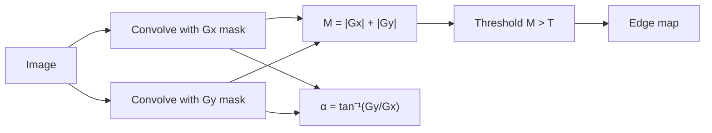
*Fig. 6: Edge detection with gradient operators.*

**Sobel numerical.**
```
z1 z2 z3     10 10 10
z4 z5 z6  =  10 10 80
z7 z8 z9     80 80 80
```
- G<sub>x</sub> = (80 + 2·80 + 80) − (10 + 2·10 + 10) = 320 − 40 = **280**
- G<sub>y</sub> = (10 + 2·80 + 80) − (10 + 2·10 + 80) = 250 − 110 = **140**
- Magnitude (approximation) = |280| + |140| = **420**; exact = √(280² + 140²) = √98,000 ≈ **313**
- Direction α = tan<sup>−1</sup>(140/280) = tan<sup>−1</sup>(0.5) ≈ **26.6°**

The large magnitude shows a strong edge (between the dark 10s at top-left and the bright 80s at bottom-right); with any reasonable threshold (e.g. T = 100) the centre pixel is marked as an edge.

**Comparison.**

| Operator | Size | Noise sensitivity | Remarks |
|---|---|---|---|
| Roberts | 2×2 | high | fastest, diagonal edges |
| Prewitt | 3×3 | medium | simple averaging |
| Sobel | 3×3 | low | weighted centre, most used |

**Conclusion.** Gradient operators approximate the first derivatives with small zero-sum masks; the gradient magnitude marks edges and its angle gives their direction. Sobel is preferred because its centre weighting smooths noise while differentiating.
:::

---

## Q4 (a) 2-D DFT and its properties

::: ans Answer

**Introduction.** The French mathematician Fourier showed that any periodic function can be expressed as a sum of sines and cosines of different frequencies (a Fourier series), and non-periodic functions as an integral of sines and cosines (Fourier transform). A function expressed this way can be completely reconstructed by the inverse process. For digital images we use the **2-D discrete Fourier transform (DFT)**, computed efficiently by the **fast Fourier transform (FFT)**.

**Definition.** <u>The 2-D DFT of an M × N image f(x,y) is F(u,v) = Σ<sub>x=0</sub><sup>M−1</sup> Σ<sub>y=0</sub><sup>N−1</sup> f(x,y) e<sup>−j2π(ux/M + vy/N)</sup>, for u = 0…M−1, v = 0…N−1, and the inverse DFT is f(x,y) = (1/MN) Σ<sub>u</sub> Σ<sub>v</sub> F(u,v) e<sup>j2π(ux/M + vy/N)</sup>.</u>

u and v are the **frequency variables**; x and y the **spatial variables**. The M × N rectangle of F(u,v) is the **frequency rectangle**.

**Spectrum, phase, power.**
- F(u,v) = R(u,v) + jI(u,v) = |F(u,v)| e<sup>jφ(u,v)</sup>
- **Fourier (magnitude) spectrum:** |F(u,v)| = [R² + I²]<sup>½</sup>
- **Phase angle:** φ(u,v) = tan<sup>−1</sup>[I(u,v)/R(u,v)]
- **Power spectrum:** P(u,v) = |F(u,v)|²
- The spectrum carries the intensity information; the phase carries the **location/shape** information (an image rebuilt from phase only still shows outlines).

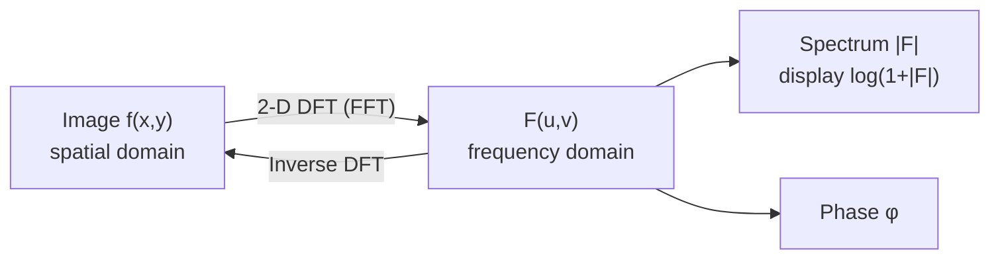
*Fig. 7: The DFT pair.*

**Properties of the 2-D DFT.**

1. **Separability.** The 2-D DFT can be computed as 1-D DFTs along the rows of f(x,y), followed by 1-D DFTs along the columns of the result. This reduces computation and allows using 1-D FFT routines.

2. **Translation (shifting).**
   f(x,y) e<sup>j2π(u₀x/M + v₀y/N)</sup> ⇔ F(u − u₀, v − v₀)
   f(x − x₀, y − y₀) ⇔ F(u,v) e<sup>−j2π(ux₀/M + vy₀/N)</sup>
   Shifting the image does **not change the magnitude** of the spectrum, only the phase.
   **Centring:** with u₀ = M/2, v₀ = N/2, multiplying f(x,y) by **(−1)<sup>x+y</sup>** moves F(0,0) to the centre (M/2, N/2) of the frequency rectangle.

3. **Periodicity.** F(u,v) = F(u + k₁M, v) = F(u, v + k₂N) = F(u + k₁M, v + k₂N); the same holds for f(x,y). The DFT is infinitely periodic in both directions.

4. **Conjugate symmetry.** For real f(x,y): F(u,v) = F*(−u,−v), hence |F(u,v)| = |F(−u,−v)|: the spectrum is **symmetric about the origin**. That is why notch filters come in symmetric pairs.

5. **Rotation.** In polar coordinates, rotating f(x,y) by θ₀ rotates F(u,v) by the same angle: f(r, θ + θ₀) ⇔ F(ω, φ + θ₀).

6. **Linearity / distributivity.** ℑ[a f₁ + b f₂] = a ℑ[f₁] + b ℑ[f₂] (distributive over addition, but **not** over multiplication).

7. **Scaling.** a f(x,y) ⇔ a F(u,v); f(ax, by) ⇔ (1/|ab|) F(u/a, v/b). Shrinking in space expands in frequency.

8. **Average value (DC term).** F(0,0) = Σ Σ f(x,y) = **MN × f̄**, where f̄ is the average grey level. Since it is usually the largest component, the spectrum is displayed as **log(1 + |F|)**.

9. **Convolution theorem.** f ⋆ h ⇔ F·H and f·h ⇔ F ⋆ H; **correlation theorem** f ☆ h ⇔ F*H. Basis of frequency-domain filtering.

10. **Laplacian.** ℑ[∇²f] = −4π²(u² + v²) F(u,v).

**Example (1-D, 4 points).** f = [1, 2, 4, 4]: F(0) = 11; F(1) = 1 + 2(−j) + 4(−1) + 4(j) = −3 + 2j; F(2) = 1 − 2 + 4 − 4 = −1; F(3) = −3 − 2j. Note F(3) = F*(1), showing conjugate symmetry, and F(0) = 4 × average (2.75).

**Conclusion.** The 2-D DFT expresses an image as a weighted sum of 2-D sinusoids. Its properties (separability, translation, periodicity, symmetry, rotation, convolution) make frequency-domain processing efficient and form the foundation of frequency-domain filtering.
:::

## Q4 (b) Sharpening frequency-domain filters

::: ans Answer

**Introduction.** Edges and other abrupt changes in intensity are associated with **high-frequency** components. So image sharpening can be achieved in the frequency domain by **high-pass filtering**, which attenuates the low-frequency components without disturbing the high-frequency information in the Fourier transform.

**Definition.** <u>A high-pass (sharpening) frequency-domain filter is a transfer function H<sub>HP</sub>(u,v) that passes high frequencies and attenuates low frequencies; it is obtained from a low-pass filter as H<sub>HP</sub>(u,v) = 1 − H<sub>LP</sub>(u,v).</u>

**Diagram (procedure and filter shapes).**
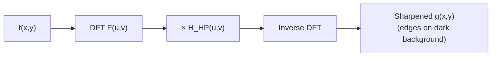

```
H(u,v)
1 |        ______         1 |        _____         1 |         _____
  |       |                 |      /                 |       /
  |       |                 |    /                   |     /
0 |_______|______ D       0 |__/__________ D       0 |___/__________ D
          D0                      D0                       D0
       Ideal HPF            Butterworth HPF           Gaussian HPF
```
*Fig. 8: Radial cross-sections of high-pass filters.*

D(u,v) = [(u − P/2)² + (v − Q/2)²]<sup>½</sup> is the distance from the centre; D<sub>0</sub> is the cut-off frequency.

### 1. Ideal high-pass filter (IHPF)
**H(u,v) = 0 if D(u,v) ≤ D<sub>0</sub>; 1 if D(u,v) > D<sub>0</sub>**
- Sets to zero all frequencies inside a circle of radius D<sub>0</sub> and passes all others without attenuation.
- Shows **ringing**: edges are distorted, thin objects appear thick or doubled, especially for small D<sub>0</sub>.

### 2. Butterworth high-pass filter (BHPF) of order n
**H(u,v) = 1 / [1 + (D<sub>0</sub>/D(u,v))<sup>2n</sup>]**
- Smoother transition than the ideal filter; much less distortion. Boundaries are less distorted even for the smallest cut-off. With n = 2 it is a good compromise between sharpness and ringing.

### 3. Gaussian high-pass filter (GHPF)
**H(u,v) = 1 − e<sup>−D²(u,v)/2D<sub>0</sub>²</sup>**
- Smoothest results, **no ringing**; even small objects and thin bars are cleaner.
- Its spatial equivalent is a difference of Gaussians (positive centre, negative surround), like the Laplacian masks.

### 4. Laplacian in the frequency domain
**H(u,v) = −4π²(u² + v²)**, or −4π²D²(u,v) relative to the centre.
Enhanced image: g(x,y) = ℑ<sup>−1</sup>{[1 + 4π²D²(u,v)] F(u,v)} (after normalising f and ∇²f to comparable ranges). Equivalent to g = f − ∇²f in the spatial domain.

### 5. Unsharp masking, high-boost and high-frequency-emphasis filtering
Because a high-pass filter removes the DC term (F(0,0) = 0), the average intensity becomes zero and the result has a **dark background** with only edges visible. To keep the tonality:
- **Unsharp mask / high-boost:** g = ℑ<sup>−1</sup>{[1 + k·H<sub>HP</sub>(u,v)] F(u,v)}, k = 1 (unsharp masking), k > 1 (high-boost).
- **High-frequency emphasis:** **H<sub>HFE</sub>(u,v) = k<sub>1</sub> + k<sub>2</sub>·H<sub>HP</sub>(u,v)**, with k<sub>1</sub> ≥ 0 controlling the offset from the origin (keeps low frequencies, e.g. 0.25–0.5) and k<sub>2</sub> > 0 the contribution of high frequencies (e.g. 0.5–2).
- Often followed by **histogram equalization** to correct the dull look. Example: a chest X-ray filtered with high-frequency emphasis (k<sub>1</sub> = 0.5, k<sub>2</sub> = 0.75) using a GHPF, then equalized, shows ribs and edges clearly.

**Comparison.**

| Filter | Transfer function | Ringing | Quality |
|---|---|---|---|
| Ideal HPF | 0 inside D<sub>0</sub>, 1 outside | severe | distorted edges |
| Butterworth HPF | 1/[1 + (D<sub>0</sub>/D)<sup>2n</sup>] | slight (n = 2) | good |
| Gaussian HPF | 1 − e<sup>−D²/2D<sub>0</sub>²</sup> | none | smoothest |

**Applications:** sharpening X-rays and fingerprints (high-pass then thresholding to clean ridges), enhancing satellite images, pre-processing for edge detection.

**Conclusion.** Sharpening in the frequency domain uses high-pass filters (ideal, Butterworth, Gaussian) defined as 1 − low-pass; Gaussian gives ringing-free results, and high-frequency-emphasis filtering adds back a fraction of the low frequencies so the sharpened image keeps its tones.
:::

---

## Q5 (a) Inverse filter vs Wiener filter (MMSE)

::: ans Answer

**Introduction.** When an image has been degraded by a known degradation function H and noise, G(u,v) = H(u,v)F(u,v) + N(u,v). The simplest approach to restore it is **inverse filtering**; a more robust approach, which takes noise into account statistically, is the **Wiener filter (minimum mean-square-error filter)**.

**Definition.**
- <u>**Inverse filtering** estimates the original transform by dividing the degraded transform by the degradation function: F̂(u,v) = G(u,v)/H(u,v).</u>
- <u>**Wiener filtering** finds an estimate f̂ of the uncorrupted image f that minimises the mean-square error e² = E{(f − f̂)²}, treating image and noise as random variables.</u>

**Degradation and restoration model (diagram).**
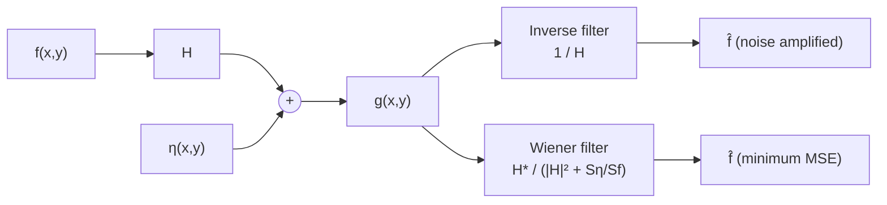
*Fig. 9: Inverse and Wiener restoration of the same degraded image.*

### Inverse filtering
F̂(u,v) = G(u,v)/H(u,v) = **F(u,v) + N(u,v)/H(u,v)**

**Problems.**
1. Even if H is known exactly, we cannot recover F exactly, because N(u,v) is a random function whose transform is unknown.
2. If H(u,v) has **zero or very small values**, the ratio N/H becomes very large and **dominates** the estimate, making the result useless. H is usually small at high frequencies, so noise is amplified there.
3. **Partial remedy:** limit the filter to frequencies near the origin (where H is large), i.e. apply a low-pass cut-off (radius D<sub>0</sub>) to 1/H; or use a pseudo-inverse that sets 1/H to zero when |H| < ε.

### Wiener (minimum mean-square-error) filter
**Assumptions:** noise and image are uncorrelated; one of them has zero mean; the grey levels in the estimate are a linear function of the levels in the degraded image.

**F̂(u,v) = [ H*(u,v) / ( |H(u,v)|² + S<sub>η</sub>(u,v)/S<sub>f</sub>(u,v) ) ] G(u,v)**

= [ (1/H(u,v)) · |H(u,v)|² / ( |H(u,v)|² + S<sub>η</sub>(u,v)/S<sub>f</sub>(u,v) ) ] G(u,v)

- H* = complex conjugate of H; |H|² = H*H.
- S<sub>η</sub>(u,v) = |N(u,v)|² = power spectrum of the noise.
- S<sub>f</sub>(u,v) = |F(u,v)|² = power spectrum of the undegraded image.
- The ratio S<sub>η</sub>/S<sub>f</sub> is the inverse of the signal-to-noise ratio at each frequency.

**How it minimises the mean-square error.**
1. **No noise** (S<sub>η</sub> = 0): the filter reduces to 1/H, the **inverse filter**.
2. **Where the signal is strong** compared with noise (S<sub>f</sub> ≫ S<sub>η</sub>, typically low frequencies): S<sub>η</sub>/S<sub>f</sub> ≈ 0, and the filter behaves like the inverse filter, undoing the blur.
3. **Where noise dominates** (S<sub>f</sub> small, typically high frequencies): the denominator is dominated by S<sub>η</sub>/S<sub>f</sub>, the filter gain becomes small, and those frequencies are **attenuated** instead of amplified.
4. **Where H = 0:** the denominator is S<sub>η</sub>/S<sub>f</sub> > 0, so the filter does **not** blow up.
This frequency-by-frequency balance between undoing the blur and suppressing the noise is exactly the solution that minimises E{(f − f̂)²}.

**Practical form.** S<sub>f</sub> is rarely known, so the ratio is approximated by a constant K:

**F̂(u,v) = [ (1/H) · |H|² / (|H|² + K) ] G(u,v)**, with K adjusted interactively for the best visual result.

**Measures:** signal-to-noise ratio SNR = ΣΣ|F|² / ΣΣ|N|²; mean-square error MSE = (1/MN) ΣΣ [f − f̂]².

**Comparison.**

| Inverse filter | Wiener filter |
|---|---|
| F̂ = G/H | F̂ = [H*/(\|H\|² + S<sub>η</sub>/S<sub>f</sub>)] G |
| ignores noise | includes noise statistics |
| deterministic | statistical (random processes) |
| blows up where H ≈ 0 | bounded everywhere |
| noise amplified at high frequencies | noise suppressed at high frequencies |
| needs only H | needs H, S<sub>η</sub>, S<sub>f</sub> (or K) |
| good only for noiseless images | optimal in the mean-square sense |

**Wiener smoothing filter (2018).** When there is no blur (H = 1), the Wiener filter becomes **W(u,v) = S<sub>f</sub>/(S<sub>f</sub> + S<sub>η</sub>)**, a smoothing (low-pass) filter that passes frequencies where the signal dominates and attenuates those where noise dominates; it is the optimal linear smoother for noise removal.

**Conclusion.** The inverse filter is simple but amplifies noise wherever H is small; the Wiener filter incorporates the noise and image power spectra, behaving like the inverse filter at high-SNR frequencies and like a suppressor at low-SNR frequencies, which minimises the mean-square error.
:::

## Q5 (b) Adaptive filters

::: ans Answer

**Introduction.** The mean and order-statistic filters apply the **same** operation everywhere, regardless of how image characteristics vary from one point to another. **Adaptive filters** change their behaviour based on the **statistical characteristics** of the image inside the filter region. They perform better than fixed filters, at the cost of more computation.

**Definition.** <u>An adaptive filter is a spatial filter whose response at each pixel depends on local statistics (such as the local mean, local variance, or the min, max and median) of the neighbourhood S<sub>xy</sub>, so that it smooths noise in flat regions while preserving edges and detail.</u>

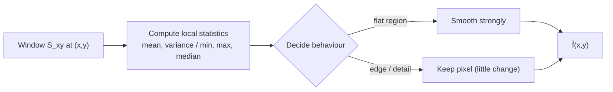
*Fig. 10: Principle of adaptive filtering.*

### 1. Adaptive, local noise-reduction filter
Uses four quantities: (a) g(x,y), the noisy pixel; (b) **σ²<sub>η</sub>**, the variance of the noise (global); (c) **m<sub>L</sub>**, the local mean in S<sub>xy</sub>; (d) **σ²<sub>L</sub>**, the local variance in S<sub>xy</sub>.

**f̂(x,y) = g(x,y) − (σ²<sub>η</sub>/σ²<sub>L</sub>) [g(x,y) − m<sub>L</sub>]**

**Behaviour:**
1. If **σ²<sub>η</sub> = 0** (no noise): f̂ = g, return the pixel unchanged.
2. If **σ²<sub>L</sub> ≫ σ²<sub>η</sub>** (high local variance: an **edge**): the ratio is small, f̂ ≈ g; edges are preserved.
3. If **σ²<sub>L</sub> = σ²<sub>η</sub>** (local area has the same properties as the noise, i.e. a flat region): f̂ = m<sub>L</sub>, the local average; noise is smoothed.
4. If σ²<sub>η</sub> > σ²<sub>L</sub> (possible when the estimate is poor), the ratio is clipped at 1.

Only σ²<sub>η</sub> must be known or estimated. Result: as smooth as an arithmetic mean filter in flat areas but **much sharper** at edges.

### 2. Adaptive median filter
The ordinary median filter works well if the spatial density of impulse noise is small (P<sub>a</sub>, P<sub>b</sub> < 0.2). The adaptive median filter handles **denser** impulse noise and smooths non-impulse noise while preserving detail. It changes the **size** of S<sub>xy</sub> during operation.

Notation: z<sub>min</sub>, z<sub>max</sub>, z<sub>med</sub> = min, max, median in S<sub>xy</sub>; z<sub>xy</sub> = the pixel at (x,y); S<sub>max</sub> = maximum allowed window size.

**Level A:** A1 = z<sub>med</sub> − z<sub>min</sub>; A2 = z<sub>med</sub> − z<sub>max</sub>.
If A1 > 0 AND A2 < 0 (the median is not an impulse), go to Level B.
Else increase the window size; if size ≤ S<sub>max</sub>, repeat Level A; else output z<sub>med</sub>.

**Level B:** B1 = z<sub>xy</sub> − z<sub>min</sub>; B2 = z<sub>xy</sub> − z<sub>max</sub>.
If B1 > 0 AND B2 < 0 (the pixel itself is not an impulse), output **z<sub>xy</sub>** (unchanged).
Else output **z<sub>med</sub>**.

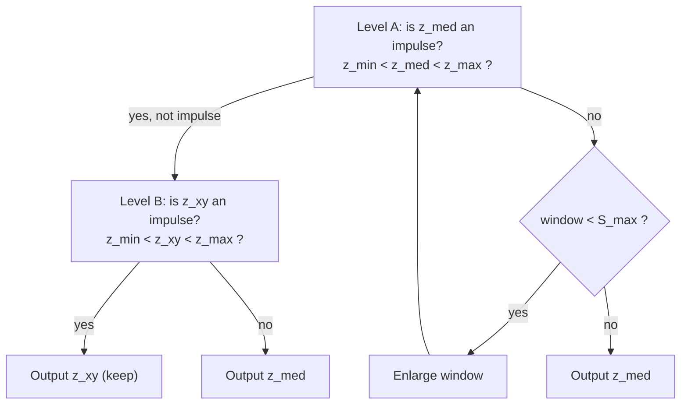
*Fig. 11: Adaptive median filter algorithm.*

**Three purposes:** remove salt-and-pepper (impulse) noise; smooth other non-impulsive noise; reduce distortion such as excessive thinning or thickening of object boundaries.

**Where adaptive filters are used.**
1. **Medical images** (ultrasound, MRI, X-ray), where noise must be removed without blurring the edges of organs and lesions.
2. **Satellite and radar images** with speckle noise (adaptive Lee/Frost filters are of this type).
3. Images with **dense or varying impulse noise** (faulty sensors, transmission errors).
4. Pre-processing before edge detection and segmentation, because edges are preserved.
5. Video and low-light photography.

**Comparison with fixed filters.** A 7×7 arithmetic mean filter removes noise but blurs everything; the adaptive local filter gives similar noise reduction with sharp edges. A 7×7 median filter removes dense impulse noise but loses detail; the adaptive median filter (S<sub>max</sub> = 7) removes it while keeping detail.

**Conclusion.** Adaptive filters adjust to local statistics: the adaptive local noise-reduction filter uses local mean and variance to smooth flat areas while keeping edges, and the adaptive median filter enlarges its window to handle dense impulse noise and replaces only pixels that are impulses.
:::

---

## Q6 (a) Colour transformations and colour image sharpening

::: ans Answer

**Introduction.** Colour transformations process the components of a colour image within the context of a single colour model, as opposed to converting between models. They extend grey-level transformations to colour images.

**Definition.** <u>A colour transformation is a function g(x,y) = T[f(x,y)], where f and g are colour images (vector-valued), usually written component-wise as s<sub>i</sub> = T<sub>i</sub>(r<sub>1</sub>, r<sub>2</sub>, …, r<sub>n</sub>), i = 1, 2, …, n, with r<sub>i</sub> and s<sub>i</sub> the colour components of f and g.</u>

For RGB, n = 3 and r<sub>1</sub>, r<sub>2</sub>, r<sub>3</sub> are the red, green and blue components; for CMYK, n = 4.

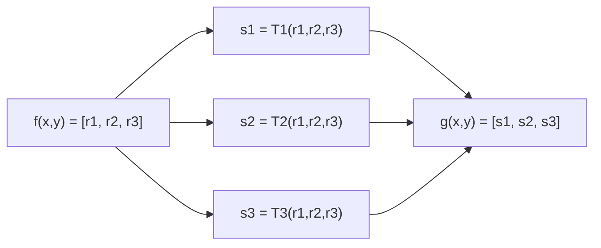
*Fig. 12: Colour transformation of each component.*

**Types of colour transformations.**

1. **Intensity modification.** g(x,y) = k f(x,y), 0 < k < 1.
   - In **HSI**: only intensity changes: s<sub>3</sub> = k r<sub>3</sub>, s<sub>1</sub> = r<sub>1</sub>, s<sub>2</sub> = r<sub>2</sub>.
   - In **RGB**: all three components must be changed: s<sub>i</sub> = k r<sub>i</sub>.
   - In **CMY**: s<sub>i</sub> = k r<sub>i</sub> + (1 − k).
   The choice of colour model is a matter of computational cost; HSI needs the fewest operations, but conversion has a cost.

2. **Colour complements.** Hues directly opposite each other on the **colour circle** are complements (like grey-scale negatives). In RGB the complement is s<sub>i</sub> = 1 − r<sub>i</sub>. Useful for enhancing detail embedded in dark regions.

3. **Colour slicing.** Highlights a specific range of colours to separate objects from their surroundings: colours inside a cube (width W) or sphere (radius R<sub>0</sub>) centred on a prototype colour (a<sub>1</sub>, a<sub>2</sub>, a<sub>3</sub>) are kept; others are set to a neutral colour (e.g. 0.5 grey):
   s<sub>i</sub> = 0.5 if any |r<sub>j</sub> − a<sub>j</sub>| > W/2; otherwise s<sub>i</sub> = r<sub>i</sub>.

4. **Tone and colour corrections.** The **tonal range** (key) of an image: **flat** images need an S-shaped curve to increase contrast, **light (high-key)** images need a power curve with γ > 1, **dark (low-key)** images need γ < 1. **Colour balancing:** correct casts (e.g. too much magenta) by adjusting one component, typically in CMY or in the L*a*b* model, which is perceptually uniform.

5. **Histogram processing.** Equalizing R, G and B independently gives erroneous colours. Instead, **equalize the intensity I** in HSI, leaving H and S unchanged; the colours are preserved and the image becomes brighter and more contrasted. Saturation may be adjusted afterwards.

### Colour image sharpening
Sharpening uses the **Laplacian**. For a vector, the Laplacian is defined as the vector of the Laplacians of its components:

**∇²[c(x,y)] = [ ∇²R(x,y), ∇²G(x,y), ∇²B(x,y) ]ᵀ**

So in RGB, sharpening is done by computing the Laplacian of **each component image separately** and subtracting (or adding, depending on the mask sign) it from that component: R′ = R − ∇²R, G′ = G − ∇²G, B′ = B − ∇²B, then recombining.

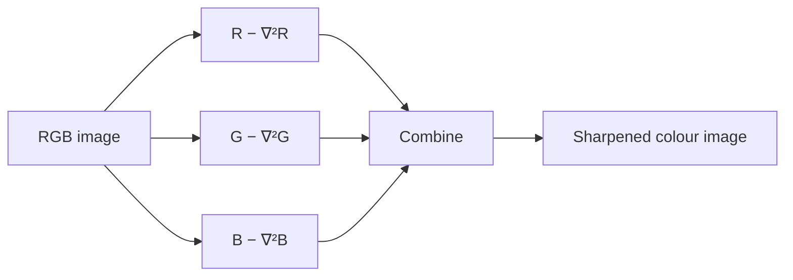
*Fig. 13: Colour image sharpening with the Laplacian.*

**Alternative:** convert to HSI and sharpen only the **intensity** component, then convert back. The results are similar; the difference image between the two methods shows small differences at edges, because RGB sharpening affects hue slightly.

**Mask used:** e.g. [0 1 0; 1 −4 1; 0 1 0] or the composite mask [0 −1 0; −1 5 −1; 0 −1 0] applied to each plane.

**Conclusion.** Colour transformations apply component-wise functions within one colour model for intensity changes, complements, slicing, tone correction and histogram equalization; colour sharpening applies the Laplacian to each RGB plane (or to I in HSI) and combines the results.
:::

## Q6 (b) CMY/CMYK model and pseudo-colour processing

::: ans Answer

**Introduction.** Displays emit light and use the additive RGB model, but printers deposit coloured pigments on paper, which subtract (absorb) light. Printing therefore uses the CMY and CMYK models. Separately, many images (X-rays, thermal images) are monochrome; pseudo-colour processing assigns colours to them to make details easier to see.

**Definition.**
- <u>The **CMY model** describes colours by their cyan, magenta and yellow components, the secondary colours of light (primary colours of pigments); **CMYK** adds black (K).</u>
- <u>**Pseudo-colour (false-colour) image processing** assigns colours to grey values according to a specified criterion, for human visualisation and interpretation of grey-scale events.</u>

### CMY and CMYK models
1. A surface coated with **cyan** pigment illuminated with white light reflects no red: cyan **subtracts red** from white light. Similarly magenta subtracts green, yellow subtracts blue.
2. Conversion (all values normalised to [0,1]):
   **[C, M, Y]ᵀ = [1, 1, 1]ᵀ − [R, G, B]ᵀ** and **[R, G, B]ᵀ = [1, 1, 1]ᵀ − [C, M, Y]ᵀ**
3. Example: pure cyan surface: C = 1, M = 0, Y = 0 → R = 0, G = 1, B = 1. Light reflected from it has no red.
4. In theory equal amounts of C, M and Y give **black**; in practice they give a **muddy brown**, and much ink is wasted for black text. So a fourth colour, **black (K)**, is added: **CMYK** (four-colour printing).
5. CMY → CMYK: K = min(C, M, Y); C′ = (C − K)/(1 − K), M′ = (M − K)/(1 − K), Y′ = (Y − K)/(1 − K) (if K = 1, C′ = M′ = Y′ = 0).


*Fig. 14: Subtractive CMYK model (draw three overlapping circles C, M, Y: overlaps give R, G, B, centre gives black).*

| RGB | CMY / CMYK |
|---|---|
| additive (light) | subtractive (pigments) |
| black = (0,0,0) | black = (1,1,1) in CMY, K in CMYK |
| monitors, cameras | printers, copiers |

### Pseudo-colour image processing
The human eye can distinguish thousands of colours but only about two dozen grey shades, so colouring grey levels makes subtle differences visible.

**1. Intensity (density) slicing.**
- View the image as a 3-D function (intensity as height). Place planes parallel to the image plane at levels l<sub>1</sub>, l<sub>2</sub>, …; each plane "slices" the function.
- Assign a different colour to each slice: **f(x,y) = c<sub>k</sub> if f(x,y) ∈ V<sub>k</sub>**, where V<sub>k</sub> is the k-th intensity interval.
- Example: in an X-ray of a weld, colour all pixels with value 255 (cracks) yellow and the rest blue, making flaws obvious to inspectors. In weather maps, colour rainfall levels.


**2. Intensity-to-colour transformations.**
- Apply three independent transformations to the grey level: **f<sub>R</sub>(x,y) = T<sub>R</sub>[f(x,y)], f<sub>G</sub> = T<sub>G</sub>[f], f<sub>B</sub> = T<sub>B</sub>[f]**, and feed them to the R, G, B inputs of a monitor.
- Often sinusoidal functions with different phases are used, so that different grey ranges get different colours.
- Example: **airport luggage X-ray scanners**: explosives and plastics show up in one colour, metals and garment in others, helping security staff.

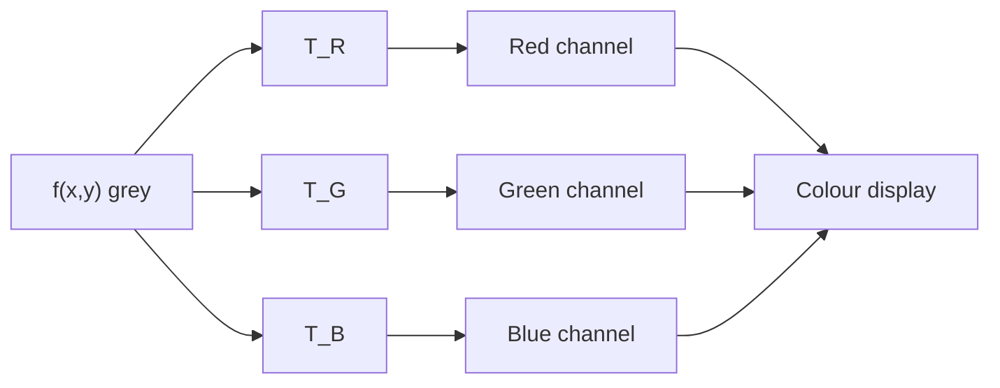
*Fig. 15: Intensity-to-colour transformation.*

**3. Combining multispectral images.** Several monochrome images of the same scene (e.g. different spectral bands from a satellite) are mapped to R, G, B, giving a **false-colour composite** (vegetation appears red in near-infrared composites).

**Applications:** medical imaging (thermal maps, nuclear medicine), weather radar, satellite land-use maps, industrial inspection, security scanners.

**Conclusion.** The CMY/CMYK model describes subtractive colour for printing (CMY = 1 − RGB, with K added for true black), while pseudo-colour processing maps grey levels to colours by intensity slicing or intensity-to-colour transformations to make grey-scale detail visible.
:::

---

## Q7 (a) Thinning, thickening and skeletons; medical imaging

::: ans Answer

**Introduction.** Many shape-analysis tasks need a **thin** representation of an object that keeps its topology (connectivity and branching): for example, analysing blood vessels, fingerprints or handwritten characters. Morphological thinning, thickening and skeletonisation provide this.

**Definition.**
- <u>**Thinning** of a set A by a structuring element B is A ⊗ B = A − (A ⊛ B), i.e. removing from A the pixels that match the hit-or-miss pattern B.</u>
- <u>**Thickening** is A ⊙ B = A ∪ (A ⊛ B), the morphological dual of thinning.</u>
- <u>The **skeleton** S(A) of a set A is the set of centres of the maximal disks inscribed in A (the medial axis).</u>

### Thinning
**A ⊗ B = A − (A ⊛ B) = A ∩ (A ⊛ B)ᶜ**

- Usually thinning is done **symmetrically** with a **sequence of structuring elements** {B} = {B<sup>1</sup>, B<sup>2</sup>, …, B<sup>8</sup>}, where each B<sup>i</sup> is a rotated version of B<sup>i−1</sup> (by 45°).
- **A ⊗ {B} = ((…((A ⊗ B<sup>1</sup>) ⊗ B<sup>2</sup>) …) ⊗ B<sup>8</sup>)**
- The process thins A by one pass with B<sup>1</sup>, then the result with B<sup>2</sup>, and so on, and the whole cycle is **repeated until no further changes occur**.
- The result is a set of **one-pixel-thick, connected lines** (m-connectivity is used to remove multiple paths at the end).

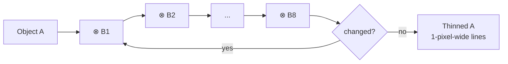
*Fig. 16: Thinning with a sequence of eight rotated structuring elements.*

### Thickening
**A ⊙ B = A ∪ (A ⊛ B)**, and with a sequence: A ⊙ {B} = ((…((A ⊙ B<sup>1</sup>) ⊙ B<sup>2</sup>) …) ⊙ B<sup>n</sup>).
- The structuring elements are those of thinning with 0s and 1s interchanged.
- **Practical method:** thin the **background** (Aᶜ) and take the complement of the result; then remove disconnected points. This avoids the separate algorithm and the result is the thickened set.

### Skeletons
The skeleton of A is expressed in terms of erosions and openings:

**S(A) = ∪<sub>k=0</sub><sup>K</sup> S<sub>k</sub>(A)**, with **S<sub>k</sub>(A) = (A ⊖ kB) − (A ⊖ kB) ∘ B**

- (A ⊖ kB) = k successive erosions of A by B.
- K = the last iterative step before A erodes to an empty set: K = max{k | (A ⊖ kB) ≠ ∅}.
- **Reconstruction:** A = ∪<sub>k=0</sub><sup>K</sup> (S<sub>k</sub>(A) ⊕ kB), so A can be rebuilt exactly from its skeleton subsets (useful for compression).
- **Medial-axis idea:** if z is a point of S(A) and (D)<sub>z</sub> is the largest disk centred at z contained in A, no larger disk containing (D)<sub>z</sub> fits in A; such a disk touches the boundary of A at two or more places.
- The morphological skeleton may not be connected; thinning gives connected skeletons, and **pruning** removes spurs.

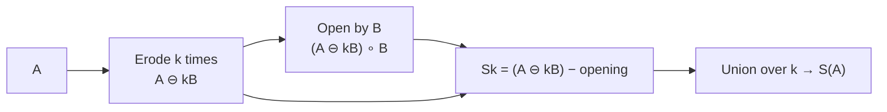
*Fig. 17: Computing the skeleton.*

**Thinning vs skeleton.**

| Thinning | Skeleton |
|---|---|
| iterative hit-or-miss removal | erosions and openings |
| always connected | may be disconnected |
| object cannot be rebuilt | object can be rebuilt from S<sub>k</sub> |
| 1-pixel-wide centre lines | medial axis of maximal disks |

### Importance in medical imaging (2019 PYQ)
1. **Blood-vessel analysis:** thinning angiograms and retinal images reduces vessels to centre lines; branch points and end points can be counted, vessel length and tortuosity measured, helping diagnosis of **diabetic retinopathy**, hypertension and stenosis.
2. **Topology preserved:** the connectivity of vessel trees, airways (bronchi) and neurons is kept, so their structure can be traced.
3. **Measurements:** the skeleton plus a distance transform gives the local **width** (diameter) of vessels at every point, to detect narrowing (stenosis) or bulging (aneurysm).
4. **Chromosome analysis:** skeletons give the medial axis for measuring length and classifying chromosomes in karyotyping.
5. **Bone and trabecular structure:** skeletons of bone micro-architecture quantify osteoporosis.
6. **Nerve fibres and cells:** counting dendrite branches in microscopy.
7. **Registration:** skeletons and their branch points serve as landmarks for aligning images.
8. **Compression:** the skeleton with radius values represents the shape compactly.
9. **Thickening** fills gaps and connects broken vessel segments after segmentation.

**Conclusion.** Thinning (repeated hit-or-miss removal with rotated SEs) and skeletonisation (erosions and openings) reduce objects to one-pixel-wide representations that keep topology, while thickening is their dual. In medical imaging they are essential for analysing vessels, airways, chromosomes and bone structure.
:::

## Q7 (b) Logic operations and binary dilation/erosion numerical

::: ans Answer

**Introduction.** In binary images, pixels are 1 (foreground, object) or 0 (background). Logic operations combine binary images pixel by pixel, and the morphological operations dilation and erosion are built on set (logic) operations. They are the basic tools of binary morphological processing.

**Definition.** <u>Logic operations on binary images are pixel-by-pixel Boolean operations (AND, OR, NOT, XOR) between corresponding pixels of binary images; in set terms they are intersection, union, complement and symmetric difference of the sets of foreground pixels.</u>

**Logic operations.**

| Operation | Set equivalent | Effect | Use |
|---|---|---|---|
| A AND B | A ∩ B | 1 only where both are 1 | masking, region of interest |
| A OR B | A ∪ B | 1 where either is 1 | combining objects |
| NOT A | Aᶜ | inverts | background extraction |
| A XOR B | (A ∪ B) − (A ∩ B) | 1 where they differ | change detection, outline |
| (NOT A) AND B | B − A | pixels in B but not A | set difference |

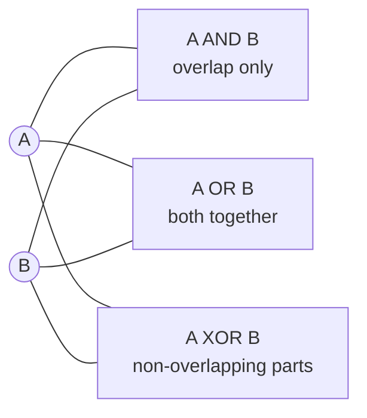
*Fig. 18: Logic operations shown with two overlapping sets (draw Venn circles in the exam).*

These operations are **functionally complete**: any other logic operation can be built from them. AND, OR and NOT are used inside morphological algorithms: e.g. boundary extraction A − (A ⊖ B) = A AND NOT(A ⊖ B); region filling uses ∩ Aᶜ.

**Dilation and erosion.**
- **Dilation:** A ⊕ B = {z | (B̂)<sub>z</sub> ∩ A ≠ ∅}: output 1 wherever the SE centred on that pixel **hits** at least one foreground pixel. In logic terms: OR of the pixels under the SE.
- **Erosion:** A ⊖ B = {z | (B)<sub>z</sub> ⊆ A}: output 1 only where the SE centred on that pixel **fits completely** inside the foreground. In logic terms: AND of the pixels under the SE.

**Numerical.** B = 3×3 square of 1s (origin at the centre). Pixels outside the image are treated as 0.
```
A =  0 0 0 0 0 0
     0 1 1 1 0 0
     0 1 1 1 0 0
     0 1 1 1 1 0
     0 0 0 0 0 0
     0 0 0 0 0 0
```

**Dilation A ⊕ B** (1 if any 1 in the 3×3 neighbourhood):
```
     1 1 1 1 1 0
     1 1 1 1 1 0
     1 1 1 1 1 1
     1 1 1 1 1 1
     1 1 1 1 1 1
     0 0 0 0 0 0
```
Working for some pixels:
- (0,0): neighbourhood includes (1,1) = 1 → **1**.
- (0,5): neighbours (0,4), (1,4), (1,5) are all 0 → **0**.
- (2,5): neighbour (3,4) = 1 → **1** (the extra pixel extended the object to the right).
- (5,0): neighbours in row 4 are all 0 → **0**.

**Erosion A ⊖ B** (1 only if all nine pixels are 1):
```
     0 0 0 0 0 0
     0 0 0 0 0 0
     0 0 1 0 0 0
     0 0 0 0 0 0
     0 0 0 0 0 0
     0 0 0 0 0 0
```
Working:
- (2,2): neighbourhood rows 1–3, cols 1–3 = all 1 → **1**.
- (2,3): includes (1,4) = 0 → **0**.
- (3,3): includes (4,2) = 0 → **0**.
Only the centre of the 3×3 block survives; the extra pixel at (3,4) disappears.

**Observations.** Dilation grew the object by one pixel on every side (from 10 pixels to 28); erosion shrank it to a single pixel. Opening (erosion then dilation) of this A would give back just the 3×3 block, removing the protruding pixel (3,4): exactly the "remove thin protrusions" property.

**Conclusion.** Logic operations (AND, OR, NOT, XOR) are the building blocks of binary image processing; dilation acts like a local OR (grows objects) and erosion like a local AND (shrinks objects), as the numerical shows.
:::

---

## Q8 (a) Image registration, geometric transformation, mapping and stereo imaging

::: ans Answer

**Introduction.** In many applications we have two or more images of the same scene taken at different times, from different viewpoints or by different sensors. Before they can be compared, combined or used to compute depth, they must be **aligned**. This is image registration. Stereo imaging uses two registered views to recover the third dimension (depth).

**Definition.** <u>Image registration is the process of geometrically aligning a sensed (input) image with a reference image of the same scene, by finding a spatial transformation that maps points of one image onto the corresponding points of the other.</u>

**Registration process (diagram).**

*Fig. 19: Steps of image registration.*

**Steps.**
1. **Feature (control point) detection:** distinctive points such as corners, line intersections, region centroids, or manually selected **tie points**.
2. **Feature matching:** establish which feature in the sensed image corresponds to which in the reference (by correlation of small windows, or descriptor matching).
3. **Transform estimation:** choose a model (affine, projective, bilinear) and compute its parameters from the matched points.
4. **Resampling:** apply the transformation and interpolate intensities.

### Geometric transformation (plane to plane)
A geometric transformation modifies the spatial relationship between pixels. It consists of:
1. **Spatial transformation of coordinates:** (x, y) = T{(v, w)}, where (v, w) are pixel coordinates in the original image and (x, y) in the transformed image.
2. **Intensity interpolation:** assigning intensity values to the spatially transformed pixels.

**Affine transform:** [x y 1] = [v w 1] T, T = [t<sub>11</sub> t<sub>12</sub> 0; t<sub>21</sub> t<sub>22</sub> 0; t<sub>31</sub> t<sub>32</sub> 1]. It can scale, rotate, translate or shear, depending on T:
- Identity: x = v, y = w
- Scaling: x = c<sub>x</sub>v, y = c<sub>y</sub>w
- Rotation: x = v cos θ − w sin θ, y = v sin θ + w cos θ
- Translation: x = v + t<sub>x</sub>, y = w + t<sub>y</sub>
- Shear: x = v + s<sub>v</sub>w, y = w (vertical); x = v, y = s<sub>h</sub>v + w (horizontal)
Affine transforms preserve straight lines and parallelism. A **bilinear** model x = c<sub>1</sub>v + c<sub>2</sub>w + c<sub>3</sub>vw + c<sub>4</sub>, y = c<sub>5</sub>v + c<sub>6</sub>w + c<sub>7</sub>vw + c<sub>8</sub> needs four tie points (8 equations, 8 unknowns); for large images, the image is divided into quadrilaterals, each with its own tie points.

### Mapping
1. **Forward mapping:** scan the input pixels and compute (x, y) = T{(v, w)} for each. Problems: two or more input pixels can map to the same output location, and some output locations may receive no pixel (holes).
2. **Inverse mapping (preferred):** scan the **output** pixels and compute (v, w) = T<sup>−1</sup>(x, y); then interpolate the input at (v, w) to decide the output value. Every output pixel gets exactly one value. Used by MATLAB and most software.
3. **Interpolation:** nearest neighbour (fast, jagged), **bilinear** (four nearest neighbours, v(x,y) = ax + by + cxy + d), **bicubic** (16 neighbours, sharpest).

### Stereo imaging
Two cameras with parallel optical axes, separated by a **baseline B**, image the same scene. A world point P appears at x<sub>L</sub> in the left image and x<sub>R</sub> in the right image.

```mermaid
flowchart TB
  P(("World point P<br/>depth Z")) --> L["Left camera<br/>image point x_L"]
  P --> R["Right camera<br/>image point x_R"]
  L --- BL["baseline B"] --- R
  L --> C["Correspondence:<br/>find x_R matching x_L"]
  R --> C
  C --> D["Disparity d = x_L − x_R"] --> Z["Depth Z = f·B / d"]
```
*Fig. 20: Stereo imaging geometry (draw two lenses side by side, both image planes, and the rays from P).*

**Depth from disparity:** by similar triangles, **Z = f·B / d**, where f is the focal length and d = x<sub>L</sub> − x<sub>R</sub> the **disparity**. Near objects have large disparity; distant objects have small disparity.

**Algorithms to establish correspondence** (the hardest part):
1. **Area/correlation-based matching:** take a small window around a point in the left image; slide it along the corresponding row (**epipolar line**) in the right image; choose the position with maximum **normalised cross-correlation** (or minimum sum of squared/absolute differences). Gives a **dense** disparity map; fails in uniform (textureless) regions and at occlusions.
2. **Feature-based matching:** extract edges, corners or line segments from both images; match features with similar properties (orientation, contrast, length). Gives a **sparse** but reliable disparity map; interpolate between features.
3. **Constraints** that reduce search and ambiguity: **epipolar constraint** (search along one line only), **uniqueness** (one match per point), **ordering** (points keep their order along the line), **continuity** (disparity varies smoothly except at object boundaries), and a **limited disparity range**.

**Algorithms to recover depth:**
1. Compute the disparity for each matched pair.
2. Triangulate: Z = fB/d, X = x<sub>L</sub>Z/f, Y = yZ/f, giving 3-D coordinates.
3. Interpolate depth in unmatched regions; refine with multiple baselines (multi-baseline stereo) or a coarse-to-fine (pyramid) search.

**Applications:** robot navigation, 3-D reconstruction, autonomous vehicles, aerial mapping (terrain elevation), medical stereo endoscopy.

**Conclusion.** Registration aligns images through feature detection, matching, a geometric transformation (affine, bilinear) with inverse mapping and interpolation. Stereo imaging matches corresponding points in two views and converts their disparity into depth using Z = fB/d.
:::

## Q8 (b) Short notes (any two)

::: ans Answer

### (i) Edge linking and the Hough transform
**Need.** Edge detection should yield only pixels on edges, but in practice noise, uneven illumination and breaks give broken, spurious edges. **Edge linking** assembles edge pixels into meaningful edges and boundaries.

**1. Local processing.** Analyse the pixels in a small neighbourhood (3×3 or 5×5) of every edge point (x, y). A neighbour (s, t) is linked to (x, y) if both are similar in:
- **Gradient magnitude:** |M(s,t) − M(x,y)| ≤ E
- **Gradient direction:** |α(s,t) − α(x,y)| ≤ A
Linked points form edges; this is simple but only works locally. **Edge following** starts from a strong edge point and tracks neighbouring edge pixels along the contour.

**2. Global processing: Hough transform.** Detects lines (or curves) even when the edge points are scattered.
- A line in normal form: **ρ = x cos θ + y sin θ**.
- Each edge point (x<sub>i</sub>, y<sub>i</sub>) corresponds to a **sinusoidal curve** in the (ρ, θ) parameter space; collinear points produce curves that **intersect at one point** (ρ′, θ′), which defines their common line.
- **Algorithm:** (1) compute an edge image; (2) subdivide the ρθ-plane into **accumulator cells** (all zero); (3) for each edge point and each θ, compute ρ and increment A(ρ, θ); (4) cells with high counts (peaks) are lines; (5) examine the continuity of pixels on each chosen line.

```mermaid
flowchart LR
  E[Edge image] --> V["Each edge point votes<br/>ρ = x cosθ + y sinθ"] --> A["Accumulator A(ρ,θ)"] --> P["Find peaks"] --> L[Detected lines]
```
Applications: detecting runways in aerial images, lane markings, straight edges in documents; extended to circles and ellipses.

### (ii) Corner detection
**Definition.** A **corner** is a point where intensity changes significantly in **two** different directions, i.e. the intersection of two edges. Corners are stable features for registration, stereo matching and tracking.

**Moravec detector.** Shift a small window by one pixel in four directions and compute the sum of squared differences (SSD) for each; the corner response is the **minimum** SSD. Flat region: all small; edge: small along the edge; corner: all large. It is not rotation-invariant.

**Harris detector.** Uses the local **structure (auto-correlation) matrix**:

M = Σ<sub>x,y</sub> w(x,y) [ I<sub>x</sub>²  I<sub>x</sub>I<sub>y</sub> ; I<sub>x</sub>I<sub>y</sub>  I<sub>y</sub>² ]

where I<sub>x</sub>, I<sub>y</sub> are the image derivatives and w is a Gaussian window. Response: **R = det(M) − k (trace M)² = λ<sub>1</sub>λ<sub>2</sub> − k(λ<sub>1</sub> + λ<sub>2</sub>)²**, k ≈ 0.04–0.06.

| Eigenvalues | R | Region |
|---|---|---|
| both small | ≈ 0 | flat |
| one large, one small | negative | edge |
| both large | large positive | **corner** |

Steps: compute derivatives → products I<sub>x</sub>², I<sub>y</sub>², I<sub>x</sub>I<sub>y</sub> → Gaussian smoothing → R → threshold → non-maximum suppression. Harris corners are invariant to rotation and to small illumination changes.

### (iii) Chain codes and boundary description
**Chain codes** represent a boundary as a connected sequence of straight-line segments of specified length and direction, using **Freeman codes**: 4-directional (0 = right, 1 = up, 2 = left, 3 = down) or 8-directional (0–7 in 45° steps).
- Generated by following the boundary (e.g. clockwise) and coding the direction of each step between grid points on a **resampled** (coarser) grid, which reduces sensitivity to noise and the code length.
- **Starting-point normalisation:** treat the code as circular and choose the starting point that gives the smallest integer.
- **Rotation normalisation:** use the **first difference** (the number of direction changes, counted anticlockwise, between adjacent elements). Example: code 10103322 → first difference 3133030 (with the circular element added first: 33133030).
- **Shape number:** the first difference of smallest magnitude; its **order** is the number of digits.

**Other boundary descriptors:** length (number of pixels on the boundary), **diameter** (maximum distance between two boundary points), major and minor axes, **eccentricity** (major/minor), curvature (convex/concave segments), **Fourier descriptors** (DFT of boundary points s(k) = x(k) + j y(k); low-order coefficients give the general shape and are easily normalised for rotation, translation and scale), and statistical moments of the boundary signature.

### (iv) Object recognition methods
**Recognition** assigns a label (class) to an object based on its **descriptors (pattern)**. Patterns are vectors x = [x<sub>1</sub>, …, x<sub>n</sub>]ᵀ (quantitative) or strings/trees (structural).

```mermaid
flowchart TB
  R[Object recognition] --> D["Deterministic (decision-theoretic)<br/>minimum distance, correlation matching"]
  R --> C["Clustering<br/>k-means (unsupervised)"]
  R --> S["Statistical<br/>Bayes classifier, neural networks"]
  R --> Y["Syntactic / structural<br/>grammars, strings"]
  R --> T["Tree search"]
  R --> G["Graph matching"]
```
1. **Deterministic / minimum distance:** assign x to the class whose mean vector m<sub>j</sub> is nearest: d<sub>j</sub>(x) = xᵀm<sub>j</sub> − ½ m<sub>j</sub>ᵀm<sub>j</sub>, choose the largest. **Correlation (template) matching:** maximum of the normalised correlation coefficient.
2. **Clustering (k-means):** group unlabelled samples: choose k centres, assign samples to the nearest centre, recompute centres, repeat until stable.
3. **Statistical (Bayes) classifier:** assign x to ω<sub>j</sub> if p(x|ω<sub>j</sub>)P(ω<sub>j</sub>) is largest; optimal (minimum average error) for Gaussian classes; neural networks learn decision functions from training samples.
4. **Syntactic recognition:** patterns are strings of primitives; a class is defined by a **grammar** G = (N, Σ, P, S); recognition = **parsing** the string (e.g. chromosome shapes, characters).
5. **Tree search:** the object or the set of hypotheses is a tree; search it (depth-first, best-first) and prune branches that violate geometric constraints (interpretation tree).
6. **Graph matching:** object = relational graph (nodes = parts with attributes, edges = relations); recognition = finding the best (sub)graph isomorphism with a model graph.

**Applications:** OCR, face and fingerprint recognition, remote-sensing classification, medical diagnosis, industrial inspection.
:::
