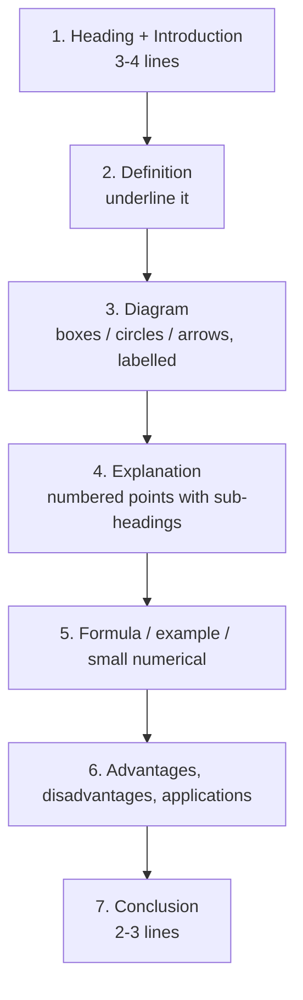

# How to write an MJPRU answer

MJPRU examiners mark long answers by **length, structure and a diagram**. A 14-mark question (two 7-mark parts) is expected to fill **4–5 pages** of the answer sheet, with **at least one diagram**, even if the diagram is only boxes and arrows. Every mock answer on this site follows the template below.

## The template for a long answer (7-mark part ≈ 2–2.5 pages)

1. **Introduction (3–4 lines).** Where the topic sits in DIP and why it is needed.
2. **Definition.** One crisp sentence, underlined or in a box. Examiners look for it first.
3. **Diagram.** Draw it early, in pencil, with a ruler, with every box labelled and a caption ("Fig. 1: Block diagram of …"). Block diagrams, pipelines, a 3×3 mask grid, a graph of a transformation curve or a Venn-style circle diagram all count.
4. **Explanation in numbered points.** Use sub-headings (i), (ii), (iii). One idea per point. 8–12 points for a 7-mark part.
5. **Formula / mathematical expression**, each symbol explained underneath.
6. **Example or a small numerical**, even if not asked: a 3×3 mask applied to one pixel is enough.
7. **Advantages / disadvantages / applications** (3–4 each).
8. **Conclusion (2–3 lines)** restating the main point.

## For numericals

- Write the **formula first**, then a **table**, then the **final answer in a box**.
- Histogram equalization: always draw the **before and after histograms** (two small bar graphs). That is your diagram.
- Filters: draw the 3×3 neighbourhood, sort the values for the median, show the sum for the mean.

## Time plan (3 hours, 5 questions)

| Activity | Time |
|---|---|
| Reading the paper and choosing 5 questions | 5 min |
| Each 14-mark question (2 parts) | 33 min |
| Revision and underlining | 10 min |

::: tip Choosing questions
Pick the numericals first (histogram equalization, filters, thresholding). They are the fastest full marks. Then take restoration, morphology and segmentation theory, which you will have rehearsed from the mocks.
:::

::: warn Common ways students lose marks
- No diagram in a long answer.
- One long paragraph instead of points with headings.
- Writing the answer for (a) and (b) together without labelling the parts.
- Not rounding sk in histogram equalization, or forgetting to merge the counts of levels that map to the same value.
:::
